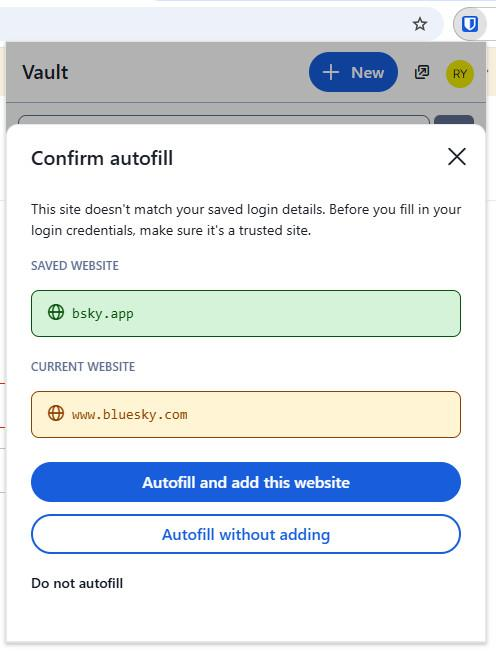
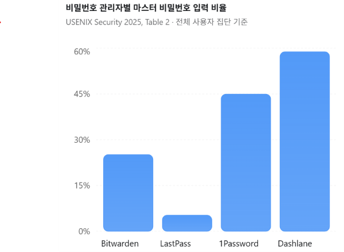
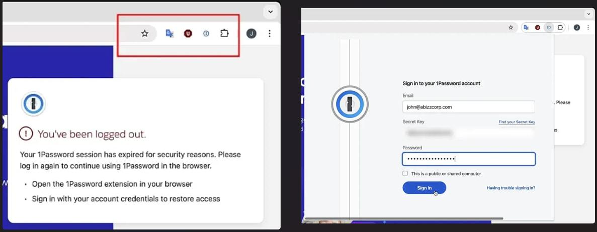

## 1. 논문 소개

- **논문명:** Phishing Attacks against Password Manager Browser Extensions
- **저자:** Claudio Anliker, Daniele Lain, Srdjan Čapkun
- **학회:** USENIX Security Symposium 2025
- **소속:** ETH Zurich
- **원문:** [USENIX 공식 논문 페이지](https://www.usenix.org/conference/usenixsecurity25/presentation/anliker)
- **PDF:** [논문 원문](https://www.usenix.org/system/files/usenixsecurity25-anliker.pdf)

비밀번호 관리자는 여러 웹사이트의 계정 정보를 저장하고 자동으로 입력해 주는 도구다. 사이트마다 서로 다른 비밀번호를 사용할 수 있도록 도와주며, 비밀번호 재사용을 줄이는 데에도 도움이 된다.

그런데 사용자를 보호하기 위한 비밀번호 관리자 자체가 피싱 공격의 대상이 된다면 어떨까?

이번 논문은 **비밀번호 관리 확장 프로그램의 로그인 화면을 위조하여 사용자의 마스터 비밀번호를 탈취하는 공격**을 다룬다.

특히 프로그램 자체를 해킹하는 것이 아니라, 정상적인 프로그램과 가짜 화면을 구별하기 어렵다는 점을 공격에 활용한다는 부분이 흥미로웠다.

### 논문 선정 이유

보안 분야의 여러 논문 중 이 논문을 선택한 이유는 평소 자주 접하는 로그인 기능과 관련된 보안 문제를 다루고 있기 때문이다.

아직 다양한 보안 분야를 공부하며 관심 분야를 찾아가는 단계인 만큼, 일상에서 접할 수 있는 보안 문제를 다룬 논문부터 이해해 보고 싶었다.

특히 사용자의 계정 정보를 보호하기 위해 사용하는 비밀번호 관리자가 오히려 피싱 공격의 대상이 될 수 있다는 점이 흥미로웠고, 이러한 공격이 실제 사용자에게 얼마나 효과적인지 알아보고 싶어 이 논문을 선정했다.

## 2. 연구 배경과 문제의식

### 2.1 비밀번호 관리자의 역할과 문제점

일반적인 피싱 공격은 정상적인 웹사이트를 모방해 사용자가 계정 정보를 입력하도록 유도한다.

비밀번호 관리자는 이러한 공격을 방어하는 데 도움이 될 수 있다. 저장된 계정 정보가 특정 웹사이트 주소와 연결되어 있기 때문에, 가짜 사이트에서는 비밀번호가 자동완성되지 않을 수 있기 때문이다.

하지만 공격자가 웹사이트의 로그인 화면이 아니라 비밀번호 관리자 자체의 로그인 화면을 위조한다면 상황이 달라진다.

사용자가 이를 정상적인 프로그램으로 착각해 마스터 비밀번호를 입력하면, 공격자는 여러 계정 정보를 보호하는 중요한 비밀번호를 알아낼 수 있다.

따라서 비밀번호 관리자 자체의 보안성뿐만 아니라, 사용자가 해당 프로그램의 화면을 얼마나 신뢰하고 구분할 수 있는지도 중요한 문제가 된다.

### 2.2 2016년 LostPass와 기존 연구의 한계

이러한 공격 방식이 2025년에 처음 등장한 것은 아니다.

2016년 보안 연구자 Sean Cassidy는 LastPass의 로그인 화면을 위조하는 **LostPass** 공격을 시연했다.

당시 LastPass는 세션이 만료되었을 때 브라우저 내부에 알림을 표시했는데, 공격자는 이러한 알림과 로그인 화면을 웹사이트에서 모방할 수 있다는 점을 발견했다.

LostPass는 가짜 세션 만료 알림으로 사용자를 유도하고, 정상적인 LastPass와 유사한 로그인 화면에 계정 정보를 입력하도록 만드는 방식이었다. 당시 공격에서는 OTP 기반 2차 인증번호까지 유도할 가능성도 제시했다.

관련 내용은 [Sean Cassidy의 LostPass 기술 블로그](https://www.seancassidy.me/lostpass.html)에서 확인할 수 있다.

하지만 2016년 LostPass는 공격의 기술적 가능성을 보여주는 개념 증명(PoC)에 가까웠다. 실제 사용자들이 얼마나 쉽게 속는지, 다른 비밀번호 관리자에서도 동일한 문제가 발생하는지에 대한 대규모 검증은 이루어지지 않았다.

2025년 연구는 이러한 공백을 다루었다.

| 구분 | 2016년 LostPass | 2025년 연구 |
|---|---|---|
| 주요 목적 | 공격의 기술적 가능성 시연 | 실제 사용자 대상 공격 효과 검증 |
| 공격 대상 | LastPass 중심 | 비밀번호 관리자 4종 |
| 연구 방식 | 개념 증명(PoC) | 대규모 피싱 시뮬레이션 |
| 사용자 행동 분석 | 체계적인 대규모 분석 없음 | 로그인 행동과 UI 반응 분석 |
| 주요 기여 | 가짜 로그인 화면을 통한 자격 증명 탈취 가능성 제시 | 현대적인 브라우저 환경에서 공격의 실효성 검증 |

즉, **2025년 논문의 핵심 기여는 새로운 공격 원리를 처음 발견했다는 것이 아니라, 기존에 알려진 공격이 실제 사용자에게도 효과적인지 체계적으로 검증했다는 점**이다.

### 2.3 연구 질문

연구진은 다음 세 가지 질문을 중심으로 연구를 진행했다.

- **RQ1.** 비밀번호 관리 확장 프로그램을 대상으로 하는 피싱 공격은 실제로 효과적인가?
- **RQ2.** 비밀번호 관리자의 인터페이스 차이가 피싱 공격에 영향을 미치는가?
- **RQ3.** 어떤 사용자 집단이 이러한 공격에 취약한가?

## 3. 핵심 아이디어와 공격 방법

이번 연구의 핵심은 **정상적인 확장 프로그램의 화면과 일반 웹페이지가 만든 화면을 사용자가 구별하기 어렵다는 점**이다.

브라우저에는 주소창과 확장 프로그램 아이콘 등이 표시되는 신뢰할 수 있는 영역(Browser Chrome)과 웹사이트의 내용이 표시되는 영역(Viewport)이 있다.

정상적인 확장 프로그램의 팝업은 브라우저가 관리하지만, 화면의 상당 부분이 웹페이지 위에 겹쳐 표시된다.

*그림 1. 브라우저 확장 프로그램의 팝업과 비밀번호 자동완성 UI (출처: Anliker et al., 2025, Figure 1)*

공격자는 이러한 특징을 이용해 웹페이지 안에 실제 확장 프로그램처럼 보이는 가짜 화면을 구현한다.

### 3.1 비밀번호 관리자 식별

공격자가 사용자의 비밀번호 관리자를 모방하려면 먼저 어떤 프로그램이 설치되어 있는지 알아내야 한다.

연구진은 이를 위해 웹페이지에 사용자에게 보이지 않는 비밀번호 입력 필드(`input type="password"`)를 추가했다.

비밀번호 관리 확장 프로그램은 웹페이지에서 로그인 입력창을 발견하면 자동완성 기능을 제공하기 위한 HTML 요소를 추가하는 경우가 있다.

연구진은 JavaScript의 `MutationObserver`를 이용해 DOM(Document Object Model)의 변화를 감지했다.

예를 들어 1Password는 `<com-1password-button>`과 같은 요소를 추가하고, LastPass에서는 `data-lastpass-icon-root`라는 속성을 확인할 수 있었다.

이러한 요소의 태그명이나 속성을 분석하면 사용자가 어떤 비밀번호 관리자를 설치했는지 구분할 수 있다.

즉, **확장 프로그램이 웹페이지에 추가하는 요소를 관찰해 설치된 프로그램을 식별하는 방식**이다.

### 3.2 정상적인 화면 요소 숨기기

비밀번호 관리자를 식별한 다음에는 탐지에 사용한 보이지 않는 비밀번호 입력 필드와 관련 요소를 제거한다.

또한 실제 로그인 입력창에서는 정상적인 비밀번호 관리자가 자동완성 아이콘을 표시하지 않도록 입력 필드의 유형과 이름, 속성을 변경했다.

이 과정에서 화면의 모양이 달라지는 부분은 CSS를 사용해 보정했다.

이렇게 하면 실제 비밀번호 관리자의 자동완성 요소가 공격자가 만든 가짜 화면과 겹치는 상황을 줄일 수 있다.

### 3.3 가짜 로그인 화면 표시

마지막으로 연구진은 각 비밀번호 관리자의 자동완성 아이콘과 로그인 화면을 HTML, CSS, JavaScript로 모방했다.

가짜 자동완성 아이콘을 클릭하면 해당 비밀번호 관리자의 잠금 해제 화면과 유사한 창이 나타나도록 구현한 것이다.

이 과정에서는 Shadow DOM을 사용해 가짜 화면의 스타일이 웹사이트의 다른 요소와 서로 영향을 주지 않도록 했다.

**중요한 점은 실제 확장 프로그램을 해킹하지 않고도, 일반 웹페이지 안에 정상적인 비밀번호 관리자처럼 보이는 화면을 구현할 수 있다는 것이다.**

다만 가짜 화면이 실제 프로그램과 완전히 동일한 것은 아니다. 이러한 차이가 공격 성공률에 어떤 영향을 미치는지는 4장에서 실험 결과와 함께 살펴본다.

## 4. 실험 방법 및 평가 결과

연구진은 비밀번호 관리 확장 프로그램을 모방한 피싱 공격이 실제 사용자에게 얼마나 효과적인지 확인하기 위해 대규모 피싱 시뮬레이션을 진행했다.

실험 대상은 **Bitwarden, LastPass, 1Password, Dashlane**의 네 가지 비밀번호 관리자였다.

먼저 한 대학교의 구성원들에게 피싱 이메일을 발송하고, 대학의 통합 로그인(SSO) 페이지를 모방한 웹사이트에 접속하도록 유도했다.

이후 브라우저에서 비밀번호 관리자가 탐지되면 해당 프로그램의 가짜 로그인 화면을 보여주는 방식으로 실험을 진행했다.

개인정보 보호를 위해 실제 비밀번호는 저장하지 않았다. 대신 두 차례 입력한 문자열의 길이와 편집 거리(Levenshtein Distance) 등을 비교하여 실제 비밀번호를 입력하려 했는지 판정했다.

---

### 4.1 RQ1. 비밀번호 관리자 피싱은 실제로 효과적인가?

첫 번째 연구 질문은 가짜 비밀번호 관리자 화면을 구현하는 것에서 나아가, **실제 사용자들이 마스터 비밀번호를 입력하는지** 확인하는 것이었다.

  <h4 style="font-size: 1.3rem; font-weight: 800; margin: 0;">
    4.1.1 전체 실험 결과
  </h4>

| 구분 | 인원 |
|---|---:|
| 피싱 이메일 발송 | 29,809명 |
| 피싱 사이트 방문 | 12,006명 |
| 지원되는 PC 환경으로 접속 | 9,422명 |
| 대상 비밀번호 관리자 탐지 | 448명 |
| 마스터 비밀번호 입력으로 판정 | 140명 |

연구 대상 비밀번호 관리자가 탐지된 448명 중 **140명(31.25%)**이 가짜 화면에 마스터 비밀번호를 입력한 것으로 판정되었다.

이는 전체 이메일 수신자의 31.25%가 아니라, 연구 대상 비밀번호 관리자가 탐지된 사용자들을 기준으로 한 결과다.

프로그램별 마스터 비밀번호 입력 비율은 다음과 같다.

| 프로그램 | 입력 인원 / 대상 인원 | 입력 비율 |
|---|---:|---:|
| Bitwarden | 55 / 219명 | 25.11% |
| LastPass | 3 / 57명 | 5.26% |
| 1Password | 62 / 138명 | 44.93% |
| Dashlane | 20 / 34명 | 58.82% |

*그림 2. 비밀번호 관리자별 마스터 비밀번호 입력 비율 (출처: Anliker et al., 2025, Table 2 기반 재구성)*

모든 프로그램에서 마스터 비밀번호를 입력한 사용자가 존재했지만, 프로그램별 입력 비율에는 상당한 차이가 나타났다.

특히 **Dashlane은 58.82%로 가장 높았지만, LastPass는 5.26%로 가장 낮았다.**

그렇다면 LastPass는 다른 프로그램보다 피싱 공격에 안전하다고 볼 수 있을까?

---

  <h4 style="font-size: 1.3rem; font-weight: 800; margin: 0;">
    4.1.2 LastPass — 낮은 마스터 비밀번호 입력률의 원인
  </h4>

연구진은 LastPass의 낮은 입력률을 이해하기 위해 사용자 행동을 추가로 분석했다.

그 결과, LastPass 사용자 57명 중 **46명(80.70%)은 가짜 자동완성 아이콘을 클릭하지 않았다.**

즉, 이들은 가짜 비밀번호 관리자 로그인 화면 자체를 보지 않은 것이다.

그러나 그렇다고 해서 피싱 공격을 알아차리고 회피했다고 단정하기는 어렵다.

LastPass 사용자 중 **31명(54.39%)은 가짜 대학 통합 로그인 페이지에 학교 계정 비밀번호를 입력**했기 때문이다.

이를 정리하면 다음과 같다.

| LastPass 사용자 행동 | 인원 및 비율 |
|---|---:|
| 가짜 자동완성 아이콘을 클릭하지 않음 | 46 / 57명 (80.70%) |
| 학교 계정 비밀번호 입력 | 31 / 57명 (54.39%) |
| 마스터 비밀번호 입력 | 3 / 57명 (5.26%) |
| 두 비밀번호 중 적어도 하나를 입력 | 34 / 57명 (59.65%) |

*출처: 논문 6.1.1절 및 Table 2. 각 항목은 서로 배타적인 집단을 의미하지 않는다.*

마스터 비밀번호 또는 학교 계정 비밀번호 중 적어도 하나를 입력한 사용자는 총 **34명(59.65%)**이었다.

연구진은 많은 LastPass 사용자가 비밀번호 관리자를 잠금 해제하기보다는 이미 기억하고 있는 학교 계정 비밀번호를 직접 입력하는 경향이 있었다고 해석했다.

따라서 LastPass의 낮은 마스터 비밀번호 입력률만으로 프로그램 자체가 다른 제품보다 안전하다고 판단하기는 어렵다.

> **RQ1 핵심 결과**
>
> 비밀번호 관리자 확장 프로그램을 모방한 피싱 공격은 실제 사용자에게도 효과적이었다. 다만 공격 대상 사이트의 특성과 사용자의 로그인 행동이 결과에 영향을 미칠 가능성도 확인할 수 있었다.

---

### 4.2 RQ2. 인터페이스의 차이가 공격 성공에 영향을 미치는가?

두 번째 연구 질문은 가짜 비밀번호 관리자와 실제 프로그램 사이의 **디자인 및 표시 방식 차이가 피싱 공격의 성공률에 영향을 미치는지** 확인하는 것이었다.

연구진은 1Password의 프로필 사진, Bitwarden의 로그인 창 표시 방식, 사용자가 인식한 화면 차이를 중심으로 분석했다.

  <h4 style="font-size: 1.3rem; font-weight: 800; margin: 0;">
    4.2.1 1Password — 프로필 사진이 달라도 속을까?
  </h4>

1Password의 정상적인 로그인 화면에는 사용자의 프로필 사진이 표시된다.

그러나 공격자는 일반적으로 사용자의 프로필 사진을 알기 어렵기 때문에 가짜 화면을 완벽하게 재현하기 어렵다.

아래 그림은 연구진이 구현한 가짜 1Password 화면과 실제 화면을 비교한 것이다.

*그림 3. 가짜 1Password 팝업(왼쪽)과 실제 팝업(오른쪽) 비교 (출처: Anliker et al., 2025, Figure 3)*

연구진은 이러한 상황을 고려해 기본 아바타를 표시하거나 프로필 사진을 제거한 가짜 화면을 사용했다.

| 가짜 화면의 조건 | 입력 인원 / 대상 인원 | 입력률 |
|---|---:|---:|
| 기본 아바타 표시 | 19 / 44명 | 43.18% |
| 프로필 사진 제거 | 20 / 50명 | 40.00% |

두 조건 모두 상당수의 사용자가 마스터 비밀번호를 입력했다.

즉, **실제 프로그램과 가짜 화면이 완전히 일치하지 않더라도 공격이 효과적일 수 있다는 것**이다.

다만 이 결과만으로 프로필 사진 유무가 공격 성공률에 통계적으로 유의미한 차이를 만든다고 단정할 수는 없다.

개인화된 화면 요소가 없다는 사실만으로 사용자가 피싱 공격을 알아차리기는 어려울 수 있다는 점이 중요한 결과다.

---

  <h4 style="font-size: 1.3rem; font-weight: 800; margin: 0;">
    4.2.2 Bitwarden — 로그인 창의 위치가 달라도 속을까?
  </h4>

Bitwarden에서는 로그인 창이 표시되는 방식에 따라 공격 성공률이 달라지는지 비교했다.

연구진은 Windows 사용자를 대상으로 두 가지 형태의 가짜 로그인 화면을 보여주었다.

하나는 실제 애플리케이션 창을 모방한 형태였고, 다른 하나는 브라우저 확장 프로그램의 팝업 형태였다.

| 가짜 로그인 화면 | 입력 인원 / 대상 인원 | 입력률 |
|---|---:|---:|
| 애플리케이션 창 모방 | 9 / 47명 | 19.15% |
| 확장 프로그램 팝업 | 14 / 57명 | 24.56% |

*출처: 논문 Table 2 기준. 원문 6.2절 본문에는 각각 19.6%, 24.1%로 서술되어 있으나, 여기서는 Table 2의 인원과 비율을 기준으로 정리했다.*

예상과 달리 브라우저 확장 프로그램 팝업 형태에서 더 높은 입력률이 나타났다.

연구진은 이러한 결과를 통해 공격자가 실제 운영체제의 애플리케이션 창을 완벽하게 모방할 필요는 없다고 해석했다.

**로그인 창이 나타나는 위치나 형태가 달라지더라도 피싱 공격을 효과적으로 막지 못할 수 있다는 것**이다.

---

  <h4 style="font-size: 1.3rem; font-weight: 800; margin: 0;">
    4.2.3 화면의 차이를 알아차린 사용자
  </h4>

연구진은 사후 설문을 통해 사용자가 비밀번호 관리자 화면에서 평소와 다른 점을 발견했는지 조사했다.

해당 질문에 응답한 비밀번호 관리자 사용자 67명 중 **37명**이 색상, 글꼴, 창의 위치 등에서 차이가 있었다고 언급했다.

그런데 이 37명 중 **27명(72.97%)은 마스터 비밀번호를 입력한 것으로 나타났다.**

일부 참가자는 화면이 평소와 다르다는 사실을 알아차렸지만, 단순히 프로그램이 업데이트되어 디자인이 변경된 것으로 생각했다는 취지의 답변을 남겼다.

개인적으로도 평소 사용하는 프로그램의 화면이 조금 달라진다면 피싱 공격보다는 업데이트에 따른 디자인 변경을 먼저 떠올릴 것 같다.

물론 이러한 사용자 습관이 공격 성공의 가장 큰 원인이라고 단정할 수는 없다. 다만 익숙한 로그인 과정이 사용자의 판단에 영향을 줄 가능성은 있다고 생각한다.

> **RQ2 핵심 결과**
>
> 가짜 화면에 시각적인 차이가 존재하더라도 피싱 공격은 효과적일 수 있다. 화면이 평소와 다르다는 사실을 알아차리는 것과 이를 실제 보안 위협으로 판단하는 것은 별개의 문제일 수 있다.

---

### 4.3 RQ3. 어떤 사용자 집단이 피싱 공격에 취약한가?

세 번째 연구 질문은 사용자의 전공 및 업무 분야, 연령, 브라우저 환경 등에 따라 공격 성공률이 달라지는지 분석하는 것이었다.

  <h4 style="font-size: 1.3rem; font-weight: 800; margin: 0;">
    4.3.1 기술적 배경에 따른 차이
  </h4>

연구진은 참가자들의 전공과 업무 분야를 네 집단으로 나누어 비교했다.

| 참가자 집단 | 입력 인원 / 대상 인원 | 입력률 |
|---|---:|---:|
| IT·컴퓨터과학·전기공학 | 49 / 171명 | 28.65% |
| 수학·자연과학 | 26 / 97명 | 26.80% |
| 행정 | 16 / 50명 | 32.00% |
| 기타 공학 | 49 / 130명 | 37.69% |

특히 **IT·컴퓨터과학·전기공학 관련 집단에서도 28.65%가 마스터 비밀번호를 입력**한 것으로 나타났다.

이는 기술적인 배경을 가진 사용자도 피싱 공격에 노출될 수 있다는 점을 보여준다.

다만 IT 관련 분야에 종사한다고 모두 보안 전문가인 것은 아니며, 이 연구는 보안 교육의 효과를 직접 비교한 실험도 아니다.

따라서 보안 지식이 피싱 공격을 예방하는 데 도움이 되지 않는다고 결론 내릴 수는 없다.

  <h4 style="font-size: 1.3rem; font-weight: 800; margin: 0;">
    4.3.2 연령 및 사용 환경에 따른 차이
  </h4>

연구진은 연령대, 브라우저 언어, 웹 브라우저 및 운영체제에 따른 차이도 분석했다.

연령별 마스터 비밀번호 입력률은 **28.57%에서 34.52%** 사이로 나타났으며, 카이제곱 검정 결과 통계적으로 유의미한 차이를 확인하지 못했다(p = 0.879).

운영체제와 브라우저에 따라서도 뚜렷한 차이는 발견되지 않았다.

하지만 이번 실험은 특정 대학교의 구성원을 대상으로 진행되었고, 30세 미만 참가자가 상대적으로 많았다.

따라서 이러한 결과를 모든 연령대나 직업군에 일반화하기는 어렵다.

> **RQ3 핵심 결과**
>
> 특정 사용자 집단만 공격에 취약한 것은 아니었다. 기술적 배경이 있는 사용자도 피싱 공격에 속을 수 있으며, 보안 지식만으로 공격으로부터 완전히 안전하다고 보장할 수는 없다.

---

### 4.4 실험 결과 종합

세 가지 연구 질문을 통해 다음과 같은 결과를 확인할 수 있었다.

| 연구 질문 | 핵심 결과 |
|---|---|
| RQ1. 공격의 실효성 | 대상 사용자 중 31.25%가 마스터 비밀번호를 입력한 것으로 판정 |
| RQ2. 인터페이스의 영향 | 프로필 사진이나 로그인 창의 차이가 있어도 공격이 효과적이었음 |
| RQ3. 사용자 특성 | 기술적인 배경이 있는 사용자도 피싱 공격에 취약할 수 있음 |

이번 연구는 비밀번호 관리자 확장 프로그램을 대상으로 한 피싱 공격이 단순히 기술적으로 가능한 수준을 넘어, **실제 사용자에게도 효과적인 공격이라는 점**을 보여주었다.

특히 가짜 화면의 정교함뿐만 아니라, 비밀번호 관리자의 인터페이스와 사용자의 로그인 행동을 함께 고려해야 한다는 점에서 의미가 있다.

## 5. 논문을 읽으며 느낀 점

이번 논문을 읽으면서 가장 먼저 떠올랐던 것은 평소 나의 로그인 습관이었다.

학교 LMS나 여러 웹사이트를 이용할 때 브라우저에 비밀번호를 저장해 두고 자동완성 기능을 사용하는 경우가 많다.

이러한 과정이 반복되다 보니 로그인 화면이 정상적인지 매번 확인하기보다는, 평소와 같은 방식으로 로그인하는 일이 자연스러워졌다.

물론 브라우저의 일반적인 자동완성과 비밀번호 관리자의 마스터 비밀번호 입력은 기술적으로 서로 다른 과정이다.

하지만 익숙한 로그인 과정에서는 사용자가 경계심을 낮출 수 있다는 점에서 비슷한 문제가 발생할 수 있다고 생각한다.

특히 RQ2의 실험 결과를 보면서 평소 사용하는 프로그램의 디자인이 조금 달라지더라도 업데이트로 인해 변경되었다고 생각할 가능성이 높다고 느꼈다.

이는 실제 실험에서 일부 참가자들이 화면의 차이를 발견하고도 비밀번호를 입력했다는 결과와 연결된다.

또한 보안을 공부한 사람이라고 해서 이러한 공격을 완벽하게 피할 수 있는 것도 아니다.

보안 지식은 위험성을 이해하고 대응하는 데 도움이 되겠지만, 평소의 습관이나 순간적인 판단으로 인해 피싱 공격에 속을 가능성은 여전히 존재한다고 생각한다.

개인적으로는 **보안 기술이 발전하더라도 사용자의 로그인 습관까지 자동으로 바뀌지는 않는다는 점**이 이번 논문에서 중요한 문제라고 느꼈다.

다만 이러한 습관이 공격 성공의 가장 큰 원인이라는 사실이 직접 검증된 것은 아니며, 논문의 결과를 바탕으로 생각해 본 해석이다.

## 6. 한계점 및 아쉬운 점

### 6.1 제한적인 실험 대상

연구진은 특정 대학교 구성원들을 대상으로 실험을 진행했다.

참가자가 비교적 젊고 교육 수준이 높은 집단에 치우쳐 있기 때문에 결과를 모든 인터넷 사용자에게 일반화하기는 어렵다.

다양한 연령대와 직업군을 대상으로 추가 실험을 진행한다면 사용자 특성에 따른 차이를 더 폭넓게 확인할 수 있을 것이다.

### 6.2 실험 환경의 영향

이번 연구에서는 대학의 통합 로그인 페이지를 사용했다.

학생들은 학교 계정을 자주 사용하기 때문에 비밀번호를 기억하고 있을 가능성이 높다.

실제로 연구진도 많은 사용자가 비밀번호 관리자를 잠금 해제하는 대신 학교 계정 비밀번호를 직접 입력했다고 설명했다.

이 부분을 보면서 한 가지 의문이 들었다.

**만약 평소 거의 접속하지 않는 사이트였다면 결과가 달라졌을까?**

개인적으로는 오래전에 가입했거나 거의 사용하지 않는 사이트라면 비밀번호를 기억하지 못해 비밀번호 관리자를 사용할 가능성이 더 높을 것이라고 생각한다.

그렇다면 가짜 비밀번호 관리자 화면을 접하는 사용자도 늘어날 수 있을 것이다.

물론 비밀번호 관리자가 이미 잠금 해제되어 있거나 사용자가 로그인을 포기하는 경우도 있으므로, 실제 성공률이 높아질지는 추가 실험이 필요하다.

이러한 점에서 익숙한 사이트와 낯선 사이트를 비교하지 못한 부분은 아쉽게 느껴졌다.

### 6.3 실제 계정 침해 여부의 미검증

연구진은 개인정보 보호를 위해 참가자의 실제 비밀번호를 수집하지 않았다.

대신 입력 길이와 유사성을 바탕으로 마스터 비밀번호 입력 여부를 추정했다.

이는 개인정보 보호 측면에서는 적절한 방법이지만, 실제 마스터 비밀번호가 입력되었는지를 완벽하게 확인할 수는 없다.

또한 마스터 비밀번호가 유출된 이후 공격자가 실제 비밀번호 관리자 계정에 접근하거나 저장된 비밀번호를 확보할 수 있는지까지 검증하지는 않았다.

따라서 마스터 비밀번호 입력 가능성과 실제 계정 침해 가능성을 구분해서 평가할 필요가 있다고 생각한다.

## 7. 앞으로의 확장 방향

### 7.1 사용자가 구별하지 못해도 안전한 UI는 가능할까?

처음에는 사용자가 로그인 화면을 주의 깊게 확인하는 것이 가장 중요하다고 생각했다.

그러나 LostPass와 이번 논문을 비교하면서, 공격자가 실제 프로그램의 화면을 정교하게 모방한다면 사용자가 눈으로 구별하는 것에는 한계가 있다는 생각이 들었다.

그래서 비밀번호 관리자의 인터페이스를 개선하는 방법에 대해서도 고민해 보았다.

처음 떠올린 방법은 웹사이트의 아이디나 비밀번호 입력창을 클릭했을 때 바로 아래에 비밀번호 관리 기능이 나타나도록 하는 것이었다.

별도의 로그인 창을 띄우지 않는다면 사용자에게 더 익숙하고 편리한 방식이 될 수 있다고 생각했다.

하지만 이 방법에도 문제가 있었다.

**입력창 아래에 표시되는 화면 역시 웹사이트가 직접 구현할 수 있다면 공격자가 비슷하게 위조할 수 있기 때문이다.**

결국 중요한 것은 화면이 어디에 나타나는지가 아니라, 누가 그 화면을 제어하느냐라는 점을 알게 되었다.

따라서 비밀번호 자동완성 기능은 편리하게 제공하되, 마스터 비밀번호처럼 중요한 정보를 입력하는 과정은 웹사이트가 접근하거나 조작할 수 없는 신뢰할 수 있는 영역에서 처리하는 방식을 생각해 보고 싶다.

다만 보호된 영역을 사용하는 것만으로 모든 UI 위조 공격이 사라지는 것은 아니므로, 사용자가 가짜 화면을 클릭하더라도 실제 비밀번호가 공격자에게 전달되지 않도록 하는 기술적인 보호 장치가 필요할 것이다.

### 7.2 2차 인증의 보호 범위와 한계

이번 논문을 읽으며 또 하나 궁금했던 부분은 마스터 비밀번호가 유출된 이후 실제 피해를 얼마나 막을 수 있는가 하는 점이었다.

처음에는 2차 인증을 적용하면 이러한 공격을 막을 수 있지 않을까 생각했다.

하지만 **마스터 비밀번호의 유출을 방지하는 것과 유출된 비밀번호를 이용한 계정 접근을 차단하는 것은 서로 다른 문제**라는 점을 알게 되었다.

예를 들어 Bitwarden은 새로운 기기에서 계정에 로그인하는 과정과 이미 로그인된 기기에서 비밀번호 보관함을 잠금 해제하는 과정을 구분한다.

2차 인증은 주로 계정 로그인 과정에 적용되지만, 이미 로그인된 기기에서 보관함을 잠금 해제할 때는 추가 인증이 필요하지 않을 수 있다.

또한 공격자가 암호화된 보관함을 별도로 확보했다면 제품의 암호화 구조에 따라 2차 인증만으로 오프라인 복호화 공격을 막지 못할 수도 있다.

따라서 단순히 2차 인증을 사용하는 것이 안전하다고 결론 내리기보다, **인증 방식과 적용되는 단계에 따라 어떤 공격을 방어할 수 있는지** 살펴볼 필요가 있다.

### 7.3 직접 구현 및 비교해 보고 싶은 것

앞으로는 실제 계정이나 비밀번호를 사용하지 않는 모의 인증 환경을 구성해 보고 싶다.

마스터 비밀번호가 이미 노출되었다는 상황을 가정하고, 다음 인증 방식들을 비교하는 것이다.

| 인증 방식 | 비교하고 싶은 내용 |
|---|---|
| 비밀번호만 사용 | 비밀번호 유출 이후 계정 접근 가능성 |
| OTP 기반 2차 인증 | 추가 인증번호가 계정 접근을 얼마나 제한하는지 |
| FIDO2 보안키 | 피싱에 강한 인증 방식이 계정 침해를 얼마나 효과적으로 방어하는지 |

이때 새로운 기기에서 로그인하는 상황과 기존 기기의 보관함을 잠금 해제하는 상황을 구분하고 싶다.

또한 브라우저가 관리하는 보호된 입력 영역과 일반 웹페이지에서 구현한 가짜 로그인 화면을 비교하여, 사용자 인터페이스의 신뢰 경계가 보안에 어떤 영향을 미치는지도 살펴보고 싶다.

이를 통해 사용자에게 주의를 요구하는 방식뿐만 아니라, **사용자가 실수하더라도 피해를 줄일 수 있는 기술적인 방법**을 고민해 보고자 한다.

### 7.4 추가로 읽어볼 논문

이번 논문은 PC 브라우저의 비밀번호 관리 확장 프로그램을 대상으로 한다.

하지만 모바일 환경에서도 비밀번호 관리자와 자동완성 기능을 사용하는 경우가 많다.

이러한 궁금증을 바탕으로 추가로 읽어보고 싶은 논문은 다음과 같다.

**AutoFail: Breaking Web Boundaries using Android's Autofill Framework**

- **저자:** Riccardo Lamarca, Philipp Beer, Marco Squarcina
- **학회:** USENIX Security Symposium 2026
- **소속:** TU Wien
- **원문:** [USENIX 공식 논문 페이지](https://www.usenix.org/conference/usenixsecurity26/presentation/lamarca)
- **PDF:** [논문 원문](https://www.usenix.org/conference/usenixsecurity26/presentation/lamarca)

이 논문은 Android의 Autofill Framework와 비밀번호 관리자가 상호작용하는 과정에서 발생할 수 있는 보안 문제를 분석한다.

이번에 리뷰한 논문과 공격 방식은 다르지만, 비밀번호 자동완성 기능과 플랫폼 사이의 신뢰 경계가 보안에 중요한 영향을 미친다는 점에서 연결할 수 있을 것 같다.

앞으로 두 논문을 비교하면서 PC 브라우저의 확장 프로그램과 모바일 자동완성 기능이 각각 어떤 보안 문제를 가지고 있는지 살펴보고 싶다.

## 8. 마무리

이번 논문을 통해 보안 프로그램 자체가 직접 해킹당하지 않더라도, 사용자가 신뢰하는 인터페이스를 모방하는 방식으로 공격이 가능하다는 점을 알게 되었다.

특히 2016년 LostPass에서 제시된 공격 방식이 2025년의 실제 사용자 실험에서도 효과적이었다는 점이 인상 깊었다.

논문을 처음 읽었을 때는 사용자가 주의를 기울이는 것이 가장 중요하다고 생각했다. 하지만 연구 내용을 살펴보면서 사용자 개인의 주의뿐만 아니라 브라우저의 UI 구조와 인증 방식도 함께 고려해야 한다는 점을 느꼈다.

앞으로는 비밀번호 관리자의 동작 구조와 브라우저의 신뢰 영역에 대해 더 공부하고, 마스터 비밀번호가 유출되더라도 실제 피해를 줄일 수 있는 인증 방식과 UI 설계를 비교해 보고 싶다.

이번 논문 리뷰를 시작으로 단순히 새로운 보안 기술을 공부하는 것에서 나아가, **기존 연구가 어떤 문제를 해결했고 어떤 한계를 남겼는지 스스로 분석하는 연습**을 이어가고자 한다.

---

## 참고 자료

**[1] Phishing Attacks against Password Manager Browser Extensions**

Anliker, C., Lain, D., & Čapkun, S. (2025). *Phishing Attacks against Password Manager Browser Extensions*. 34th USENIX Security Symposium, pp. 7857–7876.

- [USENIX 공식 논문 페이지](https://www.usenix.org/conference/usenixsecurity25/presentation/anliker)
- [논문 PDF](https://www.usenix.org/system/files/usenixsecurity25-anliker.pdf)

**[2] LostPass**

Sean Cassidy (2016). *LostPass*.

- [LostPass 기술 블로그](https://www.seancassidy.me/lostpass.html)

**[3] AutoFail: Breaking Web Boundaries using Android's Autofill Framework**

Lamarca, R., Beer, P., & Squarcina, M. (2026). *AutoFail: Breaking Web Boundaries using Android's Autofill Framework*. 35th USENIX Security Symposium, pp. 2601–2620.

- [USENIX 공식 논문 페이지](https://www.usenix.org/conference/usenixsecurity26/presentation/lamarca)

**[4] Bitwarden — Understand Log in vs. Unlock**

- [Bitwarden 공식 문서](https://bitwarden.com/help/understand-log-in-vs-unlock/)

**[5] Bitwarden — Two-Step Login FAQs**

- [Bitwarden 공식 문서](https://bitwarden.com/help/twostep-faqs/)
