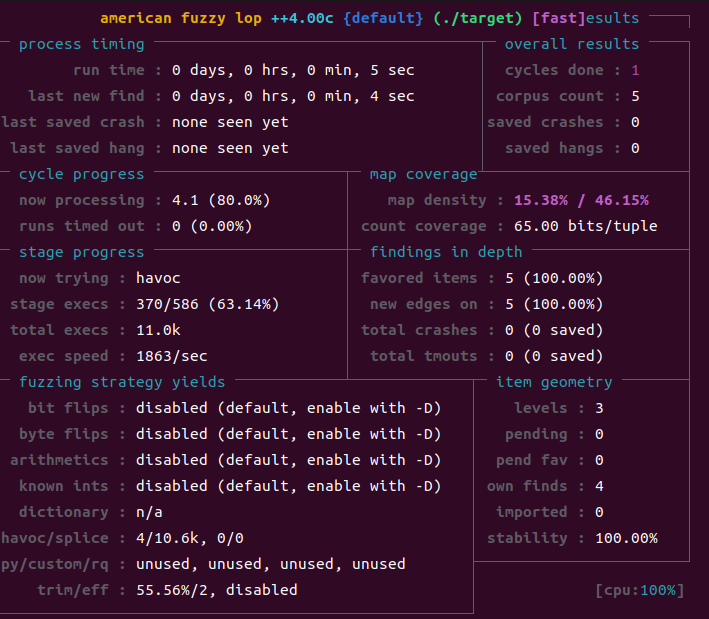
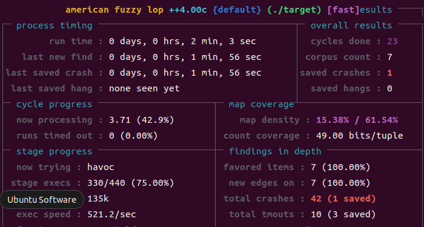
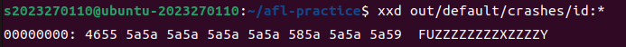

## 1. 들어가며

Knights Frontier 3기 미션을 계기로 퍼징(Fuzzing)에 대해 공부하게 되었다.

처음에는 퍼징을 프로그램에 무작위 입력값을 대량으로 넣어 오류를 발견하는 기술 정도로 이해했다. 하지만 관련 자료를 찾아보면서 단순히 입력값을 많이 생성하는 것보다 어떤 입력을 만들고, 프로그램의 실행 결과를 어떻게 활용하는지가 중요하다는 것을 알게 되었다.

이번 글에서는 퍼징의 기본 개념과 종류를 정리하고, AFL++, Jackalope, libFuzzer의 특징을 비교해 보려고 한다. 이후 AFL++를 직접 실행하여 크래시가 발생하는 입력을 찾아내는 과정도 확인해 보았다.

---

## 2. 퍼징(Fuzzing)이란?

퍼징은 프로그램에 다양한 입력값을 자동으로 전달하여 예상하지 못한 오류나 보안 취약점을 찾아내는 소프트웨어 테스트 기법이다.

일반적인 소프트웨어 테스트에서는 미리 정해진 테스트 케이스를 통해 프로그램이 예상대로 동작하는지 확인하는 경우가 많다. 반면 퍼징은 입력값을 자동으로 생성하거나 변형하면서 개발자가 예상하지 못한 상황을 탐색하는 데 중점을 둔다.

예를 들어 숫자를 입력받는 프로그램이 있다고 가정해 보자.

일반적인 테스트에서는 `100`, `500`, `1000`과 같은 정상적인 숫자를 입력하거나, 미리 정의된 잘못된 입력을 사용해 프로그램의 동작을 확인할 수 있다.

퍼징에서는 다음과 같이 다양한 입력을 자동으로 생성하여 테스트할 수 있다.

```text
100
-1
999999999999999
abc
!@#$
123abc
```

이러한 입력을 처리하는 과정에서 프로그램이 비정상적으로 종료되거나 예상하지 못한 동작을 보인다면 버그가 존재할 가능성이 있다.

물론 퍼징이 반드시 무작위 입력에만 의존하는 것은 아니다. 기존 입력값을 변형하거나 프로그램의 실행 정보를 활용해 새로운 입력을 만들기도 한다.

### 2.1 무작위 입력만으로 충분할까?

프로그램이 숫자만 입력받도록 설계되어 있다면 무작위로 생성한 문자열 대부분은 입력 검증 단계에서 거부될 수 있다.

잘못된 입력을 안전하게 처리하는지 확인하는 것도 중요하지만, 계속 같은 검증 단계에서 실행이 끝난다면 프로그램 내부의 다른 코드까지 테스트하기 어렵다.

따라서 퍼징에서는 단순히 많은 입력을 생성하는 것뿐 아니라, **프로그램의 다양한 실행 경로에 도달할 수 있는 입력을 만드는 것**도 중요하다.

---

## 3. 퍼징의 종류

퍼징은 입력값을 생성하는 방식, 프로그램 내부 정보를 활용하는 정도, 실행 결과를 활용하는 방식 등 여러 기준으로 분류할 수 있다.

각각 완전히 독립된 기법이 아니라 분류 기준이 다르기 때문에 하나의 퍼저가 여러 방식에 동시에 해당할 수도 있다.

### 3.1 입력 생성 방식

> #### **Mutation-based Fuzzing — 기존 입력 변형**

기존에 존재하는 입력값을 변형하여 새로운 테스트 케이스를 만드는 방식이다.

예를 들어 `100`이라는 입력값이 있다면 일부 값을 변경하거나 추가하여 `101`, `1000`, `-100` 등의 새로운 입력을 생성할 수 있다.

기존 입력을 활용하기 때문에 새로운 입력 형식을 처음부터 정의할 필요가 없다는 장점이 있다. 다만 변형 과정에서 프로그램이 받아들이지 못하는 입력이 만들어질 수도 있다.

> #### **Generation-based Fuzzing — 규칙에 따라 입력 생성**

입력 데이터의 형식이나 규칙을 바탕으로 새로운 테스트 케이스를 만드는 방식이다.

예를 들어 프로그램이 다음과 같은 JSON 데이터를 입력받는다고 가정해 보자.

```json
{
  "id": 100,
  "name": "test"
}
```

Generation-based Fuzzing은 JSON 구조를 고려하면서 `id`나 `name` 등의 값을 변경해 새로운 입력을 생성할 수 있다.

입력 형식을 유지하면서 여러 값을 테스트할 수 있다는 장점이 있지만, 데이터의 구조나 생성 규칙을 미리 파악해야 한다.

### 3.2 내부 정보 활용 정도

퍼징은 프로그램 내부의 실행 정보를 얼마나 활용하는지에 따라서도 구분할 수 있다.

| 종류 | 특징 |
|---|---|
| **Black-box** | 내부 구조를 모르는 상태에서 입력에 따른 응답이나 오류를 관찰한다. |
| **Gray-box** | 코드 커버리지처럼 일부 내부 실행 정보를 활용한다. |
| **White-box** | 프로그램 내부의 조건과 구조를 자세히 분석하여 입력을 생성한다. |

여기서 처음에 헷갈렸던 부분은 소스코드가 없으면 무조건 Black-box 방식이라고 생각했던 점이다.

하지만 소스코드가 없더라도 프로그램이 어떤 실행 경로를 거쳤는지 확인할 수 있다면 Gray-box 방식으로 테스트할 수 있다.

따라서 단순히 소스코드가 있는지보다는, **프로그램 내부의 정보를 얼마나 활용하는지가 중요한 구분 기준**이다.

### 3.3 Coverage-guided Fuzzing

Coverage-guided Fuzzing은 코드 커버리지 정보를 활용하여 새로운 입력을 탐색하는 방식이다.

코드 커버리지(Code Coverage)는 테스트 과정에서 프로그램의 코드가 얼마나 실행되었는지를 나타내는 지표다.

예를 들어 다음과 같은 코드가 있다고 가정해 보자.

```python
def check(number):
    if number > 100:
        if number == 777:
            print("특별한 코드 실행!")
        else:
            print("100보다 큰 숫자")
    else:
        print("100 이하")
```

`50`을 입력하면 `100 이하`라는 결과가 출력된다.

이후 `150`을 입력하면 이전에 실행되지 않았던 다른 경로가 실행된다. 반면 `200`을 입력하면 `150`과 동일한 경로가 실행된다.

커버리지 기반 퍼저는 새로운 실행 경로를 발견한 입력을 보관하고 이후 테스트에 활용할 수 있다.

결국 **어떤 입력이 새로운 실행 경로를 발견했는지 판단하고, 그 정보를 다음 테스트에 활용하는 것**이 핵심이다.

여기서 Mutation-based와 Coverage-guided는 서로 배타적인 개념이 아니다.

- **Mutation-based:** 기존 입력을 어떻게 변형할 것인가?
- **Coverage-guided:** 실행 결과를 어떻게 활용할 것인가?

입력을 변형하면서 동시에 코드 커버리지 정보를 활용할 수 있기 때문에 하나의 퍼저가 두 방식을 함께 사용할 수 있다.

---

## 4. Sanitizer의 역할

퍼징을 공부하면서 처음에 헷갈렸던 개념 중 하나가 Sanitizer였다.

처음에는 Sanitizer가 프로그램의 오류를 탐지하고 해결하는 도구라고 이해했지만, 실제로는 오류를 자동으로 수정하는 것이 아니라 **특정 오류를 탐지하고 분석에 필요한 정보를 제공하는 도구**다.

퍼저는 프로그램의 비정상 종료 등을 감지할 수 있지만, 일부 메모리 오류나 잘못된 연산은 즉시 크래시로 이어지지 않을 수 있다.

Sanitizer는 이러한 문제를 발견하는 데 도움을 준다.

대표적인 Sanitizer는 다음과 같다.

| 종류 | 주요 탐지 대상 |
|---|---|
| AddressSanitizer (ASan) | Buffer Overflow, Use-After-Free 등 메모리 안전성 오류 |
| UndefinedBehaviorSanitizer (UBSan) | 부호 있는 정수 오버플로 등 정의되지 않은 동작 |
| MemorySanitizer (MSan) | 초기화되지 않은 메모리 값의 사용 |
| ThreadSanitizer (TSan) | 멀티스레드 환경의 데이터 경쟁 |

예를 들어 C 프로그램에서 배열의 범위를 벗어난 메모리에 접근한다면 AddressSanitizer가 해당 오류를 감지하고 보고할 수 있다.

다만 모든 오류를 탐지할 수 있는 것은 아니며, 오류가 발견되더라도 실제 원인을 분석하고 수정하는 과정은 별도로 필요하다.

---

## 5. 대표적인 퍼저 비교

퍼징의 기본 개념을 정리한 뒤, AFL++, Jackalope, libFuzzer의 특징을 살펴보았다.

세 도구 모두 코드 커버리지를 활용해 새로운 실행 경로를 탐색할 수 있다는 공통점이 있다. 다만 프로그램을 테스트하는 방식이나 지원하는 환경에서는 차이가 있었다.

---

> ### **5.1 AFL++ — 다양한 방식으로 프로그램 테스트**

[AFL++ GitHub](https://github.com/AFLplusplus/AFLplusplus)

AFL++는 기존 American Fuzzy Lop(AFL)을 기반으로 발전한 퍼저다.

기존 입력값을 변형하면서 프로그램을 반복 실행하고, 이전에 실행되지 않았던 코드 경로를 발견하면 해당 입력을 저장하여 다음 테스트에 활용한다.

특징은 테스트 환경에 따라 여러 실행 방식을 사용할 수 있다는 점이다.

소스코드가 있다면 컴파일 과정에서 실행 경로를 추적하는 기능을 추가할 수 있고, 소스코드가 없는 프로그램도 별도의 계측 방식을 활용해 테스트할 수 있다.

여기서 **계측(Instrumentation)** 이란 프로그램이 실행되는 동안 어떤 코드가 사용되었는지 등의 정보를 수집할 수 있도록 하는 과정을 의미한다.

이번 실습에서는 `afl-clang-fast`를 사용하여 실행 경로를 추적할 수 있도록 프로그램을 컴파일했다.

---

> ### **5.2 Jackalope — 바이너리 프로그램 테스트**

[Jackalope GitHub](https://github.com/googleprojectzero/Jackalope)

Jackalope는 Google Project Zero에서 공개한 퍼저로, 소스코드가 없는 바이너리 프로그램도 테스트할 수 있다.

TinyInst라는 도구를 이용해 프로그램 실행 중 어떤 코드 경로가 사용되었는지 확인한다. TinyInst는 실행 중인 프로그램에 분석용 코드를 추가하여 실행 정보를 수집하는 도구다.

처음에는 소스코드가 없다는 이유로 Black-box 방식이라고 생각했지만, 실제로는 실행 경로 정보를 활용하기 때문에 Gray-box 방식에 가깝다는 점을 알게 되었다.

AFL++ 역시 소스코드가 없는 프로그램을 테스트할 수 있으므로, 두 도구의 차이를 단순히 소스코드 유무로 구분해서는 안 된다.

---

> ### **5.3 libFuzzer — 특정 함수를 반복적으로 테스트**

[libFuzzer 공식 문서](https://llvm.org/docs/LibFuzzer.html)

libFuzzer는 LLVM에서 제공하는 퍼저로, 특정 함수나 라이브러리의 기능을 반복적으로 테스트하는 데 활용할 수 있다.

가장 큰 특징은 퍼징 엔진과 테스트 대상 코드가 같은 프로세스에서 실행되는 **In-process 방식**이라는 점이다.

예를 들어 이미지 데이터를 처리하는 함수가 있다면 다양한 입력을 반복적으로 전달하면서 오류가 발생하는지 확인할 수 있다.

이를 위해서는 퍼저가 어떤 함수를 테스트할지 알 수 있도록 Fuzz Target이라는 테스트 대상 함수를 작성해야 한다.

libFuzzer 역시 코드 커버리지 정보를 활용해 입력을 변형하지만, 특정 함수를 같은 프로세스에서 반복적으로 테스트한다는 점에서 특징이 있다.

---

> ### **5.4 세 가지 퍼저의 차이**

앞서 살펴본 내용을 정리하면 다음과 같다.

| 퍼저 | 중점적으로 살펴볼 특징 | 사용 예시 |
|---|---|---|
| **AFL++** | 다양한 실행 및 계측 방식 지원 | C 프로그램 퍼징 |
| **Jackalope** | 바이너리 실행 정보 수집 | 소스코드 없는 프로그램 테스트 |
| **libFuzzer** | 같은 프로세스에서 함수 반복 실행 | 라이브러리 함수 테스트 |

세 퍼저를 비교하면서 같은 커버리지 기반 퍼저라도 테스트 대상을 실행하고 분석하는 방법에 차이가 있다는 것을 알게 되었다.

따라서 어느 도구가 무조건 더 좋다고 판단하기보다는, **프로그램의 특징과 테스트 환경에 따라 적합한 퍼저를 선택하는 것이 중요하다**고 생각한다.

---

## 6. AFL++ 실습

개념만 공부하는 것보다 실제로 퍼저를 실행해 보면 동작 원리를 이해하는 데 도움이 될 것 같아 간단한 실습을 진행했다.

이번 실습의 목표는 직접 작성한 프로그램에 AFL++를 적용하고, 입력값 변형과 코드 커버리지 피드백을 통해 크래시가 발생하는 입력을 찾아내는 것이다.

### 6.1 실습 환경

실습은 Ubuntu 환경에서 진행했다.

- 운영체제: Ubuntu
- 사용한 퍼저: AFL++ 4.00c
- 테스트 언어: C
- 컴파일러: `afl-clang-fast`
- 초기 입력값: `Faaa`

실습에 필요한 AFL++와 컴파일러를 설치한 뒤 별도의 작업 디렉터리를 생성했다.

```bash
sudo apt update
sudo apt install -y afl++ clang llvm build-essential

mkdir -p ~/afl-practice/in
cd ~/afl-practice
```

### 6.2 테스트 프로그램 작성

퍼저가 특정 조건을 만족하는 입력값을 찾아낼 수 있는지 확인하기 위해 간단한 C 프로그램을 작성했다.

```c
#include <stdio.h>
#include <stdlib.h>

int main(int argc, char *argv[]) {
    if (argc < 2) return 1;

    FILE *f = fopen(argv[1], "rb");
    if (!f) return 1;

    unsigned char buf[16] = {0};
    size_t n = fread(buf, 1, sizeof(buf), f);
    fclose(f);

    if (n >= 1 && buf[0] == 'F') {
        if (n >= 2 && buf[1] == 'U') {
            if (n >= 3 && buf[2] == 'Z') {
                if (n >= 4 && buf[3] == 'Z') {
                    abort();
                }
            }
        }
    }

    return 0;
}
```

이 프로그램은 입력 파일의 처음 네 바이트가 `FUZZ`일 경우 `abort()`를 호출하도록 작성했다.

즉, 해당 조건을 만족하는 입력이 들어오면 의도적으로 프로그램이 비정상 종료된다.

이후 AFL++의 컴파일러를 이용해 프로그램을 컴파일했다.

```bash
afl-clang-fast -O0 -g -o target target.c
```

컴파일 과정에서는 다음 메시지가 출력되었다.

```text
Instrumented 12 locations with no collisions
```

AFL++가 실행 정보를 추적하기 위해 12개 지점을 계측했다는 의미다.

이를 통해 커버리지 기반 퍼징에 필요한 계측이 적용되었음을 확인했다.

### 6.3 초기 입력값 준비 및 퍼징 실행

퍼징을 시작하기 전에 초기 입력값(Seed)을 하나 생성했다.

```bash
printf 'Faaa' > in/seed
```

초기 입력은 `Faaa`로 설정했다.

이 입력은 프로그램의 첫 번째 조건인 `F`를 만족하지만, 두 번째 조건인 `U`는 만족하지 못한다. 따라서 처음부터 크래시가 발생하지는 않는다.

이후 다음 명령어로 AFL++를 실행했다.

```bash
AFL_SKIP_CPUFREQ=1 AFL_NO_AFFINITY=1 \
afl-fuzz -i in -o out -- ./target @@
```

여기서 `-i`는 초기 입력값이 저장된 폴더, `-o`는 퍼징 결과가 저장될 폴더를 지정한다.

`@@`는 AFL++가 생성한 입력 파일의 경로를 테스트 프로그램에 전달하는 역할을 한다.

실행 과정에서는 Ubuntu의 `core_pattern` 설정으로 인해 처음에 퍼징이 중단되는 문제가 발생했다.

크래시 처리 설정을 변경한 뒤 다시 실행하자 정상적으로 퍼징 상태 화면이 나타났다.



*그림 1. AFL++ 실행 초기 상태. 아직 크래시는 발견되지 않았으며 Corpus Count가 5개로 증가한 것을 확인할 수 있다.*

처음 상태 화면에서는 약 5초 동안 11,000회의 실행이 이루어졌고, Corpus Count는 5개로 표시되었다.

Corpus는 퍼저가 이후 테스트에 활용하기 위해 보관하는 입력들의 모음이다.

초기 입력은 하나였지만, AFL++가 새로운 실행 경로를 발견한 입력들을 추가로 보관하고 있음을 확인할 수 있었다.

이 시점에서는 아직 크래시가 발견되지 않았다.

### 6.4 퍼징 결과 분석

퍼징을 계속 진행한 결과, AFL++가 크래시를 발생시키는 입력을 찾아냈다.



*그림 2. 약 13만 5천 회의 테스트 이후 크래시 42회가 관찰되었으며, 구분하여 저장된 크래시는 1개였다.*

실행 결과는 다음과 같았다.

| 항목 | 결과 |
|---|---|
| 실행 시간 | 2분 3초 |
| 총 실행 횟수 | 약 135,000회 |
| 화면에 표시된 실행 속도 | 약 521회/초 |
| Corpus Count | 7개 |
| Total Crashes | 42회 |
| Saved Crashes | 1개 |
| Total Timeouts | 10회 |
| Saved Timeouts | 3개 |

약 2분 동안 13만 회 이상의 테스트가 진행되었다.

특히 초기 입력값은 하나였지만 최종 Corpus Count는 7개까지 증가했다.

이는 AFL++가 새로운 실행 경로를 발견한 입력을 보관하고, 이후 테스트에 활용하는 과정을 보여준다.

또한 `total crashes`는 42회였지만 `saved crashes`는 1개로 표시되었다.

크래시는 총 42회 관찰됐지만, AFL++가 구분하여 저장한 크래시는 1개라는 뜻이다.

따라서 42개의 서로 다른 버그나 취약점을 발견했다고 해석해서는 안 된다.

### 6.5 크래시 입력값 확인

퍼징이 종료된 뒤 AFL++가 저장한 크래시 파일을 확인했다.

```bash
ls -l out/default/crashes/
```

이후 `xxd` 명령어를 이용해 해당 입력값을 16진수와 ASCII 문자로 확인했다.

```bash
xxd out/default/crashes/id:*
```



*그림 3. xxd 명령어로 저장된 크래시 입력을 확인한 결과, 입력값이 FUZZ로 시작하는 것을 확인할 수 있었다.*

출력된 입력의 시작 부분은 다음과 같았다.

```text
00000000: 4655 5a5a ...
```

16진수 `46 55 5a 5a`는 ASCII 문자로 변환하면 `FUZZ`다.

우리가 작성한 프로그램은 입력값이 `FUZZ`로 시작할 때 `abort()`를 호출하도록 되어 있었다.

따라서 AFL++가 이 조건을 만족하는 입력을 찾아냈다는 사실을 확인할 수 있었다.

처음 제공한 입력은 `Faaa`였지만, AFL++는 입력을 계속 변형하면서 최종적으로 크래시 조건에 도달했다.

이 과정에서 입력값을 변형하는 Mutation-based 방식과 실행 경로 정보를 활용하는 Coverage-guided 방식이 어떻게 함께 사용되는지 이해할 수 있었다.

### 6.6 실습 결과와 한계

이번 실습에서는 AFL++가 입력값을 변형하면서 새로운 실행 경로를 탐색하고, 크래시를 발생시키는 입력을 찾아내는 과정을 확인했다.

다만 이번에 발견한 크래시는 실제 보안 취약점은 아니다. 테스트를 위해 작성한 C 프로그램에 특정 입력이 들어오면 `abort()`가 호출되도록 설정했기 때문이다.

이번에는 간단한 프로그램으로 퍼징의 동작 원리를 확인하는 데 집중했다. 다음에는 실제 메모리 오류가 발생하는 프로그램을 대상으로 퍼징을 진행해 보고 싶다.

---

## 7. 공부하면서 느낀 점

처음 퍼징에 대해 찾아봤을 때는 무작위 입력값을 많이 넣으면 그만큼 오류를 발견할 가능성도 높아지는 기술이라고 생각했다.

하지만 숫자만 입력받는 프로그램에 무작위 문자열을 계속 넣는다면 대부분 입력 검증 단계에서 걸러질 것이다. 이런 예시를 통해 단순히 입력 횟수를 늘리는 것보다 프로그램의 다양한 실행 경로를 탐색하는 것이 중요하다는 사실을 이해했다.

가장 헷갈렸던 부분은 Mutation-based와 Coverage-guided의 차이였다. 처음에는 서로 다른 퍼징 기법이니 함께 사용할 수 없다고 생각했지만, 하나는 입력을 생성하는 방식이고 다른 하나는 실행 결과를 활용하는 방식이었다. 분류 기준이 다르다는 것을 알고 나니 AFL++의 동작 원리도 조금 더 이해하기 쉬웠다.

Jackalope를 조사하면서도 비슷한 혼동이 있었다. 소스코드가 없는 프로그램을 테스트한다는 설명만 보고 Black-box 퍼저라고 생각했는데, 실제로는 실행 경로 정보를 수집하기 때문에 Gray-box 방식에 해당한다는 점이 흥미로웠다.

직접 진행한 AFL++ 실습도 도움이 됐다. 처음에는 `Faaa`라는 입력 하나로 시작했지만, 약 13만 5천 번의 테스트 끝에 `FUZZ`로 시작하는 입력을 찾아냈다. 특히 크래시가 발생했다는 결과만 확인하는 것이 아니라, 저장된 입력 파일을 직접 열어 어떤 값이 문제를 일으켰는지 확인할 수 있었다.

이번에는 의도적으로 크래시가 발생하도록 만든 프로그램을 사용했지만, 다음에는 실제 프로그램을 대상으로 퍼징을 진행해 보고 싶다. AddressSanitizer 같은 도구도 함께 사용하면서 단순한 크래시 탐지를 넘어 메모리 오류를 분석하는 과정까지 경험해 보고 싶다.

---

## 8. 참고 자료

- [Google - Introduction to Fuzzing](https://github.com/google/fuzzing/blob/master/docs/intro-to-fuzzing.md)
- [The Fuzzing Book](https://www.fuzzingbook.org/)
- [AFL++ 공식 GitHub](https://github.com/AFLplusplus/AFLplusplus)
- [AFL++ - Fuzzing in Depth](https://aflplus.plus/docs/fuzzing_in_depth/)
- [Google Project Zero - Jackalope](https://github.com/googleprojectzero/Jackalope)
- [LLVM - libFuzzer](https://llvm.org/docs/LibFuzzer.html)
- [Fuzzing 공부](https://rninche01.tistory.com/entry/Fuzzing-%EA%B3%B5%EB%B6%80)
