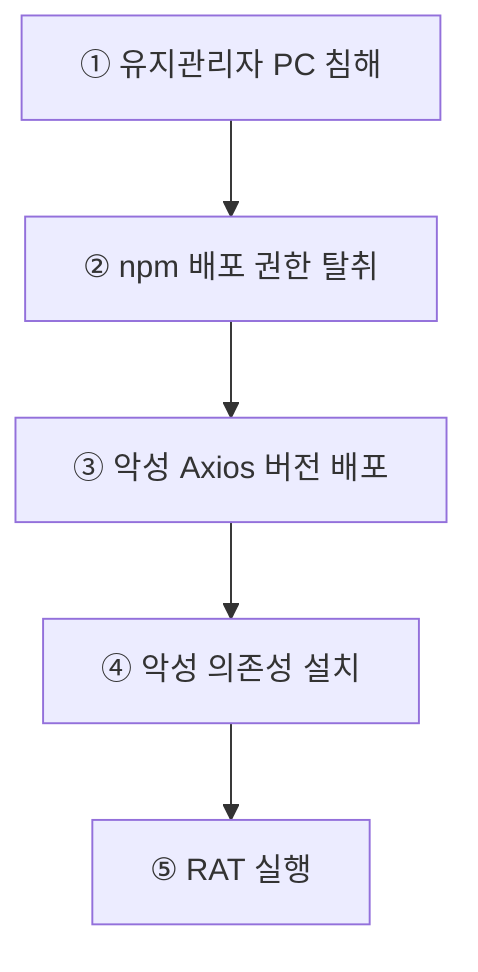

2026년 3월 31일, JavaScript에서 널리 사용되는 Axios 라이브러리의 공식 npm 패키지에 악성코드가 포함된 사건이 발생했다.

공격자는 Axios 유지관리자의 계정을 탈취해 악성 버전을 배포했고, 해당 버전을 설치한 개발자의 PC에서는 원격 접근 악성코드(RAT)가 실행될 수 있었다.

처음 사건을 접했을 때는 공격자가 유지관리자 계정의 이메일을 자신의 주소로 변경했다는 사실이 눈에 들어왔다. 이메일을 변경했기 때문에 악성 버전을 배포할 수 있었던 것일까?

또 하나 의문이었던 점은 악성 패키지가 공식 npm 저장소에서 배포됐다는 사실이다. 신뢰할 수 있는 경로에서 프로그램을 설치한다면 이런 공격을 예방할 수 있지 않을까 생각했지만, 이번에는 그 경로 자체가 공격에 이용됐다.

이러한 의문을 바탕으로 Axios와 npm의 역할부터 실제 공격 과정, 피해 가능성, 대응 과정에서 드러난 문제까지 살펴봤다.

---

## 1. Axios 공급망 공격 개요

### 1.1 Axios와 npm이란?

Axios는 JavaScript에서 HTTP 및 HTTPS 요청을 쉽게 처리하도록 도와주는 오픈소스 라이브러리다.

HTTP는 클라이언트와 서버가 데이터를 주고받을 때 사용하는 통신 규약이고, HTTPS는 TLS를 이용해 통신을 암호화하고 서버 인증 등을 제공하는 방식이다.

개발자는 Axios를 사용해 서버의 데이터를 조회하거나 API를 호출할 수 있다.

예를 들어 웹사이트에서 사용자 정보를 불러올 때 다음과 같이 사용할 수 있다.

```javascript
import axios from "axios";

const response = await axios.get("/api/users");
console.log(response.data);
```

위 코드는 `/api/users` 경로로 HTTP GET 요청을 보내고, 서버에서 전달받은 데이터를 출력하는 예제다.

Axios는 이러한 HTTP 요청을 편리하게 처리할 수 있어 다양한 JavaScript 프로젝트에서 사용된다.

그렇다면 npm은 무엇일까?

npm(Node Package Manager)은 JavaScript 패키지를 설치하고 관리하는 도구다. 또한 개발자가 만든 패키지를 게시하고 다른 개발자가 내려받을 수 있는 공식 패키지 저장소인 npm 레지스트리도 운영된다.

개발자는 필요한 라이브러리를 직접 구현하는 대신 npm을 통해 설치할 수 있다.

```bash
npm install axios
```

위 명령어는 프로젝트에 Axios 패키지를 설치하는 명령어다.

문제는 이번 공격에서 악성 버전이 배포된 곳이 바로 이 공식 npm 레지스트리였다는 점이다.

---

### 1.2 소프트웨어 공급망 공격

소프트웨어 공급망 공격(Supply Chain Attack)은 소프트웨어의 개발, 빌드, 배포 과정 등을 공격해 해당 소프트웨어를 사용하는 사용자나 조직까지 피해를 확산시키는 공격 방식이다.

공격자가 수많은 개발자의 PC를 하나씩 침해하는 것은 쉽지 않다. 하지만 많은 개발자가 사용하는 라이브러리의 배포 권한을 확보한다면, 해당 라이브러리를 설치하는 개발 환경까지 공격할 수 있다.

이번 사건에서 공격자는 Axios의 공식 npm 배포 권한을 악용해 다음 두 버전을 게시했다.

- `axios@1.14.1`
- `axios@0.30.4`

두 버전에는 `plain-crypto-js@4.2.1`이라는 악성 의존성이 추가되어 있었다.

이 패키지는 설치 과정에서 외부 서버로부터 추가 악성코드를 내려받도록 구성되어 있었다.

---

### 1.3 사고 진행 과정

| 시기 (UTC 기준) | 내용 |
|---|---|
| 2026년 3월 중순경 | 유지관리자를 대상으로 사회공학 공격 시작 |
| 3월 30일 05:57 | `plain-crypto-js@4.2.0` 초기 버전 게시 |
| 3월 31일 00:21 | 악성 `axios@1.14.1` 배포 |
| 3월 31일 약 01:00 | 악성 `axios@0.30.4` 배포 |
| 3월 31일 약 01:00 | 외부 커뮤니티에서 이상 징후 발견 및 신고 |
| 3월 31일 03:15 | 악성 Axios 버전 제거 |
| 3월 31일 03:29 | `plain-crypto-js` 패키지 제거 |
| 4월 2일 | Axios 유지관리자의 공식 사고 회고 공개 |

Axios 유지관리자의 공식 사고 회고에 따르면 악성 버전은 약 3시간 동안 공개되어 있었다.

해당 시간에 Axios를 새로 설치하거나 업데이트한 환경은 악성 패키지에 노출됐을 가능성이 있다.

다만 공격 시간대에 Axios를 사용하고 있었다는 사실만으로 감염됐다고 볼 수는 없다. 실제로 어떤 버전이 설치되었고, 악성코드가 실행됐는지 확인해야 한다.

---

## 2. 유지관리자 계정은 어떻게 탈취됐을까?

### 2.1 사회공학 공격으로 시작된 침해

Axios의 주요 유지관리자인 Jason Saayman은 GitHub에 공개한 사고 회고에서 자신의 개발 환경이 침해된 과정을 설명했다.

공격자는 실제 기업 관계자인 것처럼 접근해 유지관리자를 Slack 작업 공간에 초대했다. 이후 Microsoft Teams 회의를 진행하면서 시스템 구성요소를 업데이트해야 한다는 안내를 표시했고, 유지관리자가 이를 설치하면서 원격 접근 악성코드에 감염됐다고 밝혔다.

이처럼 사람의 신뢰나 판단을 악용해 공격자가 원하는 행동을 유도하는 방식을 **사회공학 공격(Social Engineering)**이라고 한다.

대표적으로 정상적인 기관을 사칭해 피싱 메일을 보내거나, 업무 담당자로 위장해 악성 프로그램을 설치하도록 유도하는 방법이 있다.

이번에도 공격자는 정상적인 업무 협업처럼 보이는 환경을 준비했다. 유지관리자의 설명에 따르면 실제 기업과 관계자의 신원을 모방하고, Slack 작업 공간 역시 평범한 회사처럼 보이도록 구성했다고 한다.

결국 유지관리자의 PC가 RAT에 감염됐고, 공격자는 이를 통해 npm 계정의 인증 정보에 접근할 수 있었던 것으로 알려졌다.

처음에는 npm의 기술적인 취약점이 공격에 이용된 것으로 생각했지만, 실제 침해는 유지관리자 개인의 PC에서 시작됐다.

많은 개발자가 사용하는 라이브러리의 배포 권한이 한 사람의 개발 환경과 연결되어 있었다는 점이 특히 눈에 들어왔다.

---

### 2.2 npm 액세스 토큰과 이메일 변경

공개된 보안 분석에 따르면 공격자는 유지관리자의 npm 인증 정보를 확보해 악성 버전을 게시했다.

여기서 npm 액세스 토큰(Access Token)은 npm 계정으로 특정 작업을 수행할 수 있도록 발급되는 인증 정보다.

토큰에 부여된 권한에 따라 패키지를 게시하거나 관리하는 작업도 가능하다.

공격에 사용된 것으로 분석된 장기 액세스 토큰은 유효한 기간 동안 반복적으로 사용할 수 있는 인증 정보다. 따라서 해당 토큰이 유출되고도 폐기되지 않는다면 공격자가 권한을 계속 악용할 위험이 있다.

조사 자료에서는 공격자가 유지관리자 계정의 이메일을 자신이 관리하는 Proton Mail 주소로 변경한 사실도 언급하고 있었다.

처음에는 이메일 변경이 악성 패키지 배포를 가능하게 만든 원인이라고 생각했다.

하지만 이메일은 계정 알림이나 관리 등에 사용되는 정보이며, **실제 패키지 배포에는 게시 권한이 있는 인증 정보가 필요하다.**

따라서 이메일을 변경했다는 사실보다 공격자가 패키지를 게시할 수 있는 권한을 확보했다는 점이 더 중요해 보였다.

다만 구체적으로 어떤 방식으로 인증 정보를 추출했는지, 이메일 변경 과정에서 어떤 인증 절차가 사용됐는지까지 공개된 자료만으로 모두 확인하기는 어려웠다.

---

### 2.3 GitHub 소스코드는 변경하지 않았다

이번 사건에서 또 하나 궁금했던 것은 GitHub 저장소의 코드까지 변경됐는지였다.

GitHub는 소스코드를 저장하고 변경 이력을 관리하는 서비스다. 반면 npm은 개발자가 실제로 설치하는 JavaScript 패키지를 배포하는 역할을 한다.

두 서비스는 함께 사용할 수 있지만, GitHub 저장소에 코드를 수정하는 권한과 npm에 패키지를 게시하는 권한은 별도로 관리될 수 있다.

이번 사건에서는 공격자가 GitHub 저장소의 원본 코드를 직접 변경하지 않고, 탈취한 npm 배포 권한을 이용해 악성 버전을 게시했다.

따라서 GitHub의 코드 변경 내역만 확인했다면 이러한 배포를 발견하기 어려웠을 가능성이 있다.

소스코드의 변경 이력뿐 아니라 실제로 배포되는 패키지의 내용과 배포 경로까지 확인할 필요가 있다는 생각이 들었다.

---

## 3. 악성 패키지는 어떻게 실행됐을까?

지금까지의 공격 과정을 정리하면 다음과 같다.



*그림 1. 공개된 사고 분석을 바탕으로 정리한 Axios 공급망 공격 흐름*

### 3.1 의존성(Dependency)을 이용한 공격

이번 사건에서 공격자는 Axios의 기존 HTTP 통신 기능을 직접 변경하지 않았다.

대신 `plain-crypto-js@4.2.1`이라는 새로운 의존성을 추가했다.

의존성(Dependency)이란 어떤 프로그램이나 라이브러리가 동작하기 위해 필요로 하는 다른 프로그램이나 라이브러리를 말한다.

예를 들어 A라는 패키지가 B라는 패키지를 필요로 한다면, A를 설치하는 과정에서 B도 함께 설치될 수 있다.

npm에서는 이러한 정보를 보통 `package.json` 파일에 기록한다.

공격자는 이 구조를 이용해 Axios를 설치하면 `plain-crypto-js`도 설치되도록 만들었다.

Microsoft의 분석에 따르면 공격자는 먼저 악성 기능이 없는 `plain-crypto-js@4.2.0` 버전을 게시하고, 이후 악성 설치 스크립트가 포함된 `4.2.1` 버전을 배포했다.

패키지 이름도 정상적인 암호화 라이브러리인 `crypto-js`와 비슷하게 구성되어 있었다.

이 방식이라면 개발자가 평소 사용하는 Axios를 설치하면서 새로운 의존성이 추가된 사실까지 확인하지 않는 이상 문제를 발견하기 쉽지 않았을 것으로 보인다.

---

### 3.2 postinstall 스크립트 악용

npm에서는 패키지를 설치하는 과정에서 특정 스크립트가 자동 실행되도록 설정할 수 있다.

그중 하나가 `postinstall`이다. 패키지 설치 후 필요한 파일을 생성하거나 추가 설정을 진행하는 등의 용도로 사용된다.

하지만 이번 사건에서는 이 기능이 악성코드를 실행하는 데 이용됐다.

악성 의존성의 `package.json`에는 다음과 같은 설정이 포함되어 있었다.

```json
{
  "scripts": {
    "postinstall": "node setup.js"
  }
}
```

이는 패키지 설치 후 Node.js를 이용해 `setup.js` 파일을 실행한다는 의미다.

문제는 해당 파일에 악성코드를 내려받는 기능이 포함되어 있었다는 점이다.

`setup.js`는 운영체제를 확인한 뒤 외부 C2 서버에 접속해 각 운영체제에 맞는 악성코드를 내려받도록 설계되어 있었다.

C2(Command and Control) 서버는 공격자가 감염된 시스템에 명령을 전달하거나 정보를 주고받기 위해 사용하는 서버다.

이번 공격에서는 Windows, macOS, Linux를 구분해 각각의 환경에서 실행할 수 있는 악성코드를 제공했다.

또한 설치 과정에서 실행된 파일을 삭제하거나 변조한 설정 파일을 복원해 흔적을 숨기려는 기능도 확인됐다.

이 부분이 특히 흥미로웠다.

개발자가 Axios를 설치하고 HTTP 요청 기능이 정상적으로 동작하는지만 확인했다면, 설치 과정에서 악성코드가 실행됐다는 사실을 알아차리지 못했을 가능성이 있다.

---

### 3.3 RAT는 어떤 악성코드일까?

이번 사건에서 실행된 악성코드는 WAVESHAPER.V2 계열의 RAT로 분석됐다.

RAT(Remote Access Trojan)는 원격 접근 트로이목마를 의미하며, 공격자가 감염된 시스템에서 원격으로 명령을 실행하거나 정보를 수집할 수 있도록 하는 악성코드다.

SK쉴더스와 Google의 분석에서는 WAVESHAPER.V2가 시스템 정보 수집, 디렉터리 탐색, 프로세스 정보 수집, 추가 악성코드 실행 등의 기능을 가지고 있다고 설명했다.

따라서 RAT가 실행된 환경에서는 악성 파일 하나가 설치되는 문제에서 끝나지 않을 가능성이 있다.

특히 개발자 PC나 CI/CD 환경에는 GitHub 토큰, 클라우드 API 키, 서버 접속 정보 등 중요한 인증 정보가 저장되어 있을 수 있다.

CI/CD(Continuous Integration/Continuous Delivery·Deployment)는 코드의 변경 사항을 자동으로 검사하거나 빌드하고, 배포하는 과정을 말한다.

이러한 환경에서 인증 정보가 노출된다면 공격자가 다른 시스템에 접근하거나 추가적인 공격을 시도할 위험도 있을 것이다.

---

## 4. RAT를 이용한 2차 공격 가능성

RAT에 대해 알아보면서 한 가지 궁금한 점이 생겼다.

공격자가 여러 개발자의 PC를 감염시키고 원격으로 제어할 수 있다면, 이 PC들을 다른 공격에도 활용할 수 있지 않을까?

네트워크를 공부하면서 접했던 DDoS 공격이 떠올랐다.

### 4.1 RAT와 봇넷의 관계

DDoS(Distributed Denial of Service)는 여러 시스템에서 특정 서버나 서비스로 대량의 트래픽 또는 요청을 발생시켜 정상적인 서비스 이용을 방해하는 공격이다.

이러한 공격에는 봇넷(Botnet)이 사용되기도 한다.

봇넷은 공격자가 다수의 감염 기기를 조직적으로 제어할 수 있도록 구성한 네트워크다. 여기에 포함된 감염 기기를 흔히 좀비 PC라고 부른다.

RAT가 감염된 시스템에서 원격 명령을 실행할 수 있다는 점을 고려하면, 공격자가 여러 기기를 확보한 뒤 봇넷을 구성하거나 추가 악성코드를 설치하는 것도 기술적으로 가능할 것으로 보인다.

다만 **RAT 감염 자체가 곧 봇넷 구성이나 DDoS 공격을 의미하는 것은 아니다.**

실제로 DDoS 공격에 활용하려면 공격자가 해당 목적의 명령이나 추가 기능을 실행해야 하며, 감염된 기기의 환경도 영향을 줄 수 있다.

---

### 4.2 실제로 DDoS 공격이 발생했을까?

이번 Axios 사건에서 RAT가 DDoS 공격에 사용됐다는 내용은 확인하지 못했다.

공개된 분석 자료에서는 주로 원격 명령 실행, 시스템 정보 수집, 추가 악성코드 실행 가능성을 다루고 있었다.

따라서 DDoS는 이번 사고에서 확인된 피해가 아니라, RAT의 기능을 살펴보면서 생각해 본 2차 공격 가능성이다.

실제로 발생한 사고와 기술적으로 가능한 공격을 구분할 필요가 있을 것 같다.

---

## 5. 공식 npm 저장소도 안전을 보장하지는 않았다

처음에는 신뢰할 수 있는 경로에서만 프로그램을 설치하도록 제한하면 이런 사고를 예방할 수 있지 않을까 생각했다.

하지만 이번 사건에서는 공격자가 공식 npm 레지스트리에 악성 버전을 게시했다.

개발자가 정상적인 설치 명령어를 사용하더라도 해당 시점에 악성 버전이 선택됐다면 공격에 노출될 수 있었던 것이다.

결국 패키지의 출처만 확인하는 방법으로는 이번 공격을 충분히 예방하기 어려웠을 것으로 보인다.

그렇다면 개발자와 패키지 유지관리자는 각각 어떤 조치를 취할 수 있을까?

### 5.1 개발자 입장에서 가능한 조치

먼저 패키지의 버전과 의존성 정보를 확인하는 방법이 있다.

JavaScript 프로젝트에서는 `package.json`에 의존성 정보를 기록하고, `package-lock.json`과 같은 잠금 파일을 통해 실제 설치되는 패키지 버전을 관리할 수 있다.

이러한 파일을 활용하면 검토되지 않은 새 버전이 자동으로 설치되는 위험을 줄이는 데 도움이 된다.

다만 잠금 파일에 이미 악성 버전이 기록되어 있다면 이를 자동으로 차단해 주지는 않는다.

따라서 버전을 관리하는 것 외에도 업데이트 내역과 새롭게 추가된 의존성을 확인하는 과정이 필요할 것이다.

또한 `postinstall`처럼 설치 과정에서 실행되는 스크립트를 제한하는 방법도 고려할 수 있다.

물론 정상적인 패키지에서도 설치 스크립트를 필요로 하는 경우가 있으므로 모든 프로젝트에 무조건 제한을 적용하기는 어려울 수 있다.

---

### 5.2 유지관리자 입장에서 가능한 조치

이번 사건에서는 유지관리자의 개인 PC가 침해되면서 npm 패키지 배포 권한까지 공격에 이용됐다.

Axios 유지관리자는 사고 회고에서 개인 계정을 통한 직접 배포가 위험 요소였다고 설명했다.

또한 승인되지 않은 패키지 배포를 자동으로 탐지하는 체계가 없었다는 점도 언급했다.

여기서 살펴볼 수 있는 방법이 OIDC Trusted Publishing이다.

OIDC(OpenID Connect)는 신원 정보를 확인하는 데 사용하는 인증 기술이다.

npm의 Trusted Publishing은 GitHub Actions 같은 신뢰할 수 있는 자동화 환경에서 OIDC를 이용해 패키지를 게시할 수 있도록 지원한다.

기존의 장기 액세스 토큰을 저장해 사용하는 대신, 정해진 배포 작업에서 발급되는 단기 인증 정보를 사용하는 방식이다.

이러한 방식은 장기 토큰 유출로 인한 위험을 줄이는 데 도움이 될 수 있다.

그런데 이번 사고에서는 OIDC 기반 배포 설정이 존재했음에도 장기 액세스 토큰을 통한 배포 경로가 남아 있었던 것으로 분석됐다.

따라서 OIDC를 설정했다는 사실만으로 모든 배포가 해당 절차를 거친다고 볼 수는 없다.

**실제로 어떤 인증 정보로 패키지를 게시할 수 있는지, 승인되지 않은 배포 경로가 남아 있는지까지 점검해야 할 것으로 보인다.**

---

## 6. 사고 대응과 피해 규모

### 6.1 사고 발견과 초기 대응

악성 Axios 버전은 약 3시간 만에 npm에서 제거됐다.

Axios 유지관리자의 사고 회고에 따르면 외부 커뮤니티에서 비정상적인 배포를 발견하고 신고했으며, 프로젝트 관계자와 npm 측의 대응으로 악성 버전이 삭제됐다.

그런데 이 과정에서도 문제가 있었다.

공격자는 탈취한 계정을 이용해 GitHub에 올라온 일부 사고 신고를 삭제했다.

또한 당시 프로젝트에는 비정상적인 패키지 배포를 자동으로 탐지하는 체계가 없어 외부 커뮤니티의 발견에 의존했다고 한다.

이 부분을 보면서 배포 권한을 보호하는 것뿐 아니라 예상하지 못한 버전이 게시됐을 때 이를 자동으로 확인하는 절차도 필요하지 않을까 생각했다.

사고 이후 Axios 측은 유지관리자의 기기를 초기화하고 관련 인증 정보를 재설정했으며, 패키지 배포 절차와 보안 관리 방식을 개선하겠다고 밝혔다.

---

### 6.2 감염 가능성이 있는 환경의 조치

Axios 프로젝트와 보안업체들은 악성 버전을 설치했을 가능성이 있는 환경에서 추가적인 점검을 진행하도록 권고했다.

| 점검 항목 | 확인할 내용 |
|---|---|
| Axios 버전 | `1.14.1`, `0.30.4` 설치 이력 |
| 악성 의존성 | `plain-crypto-js` 설치 여부 |
| 네트워크 | 악성 C2 서버와 통신한 기록 |
| 인증 정보 | API 키, 액세스 토큰 등 교체 |
| 개발 환경 | RAT 실행 흔적 및 추가 악성코드 |
| CI/CD 환경 | 빌드 과정에서 노출된 인증 정보 |

특히 악성 패키지를 삭제하거나 안전한 버전으로 교체했다고 해서 이미 실행된 RAT까지 제거됐다고 볼 수는 없다.

따라서 해당 버전을 설치한 환경은 시스템이 침해됐을 가능성을 고려해 추가로 점검할 필요가 있다.

---

### 6.3 실제 피해는 어느 정도였을까?

사고를 조사하면서 실제로 얼마나 많은 개발자가 피해를 입었는지도 찾아봤다.

하지만 공개된 자료만으로 전체 감염 기기 수나 실제 유출된 정보의 규모를 정확하게 파악하기는 어려웠다.

보안업체들은 여러 국가와 산업 분야에서 영향을 받은 정황을 관측했다고 밝혔지만, 이를 전체 피해 규모로 일반화할 수는 없을 것으로 보인다.

또한 악성 패키지가 배포됐다는 사실과 실제 개인정보가 유출됐다는 사실도 구분해야 한다.

확인된 것은 악성 버전이 배포됐고, 해당 버전이 설치되는 과정에서 RAT가 실행될 수 있었다는 점이다.

실제로 어떤 시스템이 감염됐고 어떤 정보가 유출됐는지는 개별 환경에 대한 조사 결과가 필요할 것이다.

---

## 7. 글을 마치며

처음 Axios 사건을 접했을 때는 유지관리자의 계정 이메일 변경이 악성 버전 배포를 가능하게 만든 원인이라고 생각했다.

하지만 조사 자료를 살펴보면서 이메일 변경보다는 npm 패키지를 게시할 수 있는 인증 정보와 권한이 탈취됐다는 점이 핵심이라는 것을 이해하게 됐다.

또한 신뢰할 수 있는 경로에서만 패키지를 설치하면 충분하지 않을까 생각했지만, 이번 사건에서는 공식 npm 레지스트리 자체가 악성 패키지의 유통 경로로 사용됐다.

앞으로 외부 라이브러리를 설치할 때는 출처뿐 아니라 버전과 의존성, 설치 과정에서 실행되는 스크립트도 확인할 필요가 있겠다는 생각이 들었다.

개인적으로는 RAT의 기능을 살펴보는 과정도 흥미로웠다.

원격 명령 실행이 가능하다는 점에서 여러 시스템이 감염된다면 봇넷이나 DDoS 같은 다른 공격으로 이어질 가능성도 떠올랐다. 다만 이번 사고에서 그러한 공격이 실제로 발생했다는 근거는 확인하지 못했기 때문에 가능성과 실제 피해를 구분해서 정리했다.

이전에 조사했던 쿠팡 개인정보 유출 사고에서는 서명 키 관리와 인증 토큰 검증 문제가 있었다.

이번 Axios 사건에서도 중요한 인증 정보가 공격에 이용됐다는 공통점이 있었다. 다만 Axios에서는 유지관리자 개인의 개발 환경이 침해된 일이 공식 패키지 배포 과정으로 이어졌다는 점이 달랐다.

특히 많은 사람이 사용하는 라이브러리의 유지관리자 한 명이 공격받았을 때, 그 영향이 어디까지 확대될 수 있는지 생각해 볼 수 있었다.

앞으로 개발 프로젝트를 진행하면서 외부 라이브러리를 사용할 때는 필요한 기능만 확인하는 데 그치지 않고, 실제 설치되는 패키지와 의존성도 조금 더 관심을 가지고 살펴보고 싶다.

---

## 참고 자료

1. [Axios GitHub, Post Mortem: axios npm supply chain compromise (2026.04.02)](https://github.com/axios/axios/issues/10636)
2. [SK쉴더스 EQST, Axios npm 패키지 공급망 공격 인사이트 보고서 (2026.04.01)](https://www.skshieldus.com/security-insights/trends/axios-supply-chain-attack-insight-report)
3. [Microsoft Security, Mitigating the Axios npm supply chain compromise (2026.04.01)](https://www.microsoft.com/en-us/security/blog/2026/04/01/mitigating-the-axios-npm-supply-chain-compromise/)
4. [Google Threat Intelligence Group, North Korea-Nexus Threat Actor Compromises Widely Used Axios NPM Package (2026.04.01)](https://cloud.google.com/blog/topics/threat-intelligence/north-korea-threat-actor-targets-axios-npm-package)
