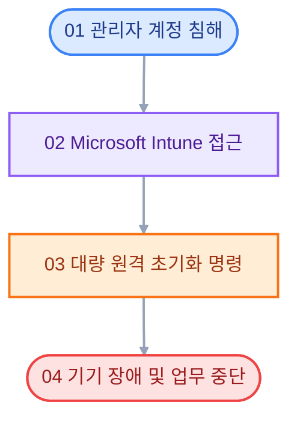
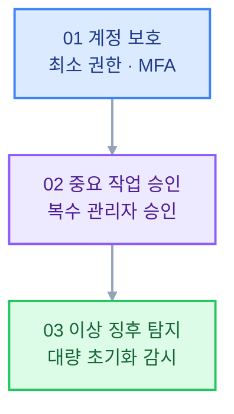

2026년 3월 11일, 미국 의료기기 제조기업 Stryker에서 사이버 공격으로 인한 대규모 시스템 장애가 발생했다.

이번 사고를 조사하면서 가장 눈에 들어왔던 부분은 공격자가 Microsoft Intune이라는 기업용 기기 관리 시스템을 악용한 것으로 알려졌다는 점이었다.

처음에는 악성코드로 여러 기기를 감염시킨 공격이라고 생각했다. 그런데 관련 자료를 찾아보니 기업이 정상적으로 사용하는 원격 관리 기능이 대규모 장애를 일으키는 데 이용됐다는 분석이 있었다.

특히 높은 관리자 권한을 확보한 공격자가 다수의 기기에 초기화 명령을 전달했다는 내용을 보고 의문이 생겼다.

**아무리 관리자라도 수많은 기기를 한꺼번에 초기화하려 한다면 추가적인 확인이 필요하지 않을까?**

또한 다른 관리자가 해당 작업을 승인했더라도 평소와 다른 대규모 작업이 발생한다면 이를 탐지할 필요가 있다고 생각했다.

이러한 의문을 바탕으로 사고 경위와 Microsoft Intune의 역할을 살펴보고, 관리자 권한이 침해됐을 때 피해를 줄일 수 있는 방법을 정리해 봤다.

---

## 1. Stryker 사이버 공격 개요

### 1.1 Stryker는 어떤 기업일까?

Stryker는 미국의 의료기기 제조기업으로, 수술 장비와 정형외과 의료기기, 응급의료 관련 제품 등을 공급하고 있다.

*미국 일리노이주 Cary에 위치한 Stryker 사무소 (출처: [Stryker Careers Blog](https://www.strykercareersblog.com/post/10-reasons-to-join-stryker-in-cary-illinois))*

2026년 3월 11일 발생한 사이버 공격으로 Stryker의 내부 IT 환경에서 장애가 발생했으며, 주문 처리와 제조, 배송 등의 업무에도 차질이 생겼다.

Stryker는 사고 발생 이후 외부 보안 전문가 및 관계 기관과 협력해 조사와 복구 작업을 진행했다고 밝혔다.

회사 측은 고객이 사용하는 의료기기 제품 자체에는 영향이 없었다고 설명했다. 다만 일부 제품의 주문과 배송에 차질이 발생한 만큼, 내부 시스템 장애가 고객에게 미치는 영향까지 없었던 것은 아니었다.

---

### 1.2 공격 조직 Handala

이번 공격에 대한 책임을 주장한 조직은 Handala Hack Team(한달라)이다.

Handala는 친이란 성향의 해킹 조직으로 알려져 있으며, 보안업계에서는 이란 정보기관과의 연계 가능성도 제기하고 있다.

Handala는 공격 이후 20만 대 이상의 시스템을 삭제하고 약 50TB의 데이터를 탈취했다고 주장했다.

그러나 공격 조직의 발표를 그대로 실제 피해 규모로 받아들이기는 어렵다.

BleepingComputer는 사고에 정통한 관계자를 인용해 약 8만 대의 기기가 원격 초기화됐다고 보도했다. 하지만 이 수치도 Stryker가 공식적으로 확정한 최종 피해 규모는 아니다.

따라서 공격자가 주장한 피해와 외부 관계자의 증언, 기업의 공식 발표를 구분해서 살펴볼 필요가 있었다.

---

### 1.3 사고 진행 과정

| 날짜 | 주요 내용 |
|---|---|
| 2026.03.11 | Stryker 사이버 공격 발생, Handala가 공격 책임 주장 |
| 2026.03.12 | Stryker, 내부 Microsoft 환경 장애와 업무 차질 발표 |
| 2026.03.16 | Intune을 이용한 대규모 원격 초기화 관련 보도 |
| 2026.03.18 | CISA, 단말 관리 시스템 보안 강화 권고 |
| 2026.03.23 | Stryker, 추가 조사에서 악성 파일 사용 사실 확인 |
| 2026.04.01 | 주요 제조·주문·유통 시스템 복구 현황 발표 |

사고 이후 여러 보안업체와 언론에서 공격 방법에 관한 분석을 공개했다.

관리자 권한이 침해되고 Intune의 원격 초기화 기능이 악용됐다는 설명이 주요 공격 경로로 제시됐다. 다만 최초 침입에 사용된 인증 정보가 어떻게 유출됐는지 등 구체적인 내용은 공개 자료만으로 모두 확인하기 어려웠다.

---

## 2. Microsoft Intune은 어떻게 공격에 이용됐을까?

### 2.1 Microsoft Intune이란?

Microsoft Intune은 기업에서 PC, 노트북, 스마트폰 등의 기기를 중앙에서 관리할 수 있도록 지원하는 클라우드 기반 서비스다.

이러한 서비스를 단말 관리 시스템(Endpoint Management System)이라고 한다.

기업의 관리자는 Intune을 통해 기기에 보안 정책을 적용하거나 소프트웨어를 배포할 수 있으며, 필요에 따라 기기에 저장된 데이터를 원격으로 삭제할 수도 있다.

*Microsoft Intune 관리 화면 예시. 상단의 Wipe 기능으로 관리 대상 기기의 초기화를 요청할 수 있다. 실제 Stryker 사고 당시의 화면은 아니다. (출처: [Microsoft Learn](https://learn.microsoft.com/ko-kr/intune/solutions/education/tutorial-school-deployment/manage-overview))*

예를 들어 직원이 회사에서 지급한 노트북을 분실했다면, 관리자는 원격 초기화 기능을 이용해 기기에 저장된 기업 정보가 외부로 유출될 위험을 줄일 수 있다.

원래는 기기를 안전하게 관리하기 위한 기능인 셈이다.

그런데 이러한 기능을 사용할 수 있는 관리자 권한이 공격자에게 넘어간다면 어떻게 될까?

---

### 2.2 관리자 계정 침해

외부 보안 분석에서는 공격자가 높은 관리자 권한을 확보한 뒤 Intune 관리 환경에 접근한 것으로 보고 있다.

BleepingComputer는 사고에 정통한 관계자를 인용해 공격자가 기존 관리자 계정을 침해한 후 새로운 Global Administrator 계정을 생성했다고 보도했다.

Global Administrator는 Microsoft Entra ID에서 높은 권한을 가진 관리자 역할이다.

Microsoft Entra ID는 기업의 사용자 계정과 인증, 접근 권한을 관리하는 서비스다. 따라서 높은 관리자 권한을 확보하면 여러 Microsoft 서비스의 설정과 접근 권한에 영향을 줄 수 있다.

일부 보안업체에서는 정보 탈취형 악성코드(Infostealer)로 수집된 계정 정보가 침입에 사용됐을 가능성도 제기했다.

Infostealer는 PC에 저장된 비밀번호나 인증 정보 등을 수집하는 악성코드다.

다만 유출된 것으로 알려진 인증 정보가 실제로 이번 공격의 최초 침입에 사용됐는지는 확인되지 않았다.

**관리자 계정 침해는 주요 공격 경로로 분석되고 있지만, 최초 침입 방법까지 확정된 것은 아니다.**

---

### 2.3 원격 초기화 기능 악용

여러 보안 분석에서는 공격자가 Microsoft Intune의 원격 초기화(Remote Wipe) 기능을 이용한 것으로 설명하고 있다.

Remote Wipe는 관리 대상 기기의 데이터를 삭제하거나 기기를 초기화하는 기능이다.

일반적으로 분실하거나 폐기할 기기를 관리할 때 사용하지만, 이번에는 다수의 기기에 삭제 명령을 전달하는 데 악용된 것으로 알려졌다.

**공격 진행 과정**

*공개된 외부 보안 분석을 바탕으로 정리한 흐름이며, 최초 계정 침해 방법과 일부 관리자 설정은 확인되지 않았다.*

여기서 Intune이 한 명의 관리자만 사용하는 시스템이라는 뜻은 아니다.

Intune은 여러 관리자에게 서로 다른 권한을 부여할 수 있고, 관리할 수 있는 기기의 범위도 구분할 수 있다.

이번 사고에서는 높은 관리자 권한이 악용되면서 대규모 작업이 가능했던 것으로 분석됐다.

**정상적인 관리 기능이라도 이를 실행하는 계정이 침해된다면 공격에 이용될 수 있다는 점**이 눈에 들어왔다.

---

## 3. 악성코드는 사용되지 않았을까?

이번 사고를 조사하면서 자료마다 설명이 달라 조금 헷갈렸던 부분이다.

초기 보도에서는 악성코드 없이 Intune의 정상적인 기능을 악용했다는 설명이 많았다. 그런데 이후 Stryker의 공식 발표에서는 악성 파일을 발견했다는 내용이 나왔다.

### 3.1 초기 발표와 추가 조사 결과

Stryker는 사고 직후 랜섬웨어나 악성코드 사용의 증거를 발견하지 못했다고 발표했다.

랜섬웨어(Ransomware)는 일반적으로 파일을 암호화하거나 시스템 접근을 제한하고, 복구 등을 대가로 금전을 요구하는 악성코드다.

이번 사고는 파일을 암호화해 금전을 요구하는 일반적인 랜섬웨어 공격과는 다른 양상을 보였다.

하지만 3월 23일 Stryker는 미국 증권거래위원회(SEC)에 제출한 공시에서 추가 조사 결과를 공개했다.

공시에 따르면 공격자는 명령을 실행하고 자신의 활동을 숨기기 위해 악성 파일을 사용했다.

다만 해당 파일은 시스템 내부나 외부로 스스로 확산되는 기능은 없었다고 설명했다.

따라서 **악성코드가 전혀 사용되지 않았다는 초기 설명을 그대로 받아들이기는 어렵다.**

---

### 3.2 악성 파일과 Intune 기능의 차이

공개된 자료를 기준으로 정리하면 다음과 같다.

| 구분 | 공개된 내용 |
|---|---|
| Microsoft Intune | 원격 관리 기능이 대규모 초기화에 악용된 것으로 분석 |
| 악성 파일 | 명령 실행과 활동 은폐에 사용된 사실을 Stryker가 확인 |
| Handala 로고 | 일부 기기의 로그인 화면에 표시됐다는 보도가 있었으나 구현 방식은 불확실 |
| 랜섬웨어 | 일반적인 파일 암호화·금전 요구형 공격으로 확인되지는 않음 |

특히 Handala 로고가 표시됐다는 사실과 악성 파일이 사용됐다는 사실을 곧바로 연결하기는 어렵다.

해당 파일이 로고를 표시하는 데 사용됐는지, 실제 기기 초기화 명령을 실행하는 데 관여했는지는 확인하지 못했다.

그래서 이번 사고에서는 **Intune의 원격 초기화 기능이 악용됐다는 외부 분석**과 **Stryker가 확인한 악성 파일의 역할**을 별도로 살펴봤다.

---

## 4. 관리자 권한이 탈취됐더라도 피해를 줄일 방법은 없었을까?

이번 사건에서 가장 관심이 갔던 부분이다.

관리자 권한은 기업의 시스템을 운영하기 위해 필요하다. 하지만 관리자 계정으로 로그인했다고 해서 모든 중요한 작업을 제한 없이 실행할 수 있도록 해도 되는지는 생각해 볼 문제다.

특히 원격 초기화처럼 많은 기기에 영향을 줄 수 있는 작업이라면 더욱 신중하게 관리할 필요가 있지 않을까?

### 4.1 관리자 계정과 최소 권한 원칙

우선 관리자 계정 자체를 보호할 필요가 있다.

관리자 계정은 일반 사용자보다 많은 작업을 수행할 수 있기 때문에 계정이 침해됐을 때 발생할 수 있는 피해도 크다.

이러한 위험을 줄이기 위한 방법으로 최소 권한 원칙(Principle of Least Privilege)이 있다.

최소 권한 원칙은 사용자에게 업무 수행에 필요한 권한만 부여하는 보안 원칙이다.

예를 들어 기기의 상태를 확인하는 업무를 담당하는 직원에게 모든 기기를 초기화할 권한까지 부여할 필요는 없을 것이다.

Microsoft Intune에서는 역할 기반 접근통제(RBAC)를 통해 관리자별로 수행할 수 있는 작업과 관리 대상 범위를 제한할 수 있다.

RBAC(Role-Based Access Control)는 사용자의 역할에 따라 접근 권한을 부여하는 방식이다.

또한 다중 인증(MFA)을 이용해 계정에 로그인할 때 추가적인 인증을 요구할 수도 있다.

이러한 조치들은 관리자 계정 침해의 위험을 줄이거나, 계정이 침해되더라도 사용할 수 있는 권한을 제한하는 데 도움이 될 것으로 보인다.

---

### 4.2 대규모 초기화에 추가 승인이 필요하지 않을까?

이번 사고에서 처음 생각했던 예방 방법이다.

만약 관리자 계정이 탈취된 상황이라면, 공격자가 정상적인 인증 정보를 가지고 시스템에 로그인할 수도 있다.

그런데 기기를 한두 대 초기화하는 작업과 수천 대를 한꺼번에 초기화하는 작업은 영향 범위가 다르다.

**관리자라는 이유만으로 대규모 초기화를 바로 실행할 수 있도록 하는 것이 적절할까?**

처음에는 중요한 작업을 수행하기 전에 비밀번호나 MFA를 통해 한 번 더 인증하면 되지 않을까 생각했다.

그런데 추가로 찾아보니 Microsoft Intune에는 Multi Admin Approval이라는 기능이 있었다.

Multi Admin Approval은 특정한 중요 작업을 실행할 때 다른 관리자의 승인을 요구하는 기능이다.

예를 들어 관리자가 기기 초기화를 요청하더라도, 별도의 승인 권한을 가진 다른 관리자가 확인하기 전까지 작업을 진행하지 않도록 설정할 수 있다.

관리자 계정 하나가 침해됐더라도 공격자가 곧바로 중요한 작업을 실행하기는 더 어려워지는 셈이다.

다만 다른 관리자의 계정까지 침해되거나 승인 과정이 제대로 운영되지 않는다면 이러한 방식도 무력화될 수 있을 것이다.

또한 Stryker가 사고 당시 해당 기능을 어떤 범위에 적용했는지는 공개된 자료에서 확인하지 못했다.

따라서 Multi Admin Approval이 없어서 사고가 발생했다고 판단하기보다는, **이번과 같은 공격의 피해를 줄이기 위해 고려할 수 있는 방법**으로 살펴봤다.

---

### 4.3 승인된 작업도 이상 징후를 탐지할 필요가 있다

복수 관리자 승인에 대해 생각하다 보니 한 가지 의문이 더 생겼다.

다른 관리자가 승인했다고 하더라도 갑자기 수천 대의 기기에 초기화 명령이 내려지는 상황을 정상적인 작업으로 봐도 될까?

Stryker는 3월 13일 공식 발표에서 기업 사이버보안팀과 제품 보안팀이 평상시에도 이상 징후를 지속적으로 모니터링하고 있다고 밝혔다.

사고 이후에는 클라우드 환경의 보안 점검 빈도를 높이고 접근통제를 재검토했다고도 설명했다.

다만 당시 Intune에서 대량 초기화 명령을 탐지하는 규칙이 있었는지, 실제로 관련 경고가 발생했는지는 공개된 자료에서 확인하기 어려웠다.

여기서 생각한 것은 일반적인 모니터링과 **특정한 고위험 관리자 작업을 탐지하는 것**은 구분해서 살펴볼 필요가 있다는 점이다.

예를 들어 다음과 같은 행동이 발생한다면 정상적인 관리자 계정에서 실행됐더라도 추가 확인이 필요하지 않을까?

- 짧은 시간에 평소보다 많은 기기의 초기화 요청 발생
- 새로 생성된 관리자 계정에서 중요한 관리 작업 수행
- 평소와 다른 시간대나 위치에서 관리자 권한 사용

이러한 방법을 이상 징후 탐지(Anomaly Detection)라고 한다.

평소 시스템의 정상적인 사용 패턴과 다른 행동을 탐지해 잠재적인 위협을 발견하는 방식이다.

관리자 승인을 받았더라도 위험도가 높은 작업이 비정상적인 규모로 발생한다면, 보안 담당자에게 경고하고 필요에 따라 작업을 일시적으로 보류하는 방안도 생각해 볼 수 있다.

물론 이런 기능이 있었다고 해서 이번 사고를 반드시 막을 수 있었다고 보기는 어렵다.

다만 관리자가 실수로 승인했거나 승인 계정까지 침해된 상황에서도 피해를 제한할 수 있는 추가적인 방어 수단은 될 수 있을 것 같다.

---

### 4.4 생각해 본 개선 방안

앞서 살펴본 보안 조치를 세 단계로 정리해 봤다.

**관리자 권한 보호를 위한 세 단계**

첫 번째는 관리자 계정 자체를 보호하고 불필요한 권한을 제한하는 것이다.

두 번째는 원격 초기화처럼 영향이 큰 작업에 다른 관리자의 승인을 요구하는 방법이다.

마지막은 정상적으로 승인된 작업이라도 대량 초기화처럼 평소와 다른 행동이 발생하는지 탐지하는 것이다.

세 가지 조치를 함께 고려한다면 계정이 침해되더라도 피해가 곧바로 대규모 장애로 이어지는 위험을 줄이는 데 도움이 될 것으로 보인다.

물론 이는 이번 사고를 살펴보면서 생각한 개선 방향이며, Stryker가 실제로 어떤 조치를 운영하지 않았는지 확인한 결과는 아니다.

---

## 5. 대규모 시스템 장애와 가용성

이번 사고는 이전에 조사했던 쿠팡 개인정보 유출 사건과 피해 양상이 달랐다.

쿠팡에서는 개인정보에 대한 무단 접근과 유출이 중심이었다면, Stryker에서는 많은 기기와 업무 시스템이 정상적으로 작동하지 못하는 문제가 크게 나타났다.

### 5.1 정보보안의 CIA 3요소

정보보안의 기본 개념에는 기밀성(Confidentiality), 무결성(Integrity), 가용성(Availability)이 있다.

| 요소 | 의미 |
|---|---|
| 기밀성 | 허가받지 않은 사람이 정보에 접근하지 못하도록 보호 |
| 무결성 | 정보가 무단으로 변경되거나 훼손되지 않도록 보호 |
| 가용성 | 필요한 시점에 정보와 시스템을 정상적으로 이용할 수 있도록 보장 |

이번 사고에서는 데이터 삭제에 따른 무결성 문제와 함께 시스템 장애로 정상적인 업무를 수행하기 어려워진 가용성 문제가 두드러졌다.

Stryker는 실제로 주문 처리, 제조, 배송 업무에 차질이 발생했다고 밝혔다.

의료기기를 공급하는 기업이라는 점에서 이러한 업무 중단은 단순히 사내 직원들이 컴퓨터를 사용하지 못하는 문제로 끝나지 않을 수도 있다.

실제로 일부 고객의 주문이나 제품 배송에도 지연이 발생했다.

다만 Stryker는 고객이 사용하는 의료기기 제품 자체는 안전하며 공격의 영향을 받지 않았다고 발표했다. 따라서 내부 시스템의 장애와 의료기기의 직접적인 작동 장애는 구분해서 봐야 한다.

---

### 5.2 사고 이후의 복구

Stryker는 공격을 확인한 뒤 사고 대응 절차를 가동하고 외부 보안 전문가와 관계 기관의 지원을 받아 조사를 진행했다.

시스템 복구 과정에서는 주문과 배송, 고객 지원에 필요한 기능을 우선적으로 복구했다고 밝혔다.

또한 전자 주문 시스템의 장애가 지속되는 동안 가능한 경우 수작업으로 주문을 처리하는 등의 업무 연속성 조치도 진행했다.

2026년 4월 1일에는 글로벌 제조 네트워크가 정상적으로 운영되고 있으며, 주요 주문·유통 시스템도 복구됐다고 발표했다.

이 과정을 보면서 공격을 예방하는 것뿐 아니라 이미 사고가 발생한 뒤 업무를 얼마나 빠르게 복구할 수 있는지도 중요하다고 생각했다.

특히 중앙 관리 시스템이 침해되면 많은 기기에 동시에 장애가 발생할 수 있으므로, 복구에 필요한 시스템과 백업까지 함께 보호할 필요가 있을 것이다.

---

## 6. 사고 대응과 아직 확인되지 않은 부분

### 6.1 Stryker의 대응

Stryker는 사고 발생 이후 외부 보안 전문가와 관계 기관의 지원을 받아 침해 범위를 조사하고 시스템을 복구했다.

3월 23일에는 공격자가 내부에서 활동하는 동안 명령을 실행하고 흔적을 숨기기 위해 사용한 악성 파일을 확인했다고 발표했다.

또한 조사 당시 고객이나 공급업체 등 외부 관계자의 시스템을 직접 침해했다는 증거는 발견하지 못했다고 설명했다.

다만 이러한 발표만으로 공격자가 주장한 모든 정보 유출 가능성의 진위를 최종적으로 판단하기는 어려웠다.

---

### 6.2 CISA의 보안 권고

미국 사이버보안·인프라보안국(CISA)은 2026년 3월 18일 단말 관리 시스템의 보안을 강화할 것을 권고했다.

주요 내용은 다음과 같다.

- **최소 권한 원칙:** 관리자의 업무에 필요한 권한만 부여
- **RBAC 적용:** 관리자별 작업 권한과 관리 대상 기기 범위 제한
- **피싱에 강한 MFA:** 관리자 계정에 대한 무단 접근 방지
- **복수 관리자 승인:** 원격 초기화와 같은 중요한 작업에 별도 승인 적용

특히 복수 관리자 승인 기능은 이번 사건을 조사하면서 처음 생각했던 추가 확인 절차와 연결되는 내용이었다.

다만 CISA가 특정 기능을 권고했다고 해서 Stryker가 사고 이전에 해당 기능을 사용하지 않았다는 뜻은 아니다.

권고사항과 실제 사고 당시의 보안 설정은 구분해서 살펴봐야 한다.

---

### 6.3 공개 자료에서 확인하기 어려웠던 내용

이번 사고에서는 구체적인 공격 경로와 내부 관리 환경에 관한 정보가 충분히 공개되지 않은 부분도 있었다.

현재까지 살펴본 자료에서 특히 확인하기 어려웠던 부분은 다음과 같다.

- 공격자가 처음 관리자 계정에 접근한 구체적인 방법
- 당시 Stryker의 관리자별 권한과 복수 승인 정책
- Intune의 대량 초기화 관련 탐지 규칙 및 경고 발생 여부
- 실제로 초기화된 기기의 최종 규모
- 공격자가 주장한 데이터 유출의 정확한 범위

Stryker가 일반적인 이상 징후 모니터링을 운영하고 있었다는 사실은 공식 발표에서 확인할 수 있었다.

하지만 대량 초기화 같은 특정 작업을 어떻게 감시하고 통제했는지는 확인하지 못했다.

따라서 이번 글에서 제안한 복수 관리자 승인이나 대량 작업 탐지는 실제 Stryker의 관리 부실을 확인한 내용이 아니라, **비슷한 사고가 발생했을 때 피해를 줄이기 위해 생각해 본 개선 방안**에 해당한다.

---

## 7. 글을 마치며

처음 Stryker 사고를 조사할 때는 관리자 계정이 침해되면서 대규모 기기 초기화가 발생했다는 사실이 가장 눈에 들어왔다.

특히 기업에서 정상적으로 사용하는 원격 관리 기능이 공격에 악용될 수 있다는 점이 흥미로웠다.

처음에는 관리자가 많은 기기를 초기화하려고 하면 비밀번호나 MFA를 통해 다시 인증하도록 하면 되지 않을까 생각했다.

그러나 Microsoft Intune의 Multi Admin Approval 기능을 찾아보면서 중요한 작업은 다른 관리자가 추가로 승인하도록 설정할 수도 있다는 사실을 알게 됐다.

그런데 복수 관리자 승인만으로도 충분할지는 의문이었다.

다른 관리자가 작업을 승인했더라도 평소와 비교해 지나치게 많은 기기를 초기화하려 한다면 정상적인 작업인지 다시 확인할 필요가 있다고 생각했다.

Stryker는 평상시 이상 징후를 모니터링하고 있었다고 밝혔지만, 사고 당시 대량 초기화 명령에 어떤 탐지 정책을 적용하고 있었는지까지 확인할 수는 없었다.

그래서 이번 사고의 원인을 특정 보안 기능의 부재로 판단하기보다는, 관리자 계정이 침해된 상황에서 피해를 제한할 수 있는 여러 방법을 생각해 보는 데 집중했다.

또한 정보보안의 CIA 3요소 중 가용성을 실제 사례에 연결해 볼 수 있었다.

앞서 조사했던 쿠팡 사고는 인증 토큰 위조와 개인정보 유출, Axios 사고는 악성 패키지를 통한 개발 환경 침해가 주요 내용이었다.

반면 Stryker에서는 관리자 권한이 악용되면서 많은 기기와 업무 시스템이 영향을 받았다는 점이 달랐다.

세 사건의 공격 방식은 서로 달랐지만, 모두 정상적인 시스템에서 신뢰하는 인증 정보나 권한이 공격에 이용됐다는 공통점이 있었다.

앞으로 시스템 보안을 공부하면서 관리자 권한을 어떻게 제한해야 하는지, 권한을 가진 계정이 침해됐을 때도 피해를 줄일 수 있는 방법에는 무엇이 있는지 더 살펴보고 싶다.

---

## 참고 자료

1. [Stryker, Customer Updates: Stryker Network Disruption (2026.03~04)](https://www.stryker.com/us/en/about/news/2026/a-message-to-our-customers-03-2026.html)
2. [Stryker, SEC Form 8-K - Cybersecurity Incident Update (2026.03.23)](https://www.sec.gov/Archives/edgar/data/310764/000119312526118634/d94012d8k.htm)
3. [CISA, Endpoint Management System Hardening Alert (2026.03.18)](https://content.govdelivery.com/accounts/USDHSCISA/bulletins/40ef439)
4. [BleepingComputer, Stryker Attack Wiped Tens of Thousands of Devices (2026.03.16)](https://www.bleepingcomputer.com/news/security/stryker-attack-wiped-tens-of-thousands-of-devices-no-malware-needed/)
5. [Microsoft Learn, Use Multi Admin Approval in Intune](https://learn.microsoft.com/en-us/intune/fundamentals/role-based-access-control/multi-admin-approval)
6. [Microsoft Learn, Intune Device Management](https://learn.microsoft.com/ko-kr/intune/solutions/education/tutorial-school-deployment/manage-overview)
7. [Stryker Careers Blog, 9 Reasons to Love Stryker in Illinois](https://www.strykercareersblog.com/post/10-reasons-to-join-stryker-in-cary-illinois)
