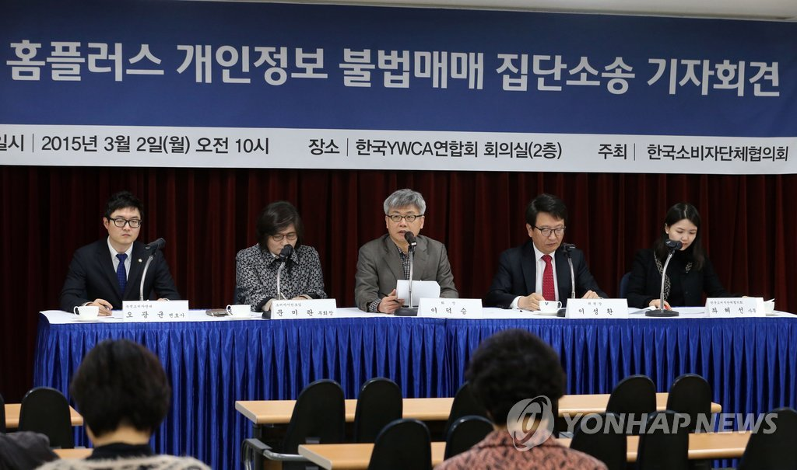

## 1. 들어가며

웹사이트에 가입하거나 이벤트에 참여하다 보면 개인정보 수집 및 이용 동의서를 쉽게 접할 수 있다. 하지만 모든 내용을 꼼꼼하게 읽고 동의하는 사람은 얼마나 될까?

이번에 공부한 판례는 **2011년 12월부터 2014년 6월까지** 홈플러스가 경품행사를 통해 고객들의 개인정보를 수집하고 이를 보험회사에 판매한 사건이다. 특히 개인정보 제공에 관한 내용을 **약 1mm 크기의 글씨**로 작성했다는 점이 눈에 띄었다.

처음에는 명백한 개인정보 보호법 위반이라고 생각했지만, 2016년 1심과 2심에서는 모두 무죄를 선고했다. 그러나 2017년 4월 7일 대법원은 하급심과 다른 판단을 내리고 원심판결을 파기환송했다.

어떤 근거로 1·2심에서 무죄를 선고했고, 대법원에서는 왜 판단이 달라졌는지 궁금해 각 판결문을 비교해 보았다.

---

## 2. 홈플러스 개인정보 판매 사건

### 2.1. 판례 정보

  
분석 대상 판례

  
대법원 제3부

  
2017년 4월 7일 선고 | 2016도13263

  
개인정보보호법위반·정보통신망법위반 등

  
판결 결과: <strong>원심판결 파기환송</strong> 
  <a href="https://www.law.go.kr/LSW/precInfoP.do?precSeq=184700">판결문 원문</a>

심급별 판결문

| 심급 | 법원 | 사건번호 | 선고일 |
|---|---|---|---|
| 1심 | 서울중앙지방법원 | [2015고단510](https://www.law.go.kr/LSW/precInfoP.do?precSeq=186011) | 2016.01.08. |
| 2심 | 서울중앙지방법원 | [2016노223](https://www.law.go.kr/LSW/precInfoP.do?evtNo=2016노223) | 2016.08.12. |
| 3심 | 대법원 | [2016도13263](https://www.law.go.kr/LSW/precInfoP.do?precSeq=184700) | 2017.04.07. |

**파기환송**이란 상급심이 이전 판결에 잘못이 있다고 판단해 해당 판결을 깨고, 하급심에서 다시 재판하도록 사건을 돌려보내는 것을 말한다.

이번 글에서는 2017년 대법원 형사 판례를 중심으로 분석하고, 이후 형사재판의 결과와 2024년 민사 판례도 함께 정리했다.

---

### 2.2. 사건 관계자

판결문에서는 사건 관계자들의 이름을 익명으로 표시하고 있다. 처음 판결문을 읽을 때 피고인 번호가 누구를 뜻하는지 헷갈려 주요 관계자들을 정리했다.

| 판결문 표기 | 실제 관계 |
|---|---|
| 피고인 1 | 당시 홈플러스 대표이사 |
| 피고인 9 회사 | 홈플러스 주식회사 |
| 공소외 1·2 회사 | 제휴 보험회사 |

개인정보 보호법의 주요 용어

| 법률 용어 | 의미 | 해당 대상 |
|---|---|---|
| 개인정보처리자 | 업무를 목적으로 개인정보를 처리하는 개인 또는 기관 등 | 홈플러스 |
| 정보주체 | 해당 개인정보로 알아볼 수 있는 사람 | 고객 |
| 제3자 | 자신의 업무나 목적을 위해 개인정보를 제공받는 외부 주체 | 보험회사 |

이후 본문에서는 이해하기 쉽도록 피고인 번호 대신 홈플러스와 보험회사라는 명칭을 사용한다.

---

### 2.3. 경품행사를 통한 개인정보 판매

대법원 판결문에 따르면 홈플러스는 2007년경부터 보험회사에 고객들의 개인정보를 판매했다. 이후 보험회사에 판매할 개인정보가 부족해지자 경품행사를 통해 개인정보를 수집하는 사업을 기획했고, 2009년경부터 경품행사를 시작했다.

이 사건에서 문제가 된 경품행사는 **2011년 12월부터 2014년 6월까지 총 11차례** 열렸다.

자동차나 다이아몬드 반지와 같은 고가의 경품을 내걸고 고객들의 참여를 유도했지만, 경품행사의 주된 목적은 고객들의 개인정보를 수집해 보험회사에 판매하는 것이었다.

개인정보 수집 및 판매 규모

| 구분 | 규모 |
|---|---:|
| 수집한 개인정보 | 약 712만 건 |
| 판매한 개인정보 | 약 600만 건 |
| 판매대금 | 약 119억 원 |
| 업무제휴약정상 판매 단가 | 건당 1,980원 |

출처: 대법원 2016도13263 판결문 경품행사 관련 공소사실에 기재된 규모로, 기존 회원정보까지 포함한 전체 사건 규모와는 차이가 있다.

수집한 개인정보와 경품행사의 관련성

| 수집 항목 | 경품행사와의 관련성에 대한 개인적인 해석 |
|---|---|
| 이름 및 휴대전화번호 | 당첨자 확인 및 연락에 활용 가능 |
| 생년월일 | 본인 확인 등에 활용 가능 |
| 주민등록번호 | 경품 응모 단계에서 수집할 필요가 있었는지 검토 필요 |
| 성별 | 경품 추첨과 직접적인 관련성 부족 |
| 자녀 수 | 경품 추첨과 직접적인 관련성 부족 |
| 부모와의 동거 여부 | 경품 추첨과 직접적인 관련성 부족 |

이름이나 연락처는 경품 당첨자를 확인하고 연락하기 위해 필요할 수 있다. 하지만 자녀 수나 부모와의 동거 여부까지 경품 추첨에 필요했을지는 의문이다.

오히려 보험회사가 고객의 상황에 맞는 보험상품을 판매하는 데 활용하기 좋은 정보라고 생각한다.

---

### 2.4. 약 1mm 크기의 개인정보 동의 문구

홈플러스 경품행사 응모권 앞면 행사 기간: 2013년 12월 26일~2014년 2월 9일

응모권 뒷면에 기재된 개인정보 입력란과 동의 문구 출처: 2015년 5월 7일 홈플러스 관련 기자간담회 자료집, p.27

위 응모권의 크기는 가로 15cm, 세로 7cm다.

앞면에는 다이아몬드와 자동차 등 고가의 경품이 크게 표시되어 있다. 반면 뒷면에는 이름, 휴대전화번호, 자녀 수 등 개인정보 입력란과 약 1mm 크기의 동의 문구가 빽빽하게 배치되어 있다.

또한 개인정보 입력이나 동의 사항이 누락되면 경품 추첨에서 제외된다는 안내도 있었다.

소비자는 경품에 당첨될 기회를 얻기 위해 응모권을 작성했지만, 홈플러스는 이를 보험회사에 판매할 개인정보를 수집하는 수단으로 활용했다.

**이러한 방식으로 받은 개인정보 제공 동의를 적법한 동의라고 볼 수 있을까?**

---

## 3. 첫 번째 쟁점 — 개인정보 제공 동의

### 3.1. 검찰과 홈플러스의 주장

<table class="hp-compare hp-three">
  <thead>
    <tr>
      <th>구분</th>
      <th>검찰 측</th>
      <th>홈플러스 측</th>
    </tr>
  </thead>
  <tbody>
    <tr>
      <td>수집 목적</td>
      <td>개인정보 판매 목적을 숨김</td>
      <td>이용 목적을 응모권에 명시</td>
    </tr>
    <tr>
      <td>동의 문구</td>
      <td>내용을 인지하기 어려운 크기</td>
      <td>작은 글씨라도 확인 가능</td>
    </tr>
    <tr>
      <td>동의 방식</td>
      <td>부정한 방법으로 동의를 받음</td>
      <td>고객으로부터 직접 동의를 받음</td>
    </tr>
    <tr>
      <td>고지 의무</td>
      <td>실제 수집 목적을 알려야 함</td>
      <td>유상 제공 사실의 고지 의무 없음</td>
    </tr>
  </tbody>
</table>

검찰은 경품행사의 실제 목적이 개인정보 판매였으므로 이를 개인정보 수집·이용 목적에 포함해 알려야 한다고 주장했다. 경품 추첨에 불필요한 개인정보까지 요구한 점도 문제로 보았다.

반면 홈플러스 측은 법률에서 요구하는 고지사항을 응모권에 기재했고, 소비자들의 동의도 받았다는 입장이었다.

결국 쟁점은 **개인정보를 수집하고 동의를 받는 방법이 적법했는지**에 있었다.

---

### 3.2. 1심 재판부의 판단

  
판결 정보 · 1심

  
서울중앙지방법원

  
2016년 1월 8일 선고 | 2015고단510

  
판결 결과: <strong>피고인 전원 무죄</strong> 
  <a href="https://www.law.go.kr/LSW/precInfoP.do?precSeq=186011">판결문 원문</a>

1심 판결문에서 가장 눈에 띄었던 부분은 개인정보의 유상 제공에 관한 판단이었다.

당시 개인정보 보호법 제17조 제2항에서는 개인정보를 제3자에게 제공하기 위한 동의를 받을 때 다음과 같은 내용을 정보주체에게 알려야 한다고 규정했다.

개인정보 제3자 제공 시 고지사항

| 구분 | 고지 내용 |
|---|---|
| 제공 대상 | 개인정보를 제공받는 자 |
| 이용 목적 | 제공받는 자의 개인정보 이용 목적 |
| 제공 항목 | 제공하는 개인정보의 항목 |
| 이용 기간 | 제공받는 자의 개인정보 보유 및 이용 기간 |
| 동의 거부 | 동의 거부 권리 및 거부에 따른 불이익이 있는 경우 그 내용 |

그러나 1심 재판부는 개인정보를 제3자에게 **유상으로 제공하는지 여부**까지 알려야 할 의무는 없다고 보았다.

또한 소비자가 경품에 당첨될 기회를 얻기 위해 자신의 개인정보가 보험회사의 영업에 사용될 것이라는 점을 인식하고 동의했다고 판단했다.

1심은 법률에서 요구하는 고지사항이 기재되어 있었고 소비자가 이에 동의했다는 사실을 중요하게 보았다.

---

### 3.3. 2심 재판부의 판단

  
판결 정보 · 항소심

  
서울중앙지방법원

  
2016년 8월 12일 선고 | 2016노223

  
판결 결과: <strong>검사의 항소 기각 · 무죄 유지</strong> 
  <a href="https://www.law.go.kr/LSW/precInfoP.do?evtNo=2016노223">판결문 원문</a>

검찰은 1심 판결에 불복해 항소했다.

검찰은 개인정보의 유상 제공 여부를 고지할 의무와 개인정보 수집의 실제 목적을 알릴 의무는 구분해야 한다고 주장했다.

2심은 소비자들의 개인정보 이용 목적에 대한 인식과 관련해 1심의 사실인정에 일부 잘못이 있다고 보았다. 다만 판결 결과를 바꿀 정도는 아니라고 판단했다.

약 1mm 크기의 글씨에 대한 판단

| 판단 근거 | 재판부가 고려한 내용 |
|---|---|
| 글씨 크기 | 복권이나 의약품 설명서 등에서도 비슷한 크기의 글씨 사용 |
| 동의 거부 사례 | 개인정보 제공에 동의하지 않은 응모자 존재 |
| 확대 응모권 | 응모함 옆에 확대된 응모권을 게시한 사례 존재 |
| 온라인 응모 | 컴퓨터 화면에서 내용 확대 가능 |

2심은 이를 근거로 홈플러스가 소비자의 동의 사항 확인을 방해하기 위해 의도적으로 글씨를 작게 만들었다고 인정하기 어렵다고 보았다.

결국 검찰의 항소를 기각하고 1심의 무죄 판단을 유지했다.

---

### 3.4. 대법원은 무엇을 다르게 보았을까?

  
판결 정보 · 상고심

  
대법원 제3부

  
2017년 4월 7일 선고 | 2016도13263

  
판결 결과: <strong>원심판결 파기환송</strong> 
  <a href="https://www.law.go.kr/LSW/precInfoP.do?precSeq=184700">판결문 원문</a>

대법원은 개인정보에 대한 동의를 받는 행위만 따로 떼어 판단해서는 안 된다고 보았다.

  개인정보처리자가 개인정보를 취득하거나 처리에 관한 동의를 받게 된 전 과정을 살펴보아 […] 종합적으로 고려하여 사회통념에 따라 판단하여야 한다.

  출처: <a href="https://www.law.go.kr/LSW/precInfoP.do?precSeq=184700">대법원 2017. 4. 7. 선고 2016도13263 판결</a> (일부 생략)

동의 문구가 존재한다는 사실만으로 판단하는 것이 아니라 개인정보를 수집하고 동의를 받기까지의 과정 전체를 고려해야 한다는 것이다.

대법원이 제시한 판단 기준

| 판단 기준 | 구체적인 의미 |
|---|---|
| 수집 동기와 목적 | 왜 개인정보를 수집했는가? |
| 수집 항목의 관련성 | 수집 목적과 개인정보가 관련되어 있는가? |
| 수집 방법 | 어떤 방식으로 개인정보를 수집하고 동의를 받았는가? |
| 법령 준수 여부 | 개인정보 보호법 등 관련 법령을 준수했는가? |
| 개인정보의 내용과 규모 | 어떤 정보를 얼마나 수집했는가? |
| 민감정보 및 고유식별정보 | 특별한 보호가 필요한 정보가 포함되어 있는가? |

대법원은 이러한 기준을 홈플러스 경품행사에 적용했다.

홈플러스 경품행사에 대한 판단

| 판단 요소 | 대법원이 주목한 부분 |
|---|---|
| 경품행사의 목적 | 개인정보 판매라는 주된 목적을 숨김 |
| 광고 방식 | 소비자가 고객감사 행사로 오인할 가능성 |
| 동의 방식 | 중요한 내용을 약 1mm 크기의 글씨로 표시 |
| 수집 범위 | 경품행사에 필요하지 않은 개인정보까지 요구 |

대법원은 위 사정들을 종합해 홈플러스의 행위가 부정한 방법에 의한 개인정보 취득 및 동의에 해당한다고 판단했다.

1·2심과 대법원의 판단 비교

<table class="hp-compare hp-three">
  <thead>
    <tr>
      <th>판단 기준</th>
      <th>1·2심</th>
      <th>대법원</th>
    </tr>
  </thead>
  <tbody>
    <tr>
      <td>고지 방식</td>
      <td>법률상 고지사항의 기재 여부</td>
      <td>소비자의 실질적인 인지 가능성</td>
    </tr>
    <tr>
      <td>글씨 크기</td>
      <td>작은 글씨만으로 위법성 인정 어려움</td>
      <td>다른 사정과 함께 종합적으로 판단</td>
    </tr>
    <tr>
      <td>수집 목적</td>
      <td>개인정보 이용 목적의 명시 여부</td>
      <td>경품행사의 실제 목적과 수집 과정</td>
    </tr>
    <tr>
      <td>판결 결과</td>
      <td><strong>무죄</strong></td>
      <td><strong>원심판결 파기환송</strong></td>
    </tr>
  </tbody>
</table>

---

### 3.5. 관련 법 조항

사건 당시 개인정보 보호법

| 법 조항 | 주요 내용 |
|---|---|
| 제15조 | 개인정보의 수집·이용 |
| 제16조 | 필요한 최소한의 개인정보 수집 |
| 제17조 | 개인정보의 제3자 제공 |
| 제22조 | 개인정보 처리에 관한 동의 방법 |
| 제59조 제1호 | 거짓이나 부정한 수단에 의한 개인정보 취득 및 동의 금지 |
| 제72조 제2호 | 해당 금지행위에 대한 벌칙 |

이 중 형사처벌 여부를 판단하는 데 특히 중요한 조항은 **제59조 제1호와 당시 제72조 제2호**다.

제15조, 제16조, 제17조, 제22조는 개인정보 수집 및 동의 과정의 적절성을 판단하는 데 관련된 규정이다. 모든 조항을 위반했다는 이유로 각각 형사처벌을 받은 것은 아니라는 점에 주의해야 한다.

---

### 3.6. 판결문을 읽으면서 든 생각

1심의 판단에서 가장 납득하기 어려웠던 부분은 소비자가 개인정보의 이용 목적을 인식하고 동의했다고 본 점이다.

약 1mm 크기의 글씨는 아무것도 적혀 있지 않은 종이에 작성하더라도 읽기 쉽지 않다. 실제 응모권 사진을 보면 여러 개인정보 입력란과 동의 사항이 함께 배치되어 있어 내용을 확인하기가 더욱 어려웠을 것이라는 생각이 든다.

2심 재판부는 복권이나 의약품 설명서에서도 비슷한 크기의 글씨가 사용된다는 점을 고려했다. 하지만 다른 곳에서도 작은 글씨를 사용한다는 사실이 개인정보 제공에 관한 고지 방식의 적절성을 뒷받침할 수 있을까?

당시 법률에서 개인정보의 유상 제공 사실까지 고지하도록 규정하지 않았다는 점은 이해할 수 있다.

그러나 돈을 받고 개인정보를 제공한다는 사실을 알릴 의무가 없다는 것과 소비자가 자신의 개인정보가 어떻게 이용되는지 제대로 알고 있었다는 것은 별개의 문제라고 생각한다.

**소비자가 동의서에 서명했다는 사실보다 자신이 어떤 내용에 동의하는지 제대로 알 수 있었는지가 더 중요하다.**

글씨 크기 하나만으로 위법 여부를 판단하지 않고 경품행사의 목적과 개인정보 수집 과정 전체를 고려한 대법원의 판단에 동의한다.

---

## 4. 두 번째 쟁점 — 사전필터링

### 4.1. 사전필터링이란?

홈플러스는 경품행사를 통해 수집한 개인정보뿐만 아니라 기존 패밀리카드 회원들의 개인정보도 보험회사에 판매했다.

대법원 판결문에 기재된 공소사실에 따르면, 2011년 12월부터 2014년 8월까지 회원들의 성명, 주민등록번호, 연락처 등 약 443만 건의 개인정보를 동의 없이 보험회사에 제공한 혐의가 홈플러스 법인에 적용됐다.

기존에는 고객에게 전화를 걸어 개인정보 제3자 제공 동의를 받은 뒤 보험회사에 개인정보를 전달했다. 이러한 전화 업무를 **퍼미션 콜(Permission Call)**이라고 한다.

보험회사는 전달받은 개인정보를 자체적으로 보유한 고객정보와 비교해 기존 보험가입자나 보험 영업 대상에서 제외할 고객 등을 걸러냈다.

그런데 홈플러스 입장에서는 보험회사가 어차피 제외할 고객에게까지 전화를 걸어 동의를 받는 것이 비효율적이었다. 이에 홈플러스는 보험회사에 필터링을 먼저 해달라고 요청했다.

기존 방식과 사전필터링 방식 비교

  

    
기존 방식

    

      
① 고객에게 퍼미션 콜

      
↓

      
② 제3자 제공 동의

      
↓

      
③ 보험회사에 개인정보 전달

      
↓

      
④ 필터링

      
↓

      
⑤ 보험 영업

    

  

  

    
사전필터링 방식

    

      
① 보험회사에 개인정보 전달

      
↓

      
② 사전필터링

      
↓

      
③ 선별된 고객에게 퍼미션 콜

      
↓

      
④ 제3자 제공 동의

      
↓

      
⑤ 고객정보 판매 및 보험 영업

    

  

대법원 판결문을 바탕으로 개인정보 제공 절차를 단순화한 그림

홈플러스는 사전필터링을 통해 불필요한 전화 횟수를 줄이고 비용을 절감할 수 있었다.

하지만 기존 방식과 달리 **고객의 제3자 제공 동의를 받기 전에 이미 보험회사에 개인정보를 전달했다는 점**이 문제가 됐다.

---

### 4.2. 개인정보 처리위탁과 제3자 제공

처음 판결문을 읽을 때는 두 개념의 차이가 쉽게 이해되지 않았다. 다른 기업에 개인정보를 전달한다는 점에서는 동일해 보였기 때문이다.

  
01. 개인정보 처리위탁

  개인정보를 수집한 기업이 자신의 업무 일부를 다른 기업에 맡기기 위해 개인정보를 전달하는 경우다.
  

    

      <strong>쇼핑몰</strong>
      <small>위탁자</small>
    

    
주소 전달 ────→

    

      <strong>택배회사</strong>
      <small>수탁자</small>
    

  

  쇼핑몰이 상품 배송을 위해 택배회사에 고객의 주소를 전달하는 경우를 예로 들 수 있다. 택배회사는 배송 업무의 대가를 받지만 고객정보를 자신의 마케팅에 이용할 수는 없다.
  
쇼핑몰의 업무를 대신 수행하기 위한 개인정보 처리

  
02. 개인정보 제3자 제공

  개인정보를 전달받은 기업이 자신의 업무와 이익을 위해 해당 정보를 처리하는 경우다.
  

    

      <strong>홈플러스</strong>
      <small>개인정보 제공자</small>
    

    
정보 제공 ────→

    

      <strong>보험회사</strong>
      <small>제3자</small>
    

  

  홈플러스가 보험회사에 고객정보를 제공하고 보험회사가 자신의 보험상품 판매를 위해 해당 정보를 활용하는 경우가 이에 해당할 수 있다.
  
보험회사 자신의 업무를 위한 개인정보 처리

두 개념의 차이

<table class="hp-compare hp-three">
  <thead>
    <tr>
      <th>구분</th>
      <th>처리위탁 · 제26조</th>
      <th>제3자 제공 · 제17조</th>
    </tr>
  </thead>
  <tbody>
    <tr>
      <td>처리 목적</td>
      <td>위탁자의 업무 수행</td>
      <td>제공받는 자의 자체 업무 수행</td>
    </tr>
    <tr>
      <td>독자적인 이익</td>
      <td>업무 수행 대가 외에는 없음</td>
      <td>개인정보 처리에 관한 독자적인 이익</td>
    </tr>
    <tr>
      <td>관리·감독</td>
      <td>위탁자의 감독 아래 처리</td>
      <td>자체 목적에 따라 처리</td>
    </tr>
    <tr>
      <td>제3자 제공 동의</td>
      <td>원칙적으로 불필요</td>
      <td>원칙적으로 필요</td>
    </tr>
  </tbody>
</table>

<small>※ 제3자 제공에도 동의 외의 적법한 처리 근거가 존재하며, 처리위탁 역시 관리·감독 등 관련 법률상의 의무를 준수해야 한다.</small>

처음에는 개인정보를 처리하면서 이익을 얻는다면 모두 제3자 제공에 해당하는 것인지 헷갈렸다.

하지만 택배회사가 배송비를 받는 것과 보험회사가 고객정보를 활용해 자신의 보험상품을 판매하는 것은 서로 다른 성격의 이익이다.

단순히 경제적 이익이 발생했는지가 아니라, **누구의 업무와 이익을 위해 개인정보를 처리하는지**가 중요하다.

대법원은 여기에 개인정보 취득 목적과 방법, 대가 수수 여부, 실질적인 관리·감독 관계 등을 함께 고려했다.

---

### 4.3. 1·2심 재판부의 판단

사전필터링에 대한 양측의 주장

<table class="hp-compare hp-three">
  <thead>
    <tr>
      <th>구분</th>
      <th>검찰 측</th>
      <th>홈플러스 측</th>
    </tr>
  </thead>
  <tbody>
    <tr>
      <td>업무 목적</td>
      <td>보험회사의 자체 영업</td>
      <td>홈플러스의 업무 효율 향상</td>
    </tr>
    <tr>
      <td>정보 전달</td>
      <td>고객 동의 없는 정보 제공</td>
      <td>위탁업무를 위한 정보 전달</td>
    </tr>
    <tr>
      <td>법률적 주장</td>
      <td><strong>제3자 제공</strong></td>
      <td><strong>처리위탁</strong></td>
    </tr>
  </tbody>
</table>

2016년 1·2심 재판부는 홈플러스 측의 입장을 받아들였다.

홈플러스가 업무 효율을 높이기 위해 사전필터링을 요청했고, 보험회사는 기존에 하던 필터링을 미리 수행한 것에 불과하다고 보았다.

또한 필터링 시점을 앞당겼다고 해서 보험회사가 최종적으로 구매할 수 있는 개인정보가 늘어나는 것은 아니라고 판단했다.

따라서 하급심은 사전필터링을 홈플러스의 업무를 위한 개인정보 처리위탁으로 보았다.

---

### 4.4. 대법원의 판단 — 보험회사의 독자적인 이익

2017년 4월 7일 대법원은 홈플러스뿐만 아니라 보험회사가 얻는 독자적인 이익에도 주목했다.

  위 보험회사들은 위와 같은 업무 처리에 관하여 독자적인 이익을 가진다고 볼 수 있다.

  출처: <a href="https://www.law.go.kr/LSW/precInfoP.do?precSeq=184700">대법원 2017. 4. 7. 선고 2016도13263 판결</a>

보험회사가 기존 보험가입자나 블랙리스트에 등록된 고객을 걸러내는 것은 보험상품 판매에 적합한 대상자를 선정하고 텔레마케팅의 효율을 높이기 위한 업무이기도 하다.

사전필터링을 통해 양측이 얻는 이익

<table class="hp-compare">
  <thead>
    <tr>
      <th>홈플러스</th>
      <th>보험회사</th>
    </tr>
  </thead>
  <tbody>
    <tr>
      <td>불필요한 퍼미션 콜 감소</td>
      <td>기존 보험가입자 등 제외</td>
    </tr>
    <tr>
      <td>전화 업무 비용 절감</td>
      <td>보험 영업에 적합한 고객 선별</td>
    </tr>
    <tr>
      <td><strong>개인정보 판매 업무의 효율 향상</strong></td>
      <td><strong>자체 보험 영업의 효율 향상</strong></td>
    </tr>
  </tbody>
</table>

홈플러스의 요청으로 필터링 시점이 앞당겨졌다고 해서 보험회사의 업무 목적 자체가 달라지는 것은 아니다.

필터링이 원래 보험회사의 텔레마케팅을 위한 업무였다면, 사전에 수행하더라도 그 성격은 그대로 남는다.

홈플러스가 이익을 얻는다는 사실과 보험회사가 독자적인 이익을 얻는다는 사실은 동시에 성립할 수 있다는 것이 대법원의 판단이었다.

---

### 4.5. 대법원의 판단 — 관리·감독 문제

대법원은 보험회사의 독자적인 이익뿐만 아니라 홈플러스의 실질적인 관리·감독 여부도 고려했다.

판결문에 따르면 보험회사 담당 직원들은 개인정보 데이터베이스를 각자의 업무용 컴퓨터에 다운로드한 후 자유롭게 복사, 편집, 이용 및 전송할 수 있었다.

개인정보 처리 과정에서 지적된 문제

| 판단 요소 | 판결문에서 지적한 내용 |
|---|---|
| 개인정보 접근 | 보험회사 직원의 업무용 컴퓨터에 DB 다운로드 |
| 데이터 통제 | 자유로운 복사·편집·이용·전송 가능 |
| 업무 범위 | 명확한 필터링 기준을 제시한 것으로 보이지 않음 |
| 관리·감독 | 실질적인 관리·감독이 이루어지지 않은 것으로 보임 |

처리위탁이라면 수탁자는 위탁자가 정한 업무 범위 안에서 개인정보를 처리해야 하고, 위탁자는 수탁자의 개인정보 처리 과정을 관리하고 감독해야 한다.

그런데 이 사건에서는 보험회사가 개인정보를 독립적으로 처리할 수 있었던 것으로 보인다.

다만 개인정보를 자유롭게 복사하고 전송할 수 있었다는 사실이 실제로 모든 개인정보가 무단 복사되거나 전송됐다는 의미는 아니다.

---

### 4.6. 사전필터링에 대한 최종 판단

1·2심과 대법원의 판단 비교

<table class="hp-compare hp-three">
  <thead>
    <tr>
      <th>판단 기준</th>
      <th>1·2심</th>
      <th>대법원</th>
    </tr>
  </thead>
  <tbody>
    <tr>
      <td>업무 목적</td>
      <td>홈플러스의 업무 효율 향상</td>
      <td>홈플러스와 보험회사 양측의 업무</td>
    </tr>
    <tr>
      <td>보험회사의 이익</td>
      <td>독자적인 이익 인정 어려움</td>
      <td>자체 영업을 위한 독자적인 이익 존재</td>
    </tr>
    <tr>
      <td>관리·감독</td>
      <td>처리위탁으로 판단</td>
      <td>실질적인 관리·감독 관계 고려</td>
    </tr>
    <tr>
      <td>결론</td>
      <td><strong>개인정보 처리위탁</strong></td>
      <td><strong>처리위탁으로 본 원심 판단에 잘못이 있음</strong></td>
    </tr>
  </tbody>
</table>

대법원은 보험회사의 독자적인 이익과 관리·감독 관계 등을 고려했을 때 사전필터링을 단순한 처리위탁으로 본 원심의 판단에 문제가 있다고 보았다.

사건 당시 관련 법 조항

| 법률 | 조항 | 주요 내용 |
|---|---|---|
| 개인정보 보호법 | 제17조 | 개인정보 제3자 제공 |
| 개인정보 보호법 | 제26조 | 개인정보 처리위탁 |
| 개인정보 보호법 | 제71조 제1호 | 동의 없는 개인정보 제공 등에 대한 벌칙 |
| 당시 정보통신망법 | 제24조의2 | 개인정보 제공 동의 |
| 당시 정보통신망법 | 제25조 | 개인정보 취급위탁 |
| 당시 정보통신망법 | 제71조 제3호 | 관련 금지행위에 대한 벌칙 |

대법원은 원심이 제3자 제공과 처리위탁을 구별하는 법리를 오해했고, 필요한 사실관계를 충분히 검토하지 않았다고 판단했다.

이에 원심판결을 파기하고 사건을 다시 하급심으로 돌려보냈다.

---

### 4.7. 관리·감독을 철저하게 했다면?

보험회사 직원들이 개인정보를 자유롭게 복사하고 전송할 수 있었다는 부분을 읽다가 궁금한 점이 생겼다.

  만약 홈플러스가 보험회사 직원들의 접근권한을 제한하고 개인정보 복사와 전송을 철저하게 통제했다면, 사전필터링을 처리위탁으로 인정받을 수 있었을까?

처음에는 그럴 수 있다고 생각했다. 위탁자가 수탁자의 개인정보 처리 과정을 제대로 관리한다면 처리위탁의 조건을 충족할 수 있지 않을까 생각했기 때문이다.

하지만 앞서 살펴본 보험회사의 독자적인 이익에 관한 판단을 다시 읽어보니 생각이 달라졌다.

개인정보를 아무리 철저하게 관리하더라도 보험회사가 자신의 보험상품을 판매하기 위해 고객을 선별한다는 사실은 변하지 않는다.

관리·감독은 여러 판단 기준 중 하나일 뿐이다. 실제 판결 결과를 단정할 수는 없지만, 그것만으로 제3자 제공이 처리위탁으로 바뀌기는 어려웠을 것이라고 생각한다.

홈플러스가 기존 방식대로 고객의 유효한 동의를 먼저 받고 개인정보를 전달했다면 적어도 사전필터링 단계에서 동의 없이 개인정보를 제공하는 문제는 피할 수 있었을 것이다.

업무 효율을 높이기 위해 개인정보 제공 동의의 순서까지 바꾼 것은 소비자의 권리보다 기업의 편의를 우선시한 결정이라고 생각한다.

---

## 5. 판결 결과와 이후 손해배상 소송

### 5.1. 형사재판의 최종 결과

형사재판의 진행 과정

| 시기 | 재판 과정 | 결과 |
|---|---|---|
| 2016.01.08. | 1심 | 무죄 |
| 2016.08.12. | 2심 | 무죄 유지 |
| 2017.04.07. | 대법원 | 원심판결 파기환송 |
| 2018년 8월 | 파기환송심 | 유죄 |
| 2019년 8월 | 재상고심 | 유죄 확정 |

2017년 4월 7일 대법원은 원심판결을 파기하고 사건을 서울중앙지방법원으로 돌려보냈다.

이후 2018년 8월 파기환송심에서 유죄를 선고했다.

2019년 8월 6일 연합뉴스 보도에 따르면 대법원은 홈플러스 법인에 벌금 7,500만 원을 선고한 원심판결을 확정했다.

  
홈플러스 법인의 최종 형사처벌

  
벌금 7,500만 원

  
2019년 8월 유죄 확정 관련 보도

  
<a href="https://www.yna.co.kr/view/AKR20190805112800004">관련 기사 — 연합뉴스, 2019.08.06.</a>

---

### 5.2. 형사재판과 민사재판

2015년 3월 2일 한국소비자단체협의회 홈플러스 개인정보 불법매매 집단소송 기자회견 출처: 연합뉴스

관련 기사를 찾아보던 중 조금 헷갈리는 부분이 있었다.

형사 판결문에서는 2016년 1·2심에서 무죄를 선고했다고 나와 있었는데, 2024년 5월 17일 경향신문의 기사에서는 1심부터 홈플러스의 손해배상 책임을 인정했다고 나와 있었기 때문이다.

찾아보니 개인정보 보호법 위반에 대한 형사재판과 피해자들이 제기한 손해배상 관련 민사재판은 별개였다.

형사재판과 민사재판의 차이

<table class="hp-compare hp-three">
  <thead>
    <tr>
      <th>구분</th>
      <th>형사재판</th>
      <th>민사재판</th>
    </tr>
  </thead>
  <tbody>
    <tr>
      <td>목적</td>
      <td>범죄 여부 판단 및 처벌</td>
      <td>개인이나 기업 간 분쟁 해결</td>
    </tr>
    <tr>
      <td>당사자</td>
      <td>검사와 피고인</td>
      <td>원고와 피고</td>
    </tr>
    <tr>
      <td>주요 결과</td>
      <td>징역, 벌금, 무죄 등</td>
      <td>손해배상 등</td>
    </tr>
    <tr>
      <td>대법원 사건번호</td>
      <td>도</td>
      <td>다</td>
    </tr>
    <tr>
      <td>금전 지급 대상</td>
      <td>벌금은 국가에 납부</td>
      <td>손해배상금은 피해자에게 지급</td>
    </tr>
  </tbody>
</table>

따라서 형사재판에서 홈플러스의 유죄가 인정됐다고 해서 모든 피해 고객에게 자동으로 손해배상이 이루어지는 것은 아니다.

대법원 사건번호에 사용되는 '도'와 '다'의 차이도 이번 판례를 조사하면서 처음 알게 됐다.

---

### 5.3. 피해자의 입증책임

민사재판에서는 개인정보가 실제로 보험회사에 제공됐다는 사실을 누가 증명해야 하는지가 쟁점이었다.

여기서 **입증책임**이란 재판에서 특정한 사실을 증명하지 못했을 때 그에 따른 불이익을 부담하는 것을 말한다.

민사재판의 심급별 판단

| 심급 | 선고 시기 | 주요 판단 |
|---|---|---|
| 1심 | 2017년 | 개인정보를 제공하지 않았다는 사실을 기업이 증명 |
| 2심 | 2018.07.11. | 자신의 개인정보가 제공됐다는 사실을 고객이 증명 |
| 대법원 | 2024.05.17. | 법 위반행위 자체는 정보주체가 증명 |

경향신문의 보도에 따르면 1심에서는 284명에 대한 손해배상 책임을 인정했다. 그러나 2심에서는 고객에게 개인정보 제공 사실에 대한 입증책임을 부여하면서 배상 인정 대상자가 152명으로 줄었다.

  
관련 판례 · 민사 상고심

  
대법원

  
2024년 5월 17일 선고 | 2018다262103

  
손해배상 청구 사건

  
<a href="https://www.law.go.kr/LSW/precInfoP.do?precSeq=240813">판결문 원문</a>

2024년 대법원은 해당 상고심에서 개인정보 제공 사실이 인정된 4명에 대한 손해배상 판단을 유지했다.

다른 원고들의 경우에는 자신의 개인정보가 보험회사에 제공됐다는 사실에 관한 구체적이고 개별적인 증명이 부족하다고 보았다.

여기서 4명은 해당 상고심에서 손해배상 책임이 인정된 원고의 수로, 전체 소송의 최종 배상 대상자가 4명뿐이라는 의미는 아니다.

개인정보 보호법 제39조 제1항과 입증책임

<table class="hp-compare">
  <thead>
    <tr>
      <th>정보주체 (고객)</th>
      <th>개인정보처리자 (기업)</th>
    </tr>
  </thead>
  <tbody>
    <tr>
      <td><strong>법 위반행위의 존재</strong> 
      자신의 개인정보가 위법하게 제공됐다는 사실</td>
      <td><strong>고의·과실의 부존재</strong> 
      해당 위반행위에 고의나 과실이 없었다는 사실</td>
    </tr>
  </tbody>
</table>

개인정보 보호법 제39조 제1항은 기업에 고의·과실이 없었다는 점에 관한 입증책임을 기업에 부여한 것이지, 위법행위가 있었는지에 대한 입증책임까지 기업에 부여한 것은 아니라는 것이 대법원의 판단이다.

개인정보 처리 기록은 대부분 기업이 보유하고 있을 텐데, 일반 소비자가 자신의 개인정보가 어느 기업에 제공됐는지 직접 확인하고 증명하는 것이 현실적으로 얼마나 가능할지 의문이 들었다.

기업의 위법행위를 처벌하는 것과 실제 피해자가 손해를 배상받는 것은 또 다른 문제였다.

---

## 6. 현재 개인정보 보호법에서는?

### 6.1. 사건 이후 달라진 동의 요건

홈플러스 사건이 발생한 2011~2014년에도 개인정보처리자가 정보주체에게 동의 사항을 명확하게 인지할 수 있도록 해야 한다는 의무가 존재했다.

이후 개인정보 보호법과 관련 규정이 개정되면서 동의를 받는 방법에 관한 기준이 더욱 구체화됐다.

대법원 판결과 법 개정 시점

| 날짜 | 주요 내용 |
|---|---|
| 2017.04.07. | 홈플러스 사건 대법원 파기환송 판결 |
| 2017.04.18. | 개인정보 보호법 제22조 제2항 신설 개정법 공포 |
| 2017.10.19. | 해당 개정법 시행 |

신설된 제22조 제2항은 서면으로 개인정보 처리에 관한 동의를 받을 때 중요한 내용을 명확하고 알아보기 쉽게 표시하도록 규정했다.

대법원 판결과 법 개정 시기가 가깝지만, 이것만으로 홈플러스 사건이 법 개정의 직접적인 원인이었다고 단정할 수는 없다.

---

### 6.2. 현행법의 개인정보 동의 기준

  
현행법 검토 기준

  
2026년 11월 25일

  
개인정보 보호법 제22조

  
개인정보 보호법 시행령 제17조

  
개인정보 처리 방법에 관한 고시 제4조

현행 개인정보 보호법 제22조 제2항에서는 서면으로 개인정보 처리 동의를 받을 때 중요한 내용을 개인정보보호위원회가 고시로 정하는 방법에 따라 명확히 표시하도록 규정하고 있다.

개인정보 보호법 시행령 제17조 제1항

| 동의 요건 | 주요 내용 |
|---|---|
| 자유로운 선택 | 정보주체가 자유롭게 동의 여부를 결정 |
| 명확성 | 구체적이고 명확한 동의 내용 |
| 가독성 | 쉽게 읽고 이해할 수 있는 문구 사용 |
| 의사표시 | 동의 여부를 명확하게 표시할 수 있는 방법 제공 |

이번 사건과 직접적으로 관련된 규정은 개인정보보호위원회의 「개인정보 처리 방법에 관한 고시」 제4조다.

해당 규정에서는 글씨의 크기, 색깔, 굵기 또는 밑줄 등을 활용해 개인정보 처리에 관한 중요한 내용을 명확하게 표시하도록 요구한다.

  관련 규정: <a href="https://www.law.go.kr/admRulLsInfoP.do?admRulSeq=2100000284146">개인정보 처리 방법에 관한 고시 제4조</a>

과거 고시에는 글씨를 최소 9포인트 이상으로 작성하고 다른 내용보다 20% 이상 크게 표시하도록 하는 기준도 있었다.

글씨의 크기에 대한 획일적인 기준이 달라지더라도 중요한 내용을 정보주체가 쉽게 알아볼 수 있도록 표시해야 한다는 의무는 여전히 중요하다.

---

### 6.3. 현재 동일한 사건이 발생한다면?

현행법을 기준으로 검토한 홈플러스 사건

| 쟁점 | 관련 조항 | 검토 사항 |
|---|---|---|
| 1mm 동의 문구 | 제22조 | 중요한 내용의 명확한 표시 |
| 불필요한 정보 수집 | 제16조 | 필요한 최소한의 개인정보 수집 여부 |
| 사전필터링 | 제17조 | 제3자 제공의 적법한 근거 |
| 개인정보 처리위탁 | 제26조 | 수탁자에 대한 관리·감독 |
| 개인정보 안전 관리 | 제29조 | 필요한 안전성 확보 조치 |

현재 개인정보 보호법 제17조 제4항에는 당초 수집 목적과 합리적으로 관련된 범위에서 일정한 조건을 충족하면 정보주체의 동의 없이 개인정보를 추가로 제공할 수 있도록 하는 규정도 존재한다.

그러나 대형마트의 회원정보를 보험회사의 자체 영업을 위해 사전에 제공하는 행위가 당초 수집 목적과 합리적으로 관련된다고 보기는 어려울 것이라고 생각한다. 동의 이외의 다른 적법한 제공 근거가 있는지도 별도로 검토해야 한다.

또한 당시 홈플러스와 동일한 방식으로 경품행사를 광고하고 약 1mm 크기의 글씨로 개인정보 제공 사실을 고지한다면, 정보주체가 중요한 내용을 쉽게 알아볼 수 있도록 표시했는지에 대해서도 문제가 제기될 수 있다.

따라서 동일한 사실관계라면 현재도 위법성이 인정될 가능성이 높다고 생각한다.

다만 실제 형사처벌 여부와 적용 조항은 구체적인 사실관계와 행위 당시의 법령에 따라 달라질 수 있다.

---

## 7. 마치며

이번 판례를 공부하면서 가장 궁금했던 것은 홈플러스가 어떤 근거로 1심과 2심에서 무죄를 선고받았는지였다.

처음에는 약 1mm 크기의 글씨로 개인정보 제공에 관한 내용을 기재했다는 사실만으로도 문제가 있다고 생각했다. 하지만 하급심 판결문을 읽어보니 당시 법률에서 요구하는 고지사항과 소비자의 동의 여부를 근거로 무죄를 판단했다는 것을 알 수 있었다.

그럼에도 나는 대법원의 판단에 동의한다. 법률에서 요구하는 내용을 모두 기재했더라도 소비자가 이를 제대로 확인하기 어려운 환경이었다면 충분한 동의가 이루어졌다고 보기 어렵기 때문이다.

사전필터링에 관한 판단도 인상 깊었다. 처음에는 홈플러스가 보험회사를 철저하게 관리·감독했다면 처리위탁으로 인정받을 수 있지 않았을까 생각했다. 하지만 보험회사의 독자적인 이익에 관한 판결문을 읽으면서 관리·감독 여부만으로 두 개념을 구분할 수 없다는 것을 이해했다.

---

### 7.1. 실무에서 참고할 점

홈플러스가 사전필터링을 도입한 이유는 불필요한 전화 업무를 줄이고 비용을 절감하기 위해서였다. 기업의 입장에서 이러한 방식이 효율적이라는 점은 이해할 수 있다.

하지만 개인정보를 다루는 기업이라면 업무 절차를 변경할 때 효율성뿐만 아니라 기존에 받은 동의의 범위를 벗어나지는 않는지도 확인해야 한다고 생각한다.

외부 업체에 개인정보를 전달할 때도 단순히 업무를 맡기는 것인지, 상대 기업이 자신의 목적으로 개인정보를 이용하는 것인지 구분할 필요가 있다.

이번 판례를 공부하기 전에는 개인정보 처리위탁과 제3자 제공의 차이를 명확하게 설명하기 어려웠다. 두 개념을 구분하는 기준을 실제 사건을 통해 이해할 수 있었다는 점에서 의미 있는 공부였다.

---

## 참고자료

판결문

- [서울중앙지방법원 2016. 1. 8. 선고 2015고단510 판결](https://www.law.go.kr/LSW/precInfoP.do?precSeq=186011)
- [서울중앙지방법원 2016. 8. 12. 선고 2016노223 판결](https://www.law.go.kr/LSW/precInfoP.do?evtNo=2016노223)
- [대법원 2017. 4. 7. 선고 2016도13263 판결](https://www.law.go.kr/LSW/precInfoP.do?precSeq=184700)
- [대법원 2024. 5. 17. 선고 2018다262103 판결](https://www.law.go.kr/LSW/precInfoP.do?precSeq=240813)

---

법령 및 행정규칙

- [국가법령정보센터 — 개인정보 보호법](https://www.law.go.kr/법령/개인정보보호법)
- [국가법령정보센터 — 개인정보 보호법 시행령](https://www.law.go.kr/법령/개인정보보호법시행령)
- [국가법령정보센터 — 개인정보 처리 방법에 관한 고시](https://www.law.go.kr/admRulLsInfoP.do?admRulSeq=2100000284146)

---

관련 기사 및 법률 해설

- [대법원 — 경품 응모권 1mm 글씨 고지 관련 형사사건 주요판결 (2017.04.07.)](https://www.scourt.go.kr/supreme/news/NewsViewAction2.work?gubun=4&seqnum=5626)
- [연합뉴스 — 홈플러스 개인정보 관련 손해배상 보도 (2017.10.24.)](https://www.yna.co.kr/view/AKR20171024091500004)
- [연합뉴스 — 대법, '경품권 개인정보 장사' 홈플러스에 벌금형 확정 (2019.08.06.)](https://www.yna.co.kr/view/AKR20190805112800004)
- [경향신문 — 홈플러스 '1㎜ 깨알고지' 개인정보 무단 판매 사건…대법원 "4명만 배상 인정" (2024.05.17.)](https://www.khan.co.kr/article/202405171502001/)
- [법무법인 법승 — 개인정보보호법상 부정한 수단이나 방법의 개념과 판단 기준](https://www.lawwin.co.kr/incheon/newsdetail?index=2269)

---

사진 자료

- 홈플러스 경품행사 응모권 앞면 및 뒷면 — 2015년 5월 7일 홈플러스 관련 기자간담회 자료집, p.27
- 홈플러스 개인정보 불법매매 집단소송 기자회견 — 연합뉴스, 2015년 3월 2일
