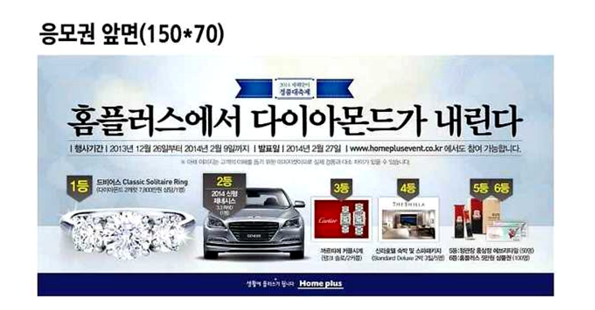
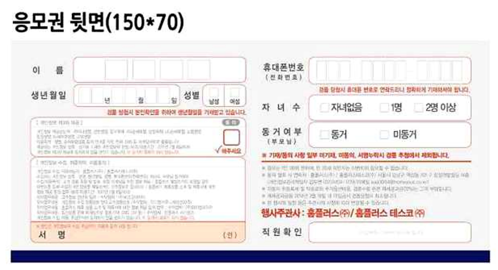

## 1. 들어가며

웹사이트에 가입하거나 이벤트에 참여하다 보면 개인정보 수집 및 이용 동의서를 쉽게 접할 수 있다. 하지만 모든 내용을 꼼꼼하게 읽고 동의하는 사람은 얼마나 될까?

이번에 공부한 판례는 홈플러스가 경품행사를 통해 고객들의 개인정보를 수집하고 이를 보험회사에 판매한 사건이다. 특히 개인정보 제공에 관한 내용을 **약 1mm 크기의 글씨**로 작성했다는 점이 눈에 띄었다.

처음에는 명백한 개인정보 보호법 위반이라고 생각했지만, 찾아보니 2016년 1심과 2심에서는 모두 무죄를 선고했다.

어떤 근거로 무죄를 선고했는지 궁금해 하급심과 대법원의 판결문을 비교해 보았다.

---

## 2. 홈플러스 개인정보 판매 사건

### 2.1. 판례 정보

| 구분 | 내용 |
|---|---|
| 사건번호 | 2016도13263 |
| 법원 | 대법원 제3부 |
| 선고일 | 2017년 4월 7일 |
| 판결 결과 | 원심판결 파기환송 |

**심급별 판결문**

| 심급 | 사건번호 | 선고일 | 원문 |
|---|---|---|---|
| 1심 | 2015고단510 | 2016.01.08. | [판결문](https://www.law.go.kr/LSW/precInfoP.do?precSeq=186011) |
| 2심 | 2016노223 | 2016.08.12. | [판결문](https://www.law.go.kr/LSW/precInfoP.do?evtNo=2016노223) |
| 대법원 | 2016도13263 | 2017.04.07. | [판결문](https://www.law.go.kr/LSW/precInfoP.do?precSeq=184700) |

판결문에서는 사건 관계자들의 이름을 익명으로 표시하고 있다. 처음 판결문을 읽을 때 헷갈리지 않도록 주요 관계자들을 정리했다.

| 판결문 표기 | 실제 관계 |
|---|---|
| 피고인 1 | 당시 홈플러스 대표이사 |
| 피고인 9 회사 | 홈플러스 주식회사 |
| 공소외 1·2 회사 | 제휴 보험회사 |

이 사건에서 고객의 개인정보를 수집하고 관리하는 홈플러스는 **개인정보처리자**, 고객은 **정보주체**에 해당한다.

---

### 2.2. 경품행사를 통한 개인정보 판매

홈플러스는 2011년 12월부터 2014년 6월까지 총 11차례 경품행사를 열었다.

자동차나 다이아몬드 반지와 같은 고가의 경품을 내걸고 고객들의 참여를 유도했지만, 대법원이 주목한 경품행사의 주된 목적은 고객들의 개인정보를 수집해 보험회사에 판매하는 것이었다.

**개인정보 수집 및 판매 규모**

| 구분 | 규모 |
|---|---:|
| 수집한 개인정보 | 약 712만 건 |
| 판매한 개인정보 | 약 600만 건 |
| 판매대금 | 약 119억 원 |
| 판매 단가 | 건당 1,980원 |

※ 경품행사 관련 공소사실에 기재된 규모로, 기존 회원정보까지 포함한 전체 사건 규모와는 차이가 있다.

**수집한 개인정보**

| 수집 항목 | 경품행사와의 관련성 |
|---|---|
| 이름 및 휴대전화번호 | 당첨자 확인 및 연락 |
| 생년월일 및 성별 | 본인 확인 등에 활용 가능 |
| 자녀 수 | 경품 추첨과 직접적인 관련성 부족 |
| 부모와의 동거 여부 | 경품 추첨과 직접적인 관련성 부족 |

이름이나 연락처는 경품 당첨자를 확인하고 연락하기 위해 필요할 수 있다. 하지만 자녀 수나 부모와의 동거 여부까지 경품 추첨에 필요했을지는 의문이다.

오히려 이러한 정보는 보험회사가 고객에게 적합한 보험상품을 판매하는 데 활용하기 좋은 정보라고 생각한다.

---

### 2.3. 약 1mm 크기의 개인정보 동의 문구

_홈플러스 경품행사 응모권 앞면 (행사 기간: 2013.12.26.~2014.02.09.)_

_응모권 뒷면에 기재된 개인정보 입력란과 동의 문구_

_출처: 2015년 5월 7일 홈플러스 관련 기자간담회 자료집, p.27_

실제 응모권의 앞면과 뒷면을 비교해 보면 차이가 확실히 드러난다.

앞면에는 다이아몬드와 자동차 등 고가의 경품이 눈에 잘 띄도록 배치되어 있다. 반면 뒷면에는 개인정보 입력란과 함께 개인정보 수집 및 제3자 제공에 관한 내용이 약 1mm 크기의 글씨로 적혀 있다.

또한 개인정보 입력이나 동의 사항이 누락되면 경품 추첨에서 제외된다는 안내도 있었다.

소비자에게는 경품에 당첨될 기회를 제공하는 행사였지만, 홈플러스에는 개인정보를 수집하고 판매하는 수단이었던 것이다.

**이러한 방식으로 받은 개인정보 제공 동의를 적법한 동의라고 볼 수 있을까?**

---

## 3. 첫 번째 쟁점 — 개인정보 제공 동의

### 3.1. 검찰과 홈플러스의 주장

| 검찰 측 | 홈플러스 측 |
|---|---|
| 경품행사의 실제 목적을 숨겼다. | 개인정보의 이용 목적을 응모권에 기재했다. |
| 중요한 동의 사항을 알아보기 어렵게 표시했다. | 글씨가 작더라도 내용을 읽을 수 있었다. |
| 경품 추첨에 불필요한 개인정보까지 수집했다. | 고객들로부터 직접 개인정보 처리 동의를 받았다. |
| 부정한 방법으로 개인정보를 취득했다. | 개인정보의 유상 제공 사실까지 고지할 의무는 없다. |

양측의 주장을 비교해 보면 **홈플러스가 고객들의 개인정보를 취득하고 동의를 받는 과정이 적법했는지**가 핵심 쟁점이었다.

특히 개인정보 보호법 제59조 제1호에서는 거짓이나 부정한 수단으로 개인정보를 취득하거나 개인정보 처리에 관한 동의를 받는 행위를 금지하고 있다.

---

### 3.2. 1심 재판부의 판단

**서울중앙지방법원 2016. 1. 8. 선고 2015고단510 판결**

1심 재판부는 홈플러스와 관련 피고인들에게 무죄를 선고했다.

판결문을 읽으면서 가장 눈에 띄었던 부분은 개인정보의 유상 제공에 관한 판단이었다.

당시 개인정보 보호법에서는 다음과 같은 사항을 정보주체에게 고지하도록 규정하고 있었다.

- 개인정보를 제공받는 제3자
- 제공받는 개인정보의 이용 목적
- 제공하는 개인정보의 항목
- 개인정보의 보유 및 이용 기간
- 동의 거부 권리 및 거부에 따른 불이익

그러나 개인정보를 제3자에게 **유상으로 제공하는지 여부**까지 고지하도록 규정하고 있지는 않았다.

1심 재판부는 소비자가 경품에 당첨될 기회를 얻기 위해 자신의 개인정보가 보험회사의 영업에 사용될 것이라는 점을 인식하고 동의했다고 판단했다.

---

### 3.3. 2심 재판부의 판단

**서울중앙지방법원 2016. 8. 12. 선고 2016노223 판결**

2심에서도 검찰의 항소를 기각하고 1심의 무죄 판단을 유지했다.

다만 소비자들의 개인정보 이용 목적에 대한 인식과 관련해 1심의 사실인정에 일부 잘못이 있다고 보면서도, 판결 결과를 바꿀 정도는 아니라고 판단했다.

약 1mm 크기의 글씨에 대해서는 다음과 같은 사정을 고려했다.

| 판단 근거 | 재판부가 고려한 내용 |
|---|---|
| 글씨 크기 | 복권, 의약품 설명서, 서비스 약관 등에서도 비슷한 크기의 글씨를 사용함 |
| 동의 거부 사례 | 일부 응모자는 실제로 개인정보 제공에 동의하지 않음 |
| 확대 응모권 | 응모함 옆에 확대된 응모권을 게시한 사례가 있음 |
| 온라인 응모 | 컴퓨터 화면에서 내용을 확대할 수 있음 |

2심은 이러한 사정을 바탕으로 홈플러스가 의도적으로 글씨를 작게 만들어 소비자가 내용을 읽지 못하도록 방해했다고 인정하기 어렵다고 보았다.

---

### 3.4. 대법원은 무엇을 다르게 보았을까?

**대법원 2017. 4. 7. 선고 2016도13263 판결**

대법원은 개인정보에 대한 동의를 받는 행위만 따로 떼어 판단해서는 안 된다고 보았다.

> 개인정보처리자가 개인정보를 취득하거나 처리에 관한 동의를 받게 된 전 과정을 살펴보아

_대법원 2016도13263 판결 중_

동의 문구가 존재한다는 사실뿐만 아니라 개인정보를 수집하게 된 목적과 과정, 광고 내용, 개인정보의 종류와 규모 등을 함께 고려해야 한다는 것이다.

대법원이 중요하게 본 부분은 다음과 같다.

- **경품행사의 목적:** 개인정보 판매라는 주된 목적을 숨김
- **광고 방식:** 소비자가 고객감사 행사로 오인할 가능성
- **동의 방식:** 중요한 내용을 약 1mm 크기의 글씨로 표시
- **수집 범위:** 경품행사에 불필요한 개인정보까지 요구

대법원은 이러한 사정을 종합해 홈플러스의 행위가 부정한 방법에 의한 개인정보 취득 및 동의에 해당한다고 판단했다.

**하급심과 대법원의 판단 비교**

| 판단 요소 | 1·2심 | 대법원 |
|---|---|---|
| 동의 문구 | 법률상 고지사항이 기재되어 있음 | 실질적인 인지 가능성까지 고려 |
| 글씨 크기 | 읽는 것이 불가능하다고 보기 어려움 | 다른 사정과 함께 종합적으로 판단 |
| 경품행사 | 소비자가 동의하고 참여한 행사 | 실제 목적을 숨긴 개인정보 수집 수단 |
| 결론 | 무죄 | 원심판결 파기환송 |

---

### 3.5. 관련 법 조항

| 개인정보 보호법 | 주요 내용 |
|---|---|
| 제15조 | 개인정보의 수집·이용 |
| 제16조 | 필요한 최소한의 개인정보 수집 |
| 제17조 | 개인정보의 제3자 제공 |
| 제22조 | 개인정보 처리에 관한 동의 방법 |
| 제59조 제1호 | 부정한 방법에 의한 개인정보 취득 및 동의 금지 |
| 당시 제72조 제2호 | 해당 금지행위에 대한 벌칙 |

위 조항들은 개인정보 수집 및 동의의 적법성을 판단하는 데 관련된 규정이다. 모든 조항이 각각 독립적인 형사처벌의 근거가 된 것은 아니며, 이 사건에서는 특히 **제59조 제1호와 당시 제72조 제2호**가 중요하다.

---

### 3.6. 판결문을 읽으면서 든 생각

1심의 판단에서 가장 납득하기 어려웠던 부분은 소비자가 개인정보의 이용 목적을 인식하고 동의했다고 본 점이다.

약 1mm 크기의 글씨는 아무것도 적혀 있지 않은 종이에 작성하더라도 읽기 쉽지 않다. 하물며 실제 응모권처럼 여러 개인정보 입력란과 동의 사항이 함께 배치된 경우에는 내용을 확인하기가 더욱 어려웠을 것이다.

2심 재판부는 복권이나 의약품 설명서에서도 비슷한 크기의 글씨가 사용된다는 점을 고려했다.

하지만 **다른 곳에서도 작은 글씨를 사용한다는 사실이 개인정보 제공에 관한 고지 방식의 적절성을 뒷받침할 수 있을까?**

당시 법률에서 유상 제공 사실까지 고지하도록 규정하지 않았다는 점은 이해할 수 있다. 그러나 유상 제공 사실에 대한 고지 의무가 없다는 것과 소비자가 개인정보의 이용 목적을 충분히 인식했다는 것은 별개의 문제라고 생각한다.

소비자가 동의서에 서명했다는 사실보다 자신이 어떤 내용에 동의하는지 제대로 알 수 있었는지가 더 중요하다.

이러한 점에서 동의를 받는 과정 전체를 고려한 대법원의 판단에 동의한다.

---

## 4. 두 번째 쟁점 — 사전필터링

### 4.1. 사전필터링이란?

홈플러스는 경품행사뿐만 아니라 기존 패밀리카드 회원들의 개인정보도 보험회사에 판매했다.

기존에는 고객에게 전화를 걸어 개인정보 제3자 제공 동의를 받은 뒤 보험회사에 개인정보를 전달했다. 이러한 전화 업무를 **퍼미션 콜(Permission Call)**이라고 한다.

보험회사는 전달받은 개인정보를 자체적으로 보유한 고객정보와 비교해 기존 보험가입자나 블랙리스트에 등록된 고객 등을 제외했다.

그런데 홈플러스 입장에서는 보험회사가 어차피 제외할 고객에게까지 전화를 걸어 동의를 받는 것이 비효율적이었다. 이에 홈플러스는 보험회사에 필터링을 먼저 해달라고 요청했다.

**기존 방식과 사전필터링 방식 비교**

| 단계 | 기존 방식 | 사전필터링 방식 |
|:---:|---|---|
| ① | 고객에게 퍼미션 콜 | **보험회사에 개인정보 전달** |
| ② | 제3자 제공 동의 | 사전필터링 |
| ③ | 보험회사에 개인정보 전달 | 선별된 고객에게 퍼미션 콜 |
| ④ | 필터링 | 제3자 제공 동의 |
| ⑤ | 보험 영업 | 동의한 고객의 정보 판매 및 보험 영업 |

홈플러스는 사전필터링을 통해 불필요한 전화 횟수를 줄이고 비용을 절감할 수 있었다.

하지만 기존 방식과 달리 **고객의 제3자 제공 동의를 받기 전에 이미 보험회사에 개인정보를 전달했다는 점**이 문제가 됐다.

---

### 4.2. 개인정보 처리위탁과 제3자 제공

처음 판결문을 읽을 때는 두 개념의 차이가 쉽게 이해되지 않았다. 다른 기업에 개인정보를 전달한다는 점에서는 동일해 보였기 때문이다.

| 구분 | 처리위탁 | 제3자 제공 |
|---|---|---|
| 관련 법 조항 | 제26조 | 제17조 |
| 처리 목적 | 위탁자의 업무 수행 | 제공받는 자의 자체 목적 |
| 독자적인 이익 | 업무 수행 대가 외에는 없음 | 개인정보 처리에 관한 독자적인 이익 존재 |
| 관리·감독 | 위탁자의 관리·감독 아래 처리 | 자체 목적에 따라 처리 |
| 별도의 제3자 제공 동의 | 원칙적으로 불필요 | 원칙적으로 필요 |

**처리위탁의 예시**

쇼핑몰이 상품 배송을 위해 택배회사에 고객의 주소를 전달하는 경우다. 택배회사는 배송 업무에 대한 대가를 받지만, 고객의 개인정보를 자신의 마케팅에 이용할 수는 없다.

**제3자 제공의 예시**

쇼핑몰이 보험회사에 고객정보를 제공하고, 보험회사가 자신의 보험상품 판매를 위해 해당 정보를 처리하는 경우다.

처음에는 개인정보를 처리하면서 이익을 얻는다면 모두 제3자 제공에 해당하는 것인지 헷갈렸다.

하지만 단순히 업무 수행에 따른 대가를 받는 것과 개인정보 처리 자체에 관해 독자적인 이익을 가지는 것은 다르다.

결국 **누구의 목적과 이익을 위해 개인정보를 처리하는지**, 그리고 개인정보를 제공한 기업이 이를 실질적으로 관리하고 감독하는지가 중요한 판단 기준이다.

---

### 4.3. 1·2심 재판부의 판단

| 검찰 측 | 홈플러스 측 |
|---|---|
| 보험회사가 자신의 영업을 위해 개인정보를 처리했다. | 불필요한 퍼미션 콜을 줄이기 위해 업무 일부를 맡겼다. |
| 개인정보 제3자 제공에 해당한다. | 개인정보 처리위탁에 해당한다. |

2016년 1·2심 재판부는 홈플러스 측의 입장을 받아들였다.

홈플러스가 업무 효율을 높이기 위해 사전필터링을 요청했고, 보험회사는 기존에 하던 필터링을 미리 수행한 것에 불과하다고 보았다.

또한 보험회사가 최종적으로 구매할 수 있는 개인정보가 사전필터링으로 인해 증가하는 것도 아니라고 판단했다.

따라서 하급심은 사전필터링을 홈플러스의 업무를 위한 **개인정보 처리위탁**으로 보았다.

---

### 4.4. 대법원의 판단 — 보험회사의 독자적인 이익

2017년 4월 7일 대법원은 보험회사가 얻는 독자적인 이익에도 주목했다.

> 위 보험회사들은 위와 같은 업무 처리에 관하여 독자적인 이익을 가진다고 볼 수 있다.

_대법원 2016도13263 판결 중_

보험회사가 기존 보험가입자나 블랙리스트에 등록된 고객을 걸러내는 것은 보험상품 판매에 적합한 대상자를 선정하고 텔레마케팅의 효율을 높이기 위한 업무이기도 하다.

| 홈플러스의 이익 | 보험회사의 이익 |
|---|---|
| 불필요한 퍼미션 콜 감소 | 기존 보험가입자 제외 |
| 전화 업무 비용 절감 | 블랙리스트 고객 제외 |
| 개인정보 판매 업무 효율 향상 | 보험 영업에 적합한 고객 선별 |

홈플러스가 요청해 필터링 시점이 앞당겨졌다고 해서 보험회사의 업무 목적 자체가 달라지는 것은 아니다.

**홈플러스가 이익을 얻는다는 사실과 보험회사가 독자적인 이익을 얻는다는 사실은 동시에 성립할 수 있기 때문이다.**

---

### 4.5. 대법원의 판단 — 관리·감독 문제

대법원은 홈플러스가 보험회사의 개인정보 처리 과정을 실질적으로 관리하고 감독했는지도 고려했다.

판결문에 따르면 보험회사 담당 직원들은 개인정보 데이터베이스를 업무용 컴퓨터에 다운로드한 후 자유롭게 복사, 편집, 이용 및 전송할 수 있었다.

| 판단 요소 | 판결문에서 지적한 내용 |
|---|---|
| 개인정보 접근 | 직원의 업무용 컴퓨터에 DB 다운로드 |
| 데이터 통제 | 자유로운 복사·편집·이용·전송 가능 |
| 업무 범위 | 명확한 필터링 기준이 제시된 것으로 보이지 않음 |
| 관리·감독 | 홈플러스의 실질적인 관리·감독이 이루어지지 않은 것으로 보임 |

정상적인 처리위탁이라면 위탁자는 수탁자가 정해진 업무 범위 내에서 개인정보를 처리하도록 관리하고 감독해야 한다.

그러나 이 사건에서는 보험회사가 개인정보를 독립적으로 처리할 수 있었던 것으로 보인다.

**대법원의 최종 판단**

| 판단 기준 | 1·2심 | 대법원 |
|---|---|---|
| 업무의 목적 | 홈플러스의 업무 효율 향상 | 양사의 업무 및 이익 |
| 보험회사의 이익 | 독자적인 이익을 인정하기 어려움 | 독자적인 이익 존재 |
| 관리·감독 | 처리위탁으로 판단 | 실질적인 관리·감독 관계에 주목 |
| 결론 | 처리위탁 | 제3자 제공 |

대법원은 개인정보 보호법 제17조와 제26조, 당시 정보통신망법 제24조의2와 제25조에 관한 법리 등을 오해하고 필요한 심리를 다하지 않았다는 이유로 원심의 판단에 잘못이 있다고 보았다.

---

### 4.6. 관리·감독을 철저하게 했다면?

이 부분을 읽으면서 한 가지 의문이 들었다.

> 만약 홈플러스가 보험회사 직원들의 개인정보 접근권한을 제한하고 복사와 전송을 철저하게 관리했다면 처리위탁으로 인정할 수 있었을까?

처음에는 관리·감독이 충분했다면 처리위탁으로 볼 수도 있지 않을까 생각했다.

하지만 판결문을 다시 살펴보니 관리·감독이 강화되더라도 보험회사가 자신의 보험 영업에 적합한 고객을 선별한다는 업무의 목적 자체는 달라지지 않는다.

| 판단 요소 | 실제 사건 | 관리·감독을 강화했다면 |
|---|---|---|
| 개인정보 복사·전송 | 자유롭게 가능 | 제한 가능 |
| 홈플러스의 관리·감독 | 미흡한 것으로 보임 | 강화 가능 |
| 보험회사의 독자적인 이익 | 존재 | 여전히 존재 |

여러 판단 요소를 종합적으로 고려해야 하므로 결과를 단정할 수는 없지만, 관리·감독을 강화하는 것만으로 제3자 제공이 처리위탁으로 바뀌기는 어려웠을 것이라고 생각한다.

홈플러스가 기존 방식대로 고객의 유효한 동의를 먼저 받고 개인정보를 전달했다면 적어도 사전필터링 단계에서 동의 없이 개인정보를 제공하는 문제는 피할 수 있었을 것이다.

**기업의 업무 효율성과 비용 절감도 중요하지만, 이를 위해 소비자의 개인정보 자기결정권을 침해해서는 안 된다고 생각한다.**

---

## 5. 판결 결과와 이후 손해배상 소송

### 5.1. 형사재판 결과

| 시기 | 재판 과정 | 결과 |
|---|---|---|
| 2016.01.08. | 1심 | 무죄 |
| 2016.08.12. | 2심 | 무죄 유지 |
| 2017.04.07. | 대법원 | 원심판결 파기환송 |
| 2018년 | 파기환송심 | 유죄 |
| 2019년 | 재상고심 | 유죄 확정 |

대법원은 2017년 4월 7일 원심판결을 파기하고 사건을 서울중앙지방법원으로 돌려보냈다.

이후 파기환송심에서 유죄를 선고했고, 2019년 8월 유죄 판결이 확정됐다는 사실이 보도됐다.

최종적으로 홈플러스 법인에는 **벌금 7,500만 원**이 확정됐다.

---

### 5.2. 형사재판과 민사재판

_2015년 3월 2일 한국소비자단체협의회의 홈플러스 개인정보 불법매매 집단소송 기자회견 (출처: 연합뉴스)_

관련 기사를 찾아보던 중 조금 헷갈리는 부분이 있었다.

형사 판결문에서는 1·2심에서 무죄를 선고했다고 나와 있었는데, 2024년 5월 17일 경향신문의 기사에서는 1심부터 홈플러스의 손해배상 책임을 인정했다고 나와 있었기 때문이다.

찾아보니 개인정보 보호법 위반에 대한 형사재판과 피해자들이 제기한 손해배상 관련 민사재판은 별개였다.

| 구분 | 형사재판 | 민사재판 |
|---|---|---|
| 목적 | 범죄에 대한 처벌 | 피해자의 권리 구제 |
| 당사자 | 검사와 피고인 | 원고와 피고 |
| 주요 결과 | 징역, 벌금, 무죄 등 | 손해배상 등 |
| 대법원 사건번호 | 도 | 다 |

대법원 사건번호에서도 형사사건은 '도', 민사사건은 '다'를 사용하는 것을 확인할 수 있었다.

홈플러스에 부과된 벌금은 국가에 납부하는 것이고, 손해배상금은 피해 고객에게 지급하는 것이다.

따라서 형사재판에서 홈플러스의 유죄가 인정됐다고 해서 모든 피해 고객에게 자동으로 손해배상이 이루어지는 것은 아니다.

---

### 5.3. 피해자의 입증책임

민사재판에서는 개인정보가 실제로 보험회사에 제공됐다는 사실을 누가 증명해야 하는지가 쟁점이었다.

| 심급 | 선고 시기 | 주요 판단 |
|---|---|---|
| 1심 | 2017년 | 기업이 개인정보를 제공하지 않았다는 사실을 증명해야 함 |
| 2심 | 2018년 | 고객이 자신의 개인정보가 제공됐다는 사실을 증명해야 함 |
| 대법원 | 2024.05.17. | 법 위반행위 자체는 정보주체가 증명해야 함 |

경향신문의 보도에 따르면 1심에서는 284명에 대한 손해배상 책임을 인정했지만, 2심에서는 고객에게 개인정보 제공 사실에 대한 입증책임을 부여하면서 배상 인정 대상자가 152명으로 줄었다.

2024년 대법원은 해당 상고심 심리 대상 중 4명에게 각각 5만~30만 원의 위자료를 인정한 원심 판단을 유지했다.

※ 전체 소송의 최종 배상 대상자가 4명뿐이라는 의미는 아니다.

**개인정보 보호법 제39조 제1항과 입증책임**

| 입증할 내용 | 입증책임 |
|---|---|
| 개인정보 보호법 위반행위의 존재 | 정보주체 |
| 고의 또는 과실이 없었다는 사실 | 개인정보처리자 |

**관련 판결:** [대법원 2024. 5. 17. 선고 2018다262103 판결](https://www.law.go.kr/LSW/precInfoP.do?precSeq=240813)

개인정보 처리 기록은 대부분 기업이 가지고 있을 텐데, 일반 소비자가 자신의 개인정보가 어느 기업에 제공됐는지 직접 확인하고 증명하는 것이 현실적으로 얼마나 가능할지 의문이 들었다.

기업의 위법행위를 처벌하는 것과 실제 피해자가 구제받는 것은 또 다른 문제라는 점도 알게 됐다.

---

## 6. 현재 개인정보 보호법에서는?

### 6.1. 사건 이후 달라진 동의 요건

대법원 판결이 나온 2017년 4월 이후 개인정보 보호법의 동의 방법에 관한 규정도 개정됐다.

| 시기 | 주요 내용 |
|---|---|
| 2017.04.07. | 홈플러스 사건 대법원 파기환송 판결 |
| 2017.04.18. | 개인정보 보호법 제22조 제2항 신설 개정법 공포 |
| 2017.10.19. | 해당 개정법 시행 |

개정된 제22조 제2항에서는 서면으로 개인정보 처리에 관한 동의를 받을 때 중요한 내용을 명확하게 표시하고 알아보기 쉽게 해야 한다고 규정했다.

현행 개인정보 보호법 시행령 제17조 제1항에서도 다음과 같은 동의 요건을 확인할 수 있다.

- **자유로운 선택:** 정보주체가 자유롭게 동의 여부를 결정할 수 있어야 함
- **명확성:** 동의 내용이 구체적이고 명확해야 함
- **가독성:** 쉽게 읽고 이해할 수 있는 문구를 사용해야 함
- **의사표시:** 동의 여부를 명확하게 표시할 수 있어야 함

사건 당시에도 정보주체가 동의 사항을 명확하게 인지할 수 있도록 해야 한다는 의무가 있었다. 이후 법 개정을 통해 이러한 의무가 더욱 구체화됐다.

다만 법 개정 시기가 이 사건의 대법원 판결과 가깝다는 사실만으로 홈플러스 사건이 법 개정의 직접적인 원인이었다고 단정할 수는 없다.

---

### 6.2. 현재 동일한 사건이 발생한다면?

2026년 11월 25일 기준 개인정보 보호법을 바탕으로 동일한 사건이 발생했을 경우를 생각해 보았다.

| 쟁점 | 관련 법 조항 | 검토 사항 |
|---|---|---|
| 1mm 동의 문구 | 제22조 | 중요한 내용을 알아보기 쉽게 표시했는지 |
| 불필요한 정보 수집 | 제16조 | 필요한 최소한의 개인정보만 수집했는지 |
| 사전필터링 | 제17조 | 제3자 제공에 관한 적법한 근거가 있는지 |
| 개인정보 처리위탁 | 제26조 | 적절한 관리·감독이 이루어졌는지 |
| 개인정보 안전 관리 | 제29조 | 필요한 안전성 확보 조치를 했는지 |

현행법에는 정보주체의 동의 없이도 개인정보를 제3자에게 제공할 수 있는 예외가 존재한다.

그러나 기존 회원정보를 보험회사의 영업을 위해 사전 제공하는 행위에 이러한 예외가 적용될 수 있는지는 별도로 검토해야 한다.

이 사건과 동일한 사실관계라면 현재도 위법성이 인정될 가능성이 높다고 생각한다. 특히 동의 방법에 관한 규정이 구체화됐다는 점에서 약 1mm 크기의 동의 문구에 대해서도 보다 명확하게 문제를 제기할 수 있을 것이다.

---

## 7. 마치며

이번 판례를 분석하면서 대법원의 판단뿐만 아니라 1·2심에서 어떤 근거로 무죄를 선고했는지 직접 확인할 수 있었다.

나는 개인정보 수집과 동의 과정 전체를 고려하고, 사전필터링의 실질적인 목적과 관리·감독 관계를 함께 검토한 대법원의 판단에 동의한다.

특히 인상 깊었던 것은 **개인정보의 안전한 관리와 개인정보 처리의 적법성이 서로 다른 문제**라는 점이다.

홈플러스가 보험회사의 개인정보 접근권한을 제한하고 데이터 복사와 전송을 철저하게 통제했더라도, 그것만으로 개인정보를 제공하는 행위 자체가 적법해지는 것은 아니기 때문이다.

---

### 정보보안 실무에서 참고할 점

| 개선 방안 | 적용 목적 |
|---|---|
| 동의 화면의 가독성 개선 | 소비자의 실질적인 이해와 선택 보장 |
| 최소 권한 원칙 | 필요한 범위 내에서만 개인정보 접근 허용 |
| 데이터 반출 통제 | 불필요한 복사 및 외부 전송 방지 |
| 개인정보 처리 이력 관리 | 접근 및 제공 내역 확인 |
| 외부 업체 관리·감독 | 업무 범위 준수 여부 확인 |
| 개인정보 파기 확인 | 업무 종료 후 불필요한 정보 보유 방지 |

특히 개인정보 제공 이력은 기업의 관리·감독뿐만 아니라 향후 피해자가 자신의 개인정보 침해 사실을 확인하는 데에도 도움이 될 수 있을 것이다.

위 조치들은 판결문에서 지적한 문제와 관련해 생각해 본 개선 방안이며, 실제 홈플러스가 모든 조치를 이행하지 않았다는 의미는 아니다.

평소 정보보안을 공부하면서 개인정보 보호라고 하면 암호화나 접근통제와 같은 기술적인 부분을 먼저 떠올렸다.

하지만 이번 판례를 통해 개인정보를 왜 수집하는지, 누구에게 어떤 목적으로 제공하는지, 소비자가 이러한 내용을 제대로 알고 동의했는지까지 함께 고려해야 한다는 점을 배웠다.

**개인정보를 안전하게 관리하는 것만큼이나 적법하게 수집하고 이용하는 것도 중요하다고 생각한다.**

---

## 참고자료

### 판결문

- [서울중앙지방법원 2016. 1. 8. 선고 2015고단510 판결](https://www.law.go.kr/LSW/precInfoP.do?precSeq=186011)
- [서울중앙지방법원 2016. 8. 12. 선고 2016노223 판결](https://www.law.go.kr/LSW/precInfoP.do?evtNo=2016노223)
- [대법원 2017. 4. 7. 선고 2016도13263 판결](https://www.law.go.kr/LSW/precInfoP.do?precSeq=184700)
- [대법원 2024. 5. 17. 선고 2018다262103 판결](https://www.law.go.kr/LSW/precInfoP.do?precSeq=240813)

---

### 법령

- [국가법령정보센터 — 개인정보 보호법](https://www.law.go.kr/법령/개인정보보호법)
- [국가법령정보센터 — 개인정보 보호법 시행령](https://www.law.go.kr/법령/개인정보보호법시행령)

---

### 관련 기사 및 자료

- [연합뉴스 — 홈플러스 경품행사 관련 보도 (2015.04.27.)](https://www.yna.co.kr/view/AKR20150427076300002)
- [참여연대 — 판사 눈에만 보이는 1mm의 상식](https://peoplepower21.org/judiciary/1388296)
- [대법원 — 홈플러스 경품행사 관련 행정 및 형사사건 보도자료 (2017.04.07.)](https://scourt.go.kr/portal/news/NewsViewAction.work?gubun=6&seqnum=1276)
- [연합뉴스 — 홈플러스 개인정보 관련 손해배상 보도 (2017.10.24.)](https://www.yna.co.kr/view/AKR20171024091500004)
- [연합뉴스 — 홈플러스 개인정보 판매 관련 형사재판 보도 (2019.08.06.)](https://www.yna.co.kr/view/AKR20190805112800004)
- 경향신문 — 홈플러스 개인정보 판매 관련 손해배상 판결 보도 (2024.05.17.)
- 홈플러스 관련 기자간담회 자료집 (2015.05.07.), p.27
