네트워크 보안을 공부하면서 방화벽의 개념과 역할에 대해서는 접한 적이 있었지만, IDS와 IPS는 이번 미션을 통해 처음 접하게 되었다.

처음에는 IDS는 침입을 탐지하고 IPS는 침입을 탐지하고 차단하는 시스템이라는 차이부터 공부했다. 그 과정에서 자동으로 공격을 차단할 수 있는 IPS가 있는데도 IDS를 사용하는 이유와 두 시스템이 방화벽과 어떤 차이가 있는지 궁금해졌다.

이번 글에서는 IDS와 IPS의 기본 개념부터 탐지 방식, 장단점, 실제 네트워크 배치 구조까지 살펴보고, 학습 과정에서 궁금했던 부분과 새롭게 알게 된 내용을 정리하고자 한다.

---

## 1. IDS와 IPS란?

### 1.1 IDS(Intrusion Detection System)

IDS는 **침입 탐지 시스템**으로, 네트워크 트래픽이나 시스템 내부에서 발생하는 활동을 분석하여 의심스러운 행위나 침입 시도를 탐지하는 보안 시스템이다.

**주요 탐지 대상**

- 알려진 공격 패턴이 포함된 네트워크 트래픽
- 비정상적인 로그인 시도
- 중요 시스템 파일의 변경
- 의심스러운 프로세스 실행

침입으로 의심되는 활동이 발견되면 경고를 발생시키고 관련 정보를 로그로 기록한다.

일반적인 수동형 IDS는 트래픽을 직접 차단하지 않기 때문에 관리자가 탐지 결과를 확인한 뒤 추가적인 대응을 수행해야 한다.

---

### 1.2 IPS(Intrusion Prevention System)

IPS는 **침입 방지 시스템**으로, 위협을 탐지하는 기능뿐만 아니라 설정된 정책에 따라 공격을 자동으로 차단하는 기능을 제공한다.

네트워크 기반 IPS는 다음과 같은 대응을 수행할 수 있다.

- 악성 패킷 폐기
- 비정상적인 연결 차단
- 특정 공격 패턴에 해당하는 트래픽 차단

IDS와 IPS의 개념을 처음 공부했을 때는 IPS가 IDS에 차단 기능까지 추가한 시스템이므로 IPS를 사용하는 것이 더 효과적이지 않을까 하는 의문이 들었다.

하지만 오탐, 장비 장애, 네트워크 성능 등의 문제를 살펴보면서 두 시스템을 단순히 기능의 우열로 구분하기는 어렵다는 것을 알게 되었다.

---

## 2. IDS의 유형

### 2.1 호스트 기반 IDS(HIDS)

HIDS(Host-based Intrusion Detection System)는 개별 컴퓨터나 서버에서 발생하는 활동을 감시하는 침입 탐지 시스템이다.

여기서 호스트(Host)는 네트워크에 연결되어 통신할 수 있는 장치를 의미하며, 개인용 컴퓨터나 웹 서버, 데이터베이스 서버 등이 이에 해당한다.

일반적으로 보호하려는 호스트에 에이전트를 설치하여 운영체제 내부에서 발생하는 이벤트를 수집하고 분석한다.

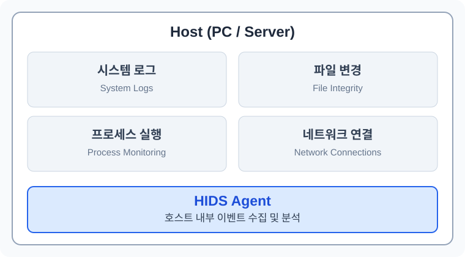
_HIDS의 설치 위치 및 주요 감시 대상_

**주요 감시 대상**

- 시스템 및 인증 로그
- 파일 생성과 변경
- 프로세스 실행
- 시스템 설정 변경
- 해당 호스트의 네트워크 연결 정보

**장점**

- 네트워크 트래픽만으로 확인하기 어려운 시스템 내부의 활동을 감시할 수 있다.
- 파일 변경이나 악성 프로세스 실행 등 침해 흔적을 확인하는 데 유용하다.
- 호스트에서 수집한 로그를 통해 네트워크 공격으로 발생한 이상 징후를 분석할 수 있다.

**단점**

- 감시 대상 호스트마다 에이전트 설치 및 관리가 필요할 수 있다.
- CPU와 메모리 등 호스트의 자원을 사용한다.
- 감시 대상이 침해되면 탐지 시스템 자체도 영향을 받을 수 있다.

---

### 2.2 네트워크 기반 IDS(NIDS)

NIDS(Network-based Intrusion Detection System)는 네트워크에서 오가는 트래픽을 분석하여 침입 시도를 탐지하는 시스템이다.

특정 네트워크 구간에서 패킷을 수집하며, 패킷의 내용이나 통신 패턴 등을 분석한다.

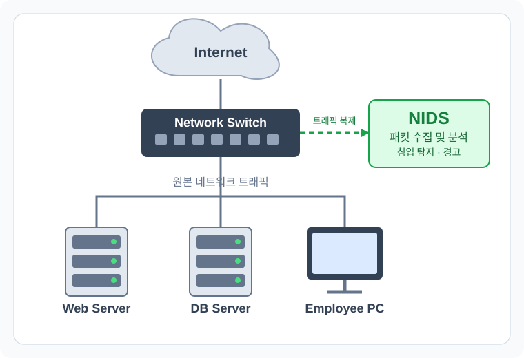
_스위치에서 복제된 트래픽을 수집하고 분석하는 NIDS_

스위치의 포트 미러링(Port Mirroring) 기능이나 네트워크 TAP 등을 이용하면 실제 통신에 개입하지 않고 복제된 트래픽을 NIDS에 전달할 수 있다.

**주요 감시 대상**

- 패킷 및 프로토콜 정보
- 알려진 네트워크 공격 패턴
- 비정상적인 연결 시도
- 트래픽 양과 통신 패턴
- 외부 서버와의 의심스러운 통신

**장점**

- 하나의 감시 지점에서 여러 시스템의 통신을 관찰할 수 있다.
- 네트워크를 통한 공격 시도나 비정상적인 통신 패턴을 파악하기에 유리하다.

**단점**

- 센서의 감시 범위에 포함되지 않는 트래픽은 분석하기 어렵다.
- 암호화된 트래픽의 상세 내용을 확인하는 데 한계가 있다.
- 시스템 내부에서 발생하는 파일 변경이나 프로세스 실행을 직접 확인하기 어렵다.

---

### 2.3 HIDS와 NIDS의 차이 및 상호보완 관계

처음 HIDS와 NIDS의 개념을 공부하면서 두 시스템의 분류 기준이 무엇인지 궁금했다.

호스트 기반 IDS는 컴퓨터 내부를 감시하고 네트워크 기반 IDS는 컴퓨터 외부를 감시하는 것인지, 그렇다면 HIDS는 네트워크를 통한 공격 자체를 탐지할 수 없는 것인지 의문이 들었다.

하지만 두 시스템의 분류 기준은 공격이 내부에서 발생했는지 외부에서 발생했는지가 아니라, **어디에서 어떤 정보를 수집하여 침입을 탐지하는가**에 있다.

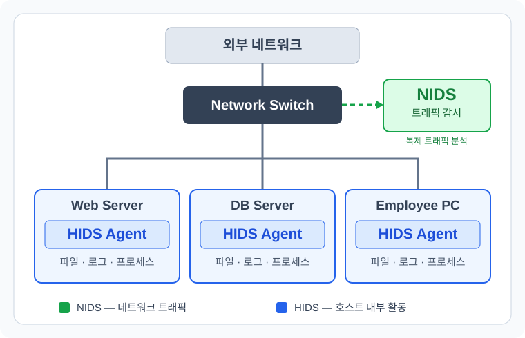
_HIDS와 NIDS의 설치 위치 및 감시 대상 비교_

예를 들어 공격자가 웹 서버에 침입하여 악성 파일을 생성하고 외부로 데이터를 전송하는 상황을 생각해 보았다.

| 공격 행위 | 상대적으로 유리한 시스템 |
|---|---|
| 비정상적인 네트워크 접근 | NIDS |
| 악성 파일 생성 | HIDS |
| 악성 프로세스 실행 | HIDS |
| 외부 서버와의 비정상적인 통신 | NIDS |
| 대량의 데이터 전송 | NIDS |

HIDS도 인증 로그나 네트워크 연결 정보를 통해 네트워크를 통한 공격을 탐지할 수 있다. 다만 다른 호스트 간의 통신이나 네트워크 전체의 트래픽을 감시하는 데는 한계가 있다.

NIDS가 공격 시도를 놓치더라도 HIDS가 서버 내부의 침해 흔적을 발견할 수 있으며, 반대로 HIDS에서 확인하기 어려운 네트워크상의 이상 징후를 NIDS가 발견할 수도 있다.

따라서 두 시스템은 어느 하나가 더 우수하다기보다는 **서로의 한계를 보완하는 관계**라고 생각한다.

이처럼 여러 보안 수단을 활용하여 각각의 한계를 보완하는 방식은 심층 방어(Defense in Depth) 전략과도 연결된다.

---

### 2.4 그 밖의 IDS/IPS 유형

NIST SP 800-94에서는 침입 탐지 및 방지 기술을 크게 네 가지로 분류한다.

| 유형 | 주요 감시 대상 |
|---|---|
| 네트워크 기반 | 네트워크 트래픽 및 프로토콜 |
| 호스트 기반 | 개별 호스트의 내부 활동 |
| 무선 네트워크 기반 | 무선 네트워크 및 무선 프로토콜 |
| 네트워크 행위 분석(NBA) | 트래픽 양과 네트워크 연결 패턴 |

무선 기반 시스템은 비인가 무선 접근점이나 비정상적인 무선 통신 등을 탐지하는 데 활용할 수 있다.

네트워크 행위 분석은 평소와 다른 트래픽 흐름이나 연결 패턴을 파악하는 데 유용하다.

호스트 기반과 네트워크 기반의 분류는 IPS에도 적용할 수 있다. 네트워크 기반 IPS(NIPS)는 네트워크상의 위협을 탐지하고 차단하며, 호스트 기반 IPS(HIPS)는 개별 호스트에서 정책에 위배되는 프로그램 실행이나 시스템 접근 등을 차단할 수 있다.

---

## 3. 침입 탐지 방식

HIDS와 NIDS가 감시 대상에 따른 분류라면, 탐지 방식은 수집한 정보를 어떤 기준으로 분석하는지에 따른 분류이다.

대표적인 탐지 방식으로는 시그니처 기반 탐지, 이상행위 기반 탐지, 상태 기반 프로토콜 분석이 있다.

### 3.1 시그니처 기반 탐지(Signature-based Detection)

시그니처 기반 탐지는 이미 알려진 공격의 특징이나 패턴을 탐지 규칙으로 정의하고, 수집한 데이터와 비교하는 방식이다.

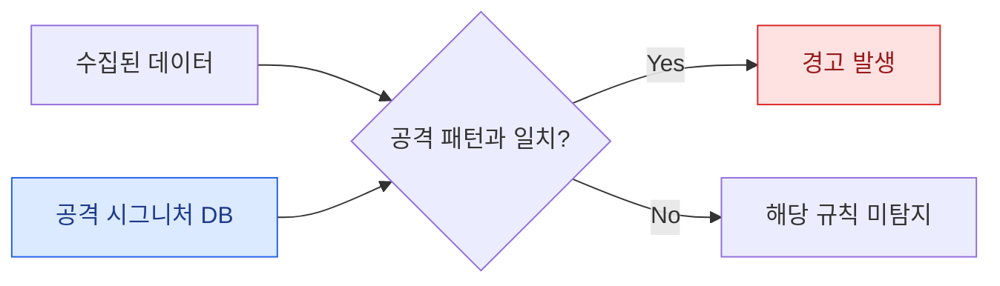

예를 들어 알려진 SQL Injection 공격 패턴을 탐지 규칙으로 등록하면, 해당 패턴과 일치하는 요청이 발생했을 때 경고를 생성할 수 있다.

**장점**

- 알려진 공격을 탐지하는 데 효과적이다.
- 어떤 공격 패턴에 의해 탐지되었는지 확인하기 쉽다.

**단점**

- 기존 시그니처에 해당하지 않는 새로운 공격을 놓칠 수 있다.
- 새로운 공격에 대응하기 위해 탐지 규칙을 지속적으로 업데이트해야 한다.

---

### 3.2 이상행위 기반 탐지(Anomaly-based Detection)

이상행위 기반 탐지는 정상적인 활동을 기준선(Baseline)으로 설정하고, 평소와 다른 행동이 발생하는지 분석하는 방식이다.

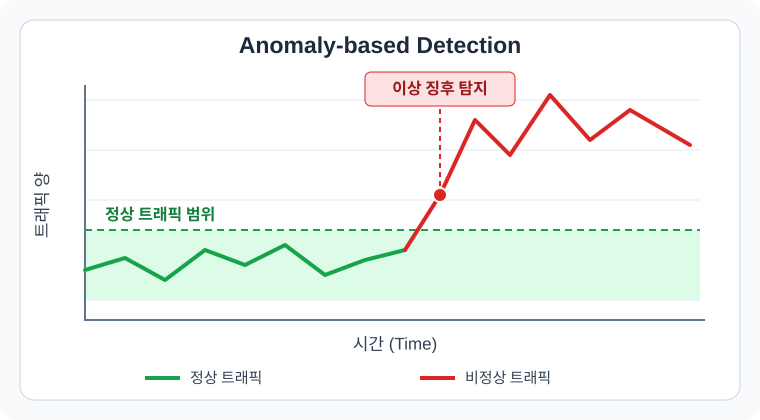
_정상 트래픽의 기준 범위를 벗어난 이상 징후 탐지 (가상 사례)_

처음에는 단순히 평소보다 트래픽 양이 증가하는 경우를 탐지하는 방식이라고 생각했다.

하지만 트래픽 양뿐만 아니라 로그인 시간, 접속 빈도, 통신 대상 등 다양한 정보를 활용할 수 있다.

| 감시 대상 | 정상행위 | 이상행위 |
|---|---|---|
| 트래픽 양 | 일정한 수준 유지 | 갑작스러운 증가 |
| 로그인 | 평소 시간대에 접속 | 새벽 시간대의 반복 접속 |
| 통신 대상 | 기존 서버와 통신 | 새로운 외부 서버와 통신 |
| 파일 접근 | 업무 관련 파일 접근 | 중요 파일에 대한 대량 접근 |

**장점**

- 알려진 공격 패턴에 해당하지 않더라도 이상 징후를 통해 새로운 공격을 탐지할 가능성이 있다.

**단점**

- 정상적인 업무나 서비스 이용량의 변화도 공격으로 잘못 판단할 수 있다.
- 정상행위의 기준을 지속적으로 관리해야 한다.
- 새로운 공격이라도 정상행위와 유사하다면 탐지하지 못할 수 있다.

그래프처럼 정상 범위를 벗어난 트래픽이 발생하더라도 반드시 공격이라고 볼 수는 없다. 정상적인 업무나 서비스 이용 과정에서도 평소와 다른 트래픽이 발생할 수 있기 때문이다.

---

### 3.3 상태 기반 프로토콜 분석(Stateful Protocol Analysis)

상태 기반 프로토콜 분석은 프로토콜의 정상적인 동작 방식과 현재 연결 상태를 바탕으로 비정상적인 통신을 탐지하는 방식이다.

이를 이해하기 위해 기존에 공부했던 TCP의 3-way handshake를 떠올려 보았다.

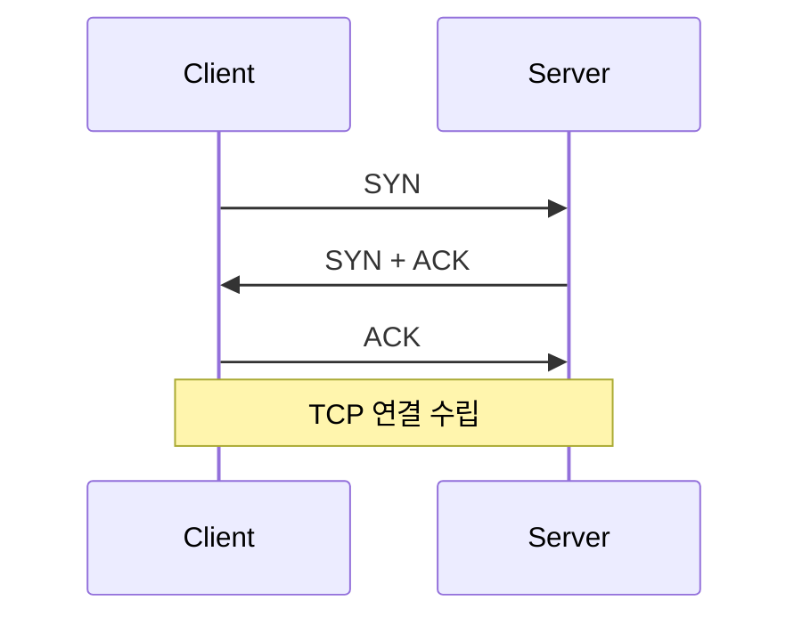

TCP에서는 연결 상태에 따라 주고받아야 하는 패킷의 종류와 순서가 달라진다.

따라서 개별 패킷의 형식이 정상적이더라도, 현재 연결 상태에서 해당 패킷이 등장하는 것이 적절한지 확인할 필요가 있다.

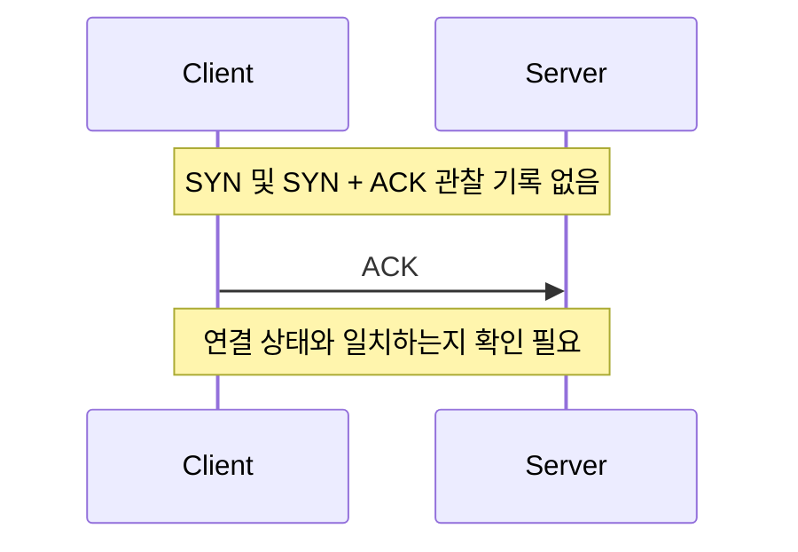

예를 들어 연결 수립 과정이 관찰되지 않았는데 ACK 패킷이 등장한다면 의심스러운 상황으로 판단할 수 있다.

물론 센서가 통신 도중부터 감시했거나 일부 패킷을 수집하지 못했을 수도 있으므로 이를 곧바로 공격으로 단정할 수는 없다.

TCP 연결 상태는 이해를 돕기 위한 예시이며, 실제 상태 기반 프로토콜 분석은 HTTP, FTP 등의 애플리케이션 프로토콜에서 발생하는 비정상적인 메시지나 동작 순서도 분석할 수 있다.

**장점**

- 개별 패킷의 내용만 확인해서는 파악하기 어려운 비정상적인 통신을 탐지할 수 있다.
- 알려진 공격 패턴이 없어도 프로토콜의 규칙을 위반하는 활동을 발견할 수 있다.

**단점**

- 연결 상태와 프로토콜의 동작 정보를 관리하기 위한 추가적인 자원이 필요하다.
- 프로토콜의 정상적인 규칙을 준수하면서 이루어지는 공격은 놓칠 수 있다.

---

### 3.4 세 가지 탐지 방식의 비교

| 구분 | 시그니처 기반 | 이상행위 기반 | 상태 기반 프로토콜 분석 |
|---|---|---|---|
| 판단 기준 | 알려진 공격 패턴 | 정상행위 기준선 | 프로토콜 규칙 및 상태 |
| 주요 강점 | 기존 공격 탐지 | 새로운 이상 징후 탐지 | 비정상적인 프로토콜 사용 탐지 |
| 주요 한계 | 새로운 패턴에 취약 | 정상행위에 대한 오탐 | 규칙을 준수하는 공격 탐지에 한계 |
| 관리 요소 | 시그니처 업데이트 | 기준선 조정 | 프로토콜 및 연결 상태 관리 |

공격자가 TCP와 HTTP의 규칙을 정상적으로 준수하면서 SQL Injection 공격을 시도한다면 어떤 탐지 방식이 효과적일지 생각해 보았다.

처음에는 이상행위 기반 탐지가 적절하다고 생각했지만, 알려진 SQL Injection 공격 패턴이라면 단 한 번의 요청만으로도 시그니처 기반 탐지가 효과적일 수 있다는 점을 알게 되었다.

반대로 기존 시그니처에 해당하지 않는 새로운 공격이 비정상적인 행동을 발생시킨다면 이상행위 기반 탐지가 유리할 수 있다.

다만 새로운 공격이라고 해서 반드시 이상행위 기반 탐지에서 발견되는 것은 아니다. 정상적인 활동과 유사하게 공격이 이루어진다면 탐지하지 못할 수도 있기 때문이다.

**프로토콜의 규칙을 준수한다고 안전한 통신인 것은 아니며, 평소와 다른 활동이라고 반드시 공격인 것도 아니다.**

결국 HIDS와 NIDS의 관계처럼 탐지 방식도 각각의 강점과 한계를 고려하여 함께 활용하는 것이 중요하다.

---

## 4. IDS와 IPS의 동작 구조

### 4.1 IDS — Out-of-band

일반적인 네트워크 기반 IDS는 실제 트래픽이 전달되는 경로 밖에서 복제된 트래픽을 분석한다.

이러한 배치 방식을 Out-of-band(대역 외 방식)라고 한다.

**동작 과정**

1. 클라이언트가 서버로 패킷을 전송한다.
2. 네트워크 장비가 트래픽을 복제하여 IDS에 전달한다.
3. IDS가 패킷의 내용과 통신 패턴을 분석한다.
4. 탐지 조건에 해당하면 경고와 로그를 생성한다.
5. 관리자가 탐지 결과를 확인하고 대응한다.

원본 트래픽은 IDS의 분석 결과를 기다리지 않고 서버에 전달된다.

따라서 공격이 탐지되더라도 해당 요청이 이미 서버에 도달했을 수 있다.

---

### 4.2 IPS — Inline

네트워크 기반 IPS는 일반적으로 실제 트래픽이 통과하는 경로에 설치된다.

이러한 배치 방식을 Inline(인라인 방식)이라고 한다.

**동작 과정**

1. 클라이언트가 서버로 패킷을 전송한다.
2. 패킷이 IPS를 통과한다.
3. IPS가 패킷을 분석하고 탐지 규칙을 검사한다.
4. 차단 정책에 해당하는 트래픽은 폐기하거나 연결을 차단한다.
5. 허용된 트래픽은 목적지로 전달한다.

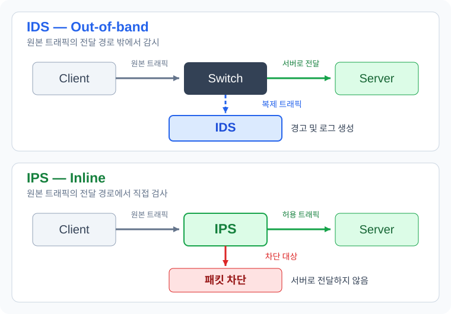
_IDS의 Out-of-band 방식과 IPS의 Inline 방식 비교_

IDS는 복제된 트래픽을 분석하는 반면, IPS는 원본 트래픽의 전달 과정에 직접 개입한다.

이러한 배치 구조의 차이는 탐지와 차단 여부뿐만 아니라 네트워크의 성능과 가용성에도 영향을 준다.

---

### 4.3 IDS와 IPS의 비교

| 구분 | IDS | IPS |
|---|---|---|
| 주요 목적 | 침입 탐지 | 침입 탐지 및 방지 |
| 일반적인 배치 | Out-of-band | Inline |
| 경고 및 로그 | 가능 | 가능 |
| 직접적인 자동 차단 | 일반적으로 불가능 | 정책에 따라 가능 |
| 오탐 발생 시 | 불필요한 경고 | 정상 트래픽 차단 가능 |
| 장비 장애 발생 시 | 탐지 기능 상실 | 통신 중단 가능 |
| 네트워크 성능 | 직접적인 영향이 적음 | 지연 및 병목 발생 가능 |

표에서 비교한 배치 방식은 일반적인 네트워크 기반 IDS와 IPS를 기준으로 한다.

---

## 5. IDS와 IPS의 운영 시 고려사항

### 5.1 오탐과 미탐

침입 탐지 시스템을 운영할 때는 탐지율뿐만 아니라 오탐과 미탐도 고려해야 한다.

| 구분 | 의미 |
|---|---|
| False Positive (오탐) | 정상적인 활동을 공격으로 판단 |
| False Negative (미탐) | 실제 공격을 탐지하지 못함 |

특히 동일한 오탐이 발생하더라도 IDS와 IPS에서 나타나는 결과는 다를 수 있다.

이를 이해하기 위해 대학교 수강신청 서버를 예시로 생각해 보았다.

평소보다 많은 학생이 동시에 접속하면서 트래픽이 급격하게 증가했다고 가정해 보자.

실제 공격이 아닌 정상적인 서비스 이용임에도 이를 이상행위로 판단할 수 있다.

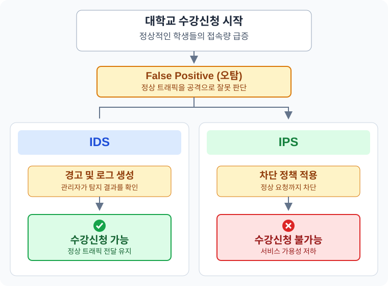
_수강신청 서버에서 오탐이 발생했을 때 IDS와 IPS의 처리 결과 비교 (가상 사례)_

IDS에서는 불필요한 경고가 발생하지만, IPS에서는 차단 정책에 따라 정상적인 학생들의 수강신청 요청까지 차단될 수 있다.

이는 정보보안의 3대 요소인 CIA 중 가용성(Availability)과도 연결된다.

**보안을 강화하기 위해 도입한 시스템이 오히려 정상적인 서비스 이용을 방해할 수도 있다는 점**에서 탐지 정확도와 차단 정책의 중요성을 알 수 있었다.

---

### 5.2 장비 장애가 네트워크에 미치는 영향

IDS와 IPS에 각각 장애가 발생한다면 어떤 차이가 있을지 생각해 보았다.

처음에는 IDS는 탐지 기능을 상실하고, IPS는 탐지 및 방지 기능을 상실한다는 정도로만 생각했다.

하지만 두 시스템의 실제 배치 구조를 살펴보면서 정상적인 네트워크 통신에 미치는 영향도 다르다는 것을 알게 되었다.

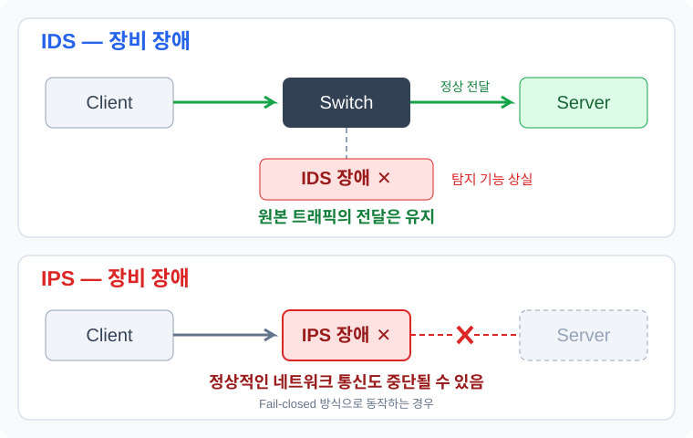
_IDS와 IPS의 장애 발생 시 네트워크 통신에 미치는 영향_

Out-of-band 방식의 IDS는 복제된 트래픽을 분석하므로 장비 자체에 장애가 발생하더라도 원본 트래픽의 전달에는 직접적인 영향을 주지 않는다.

반면 Inline 방식의 IPS는 실제 트래픽이 장비를 통과하기 때문에 장애 대응 설정에 따라 정상적인 통신까지 중단될 수 있다.

즉, IDS와 IPS의 차이는 탐지 및 차단 기능뿐만 아니라 **장애가 실제 서비스에 미치는 영향**에서도 나타난다.

---

### 5.3 Fail-open과 Fail-closed

IPS에 장애가 발생했을 때 어떻게 대응할 것인지도 중요한 운영 요소이다.

대표적으로 Fail-open과 Fail-closed 방식이 있다.

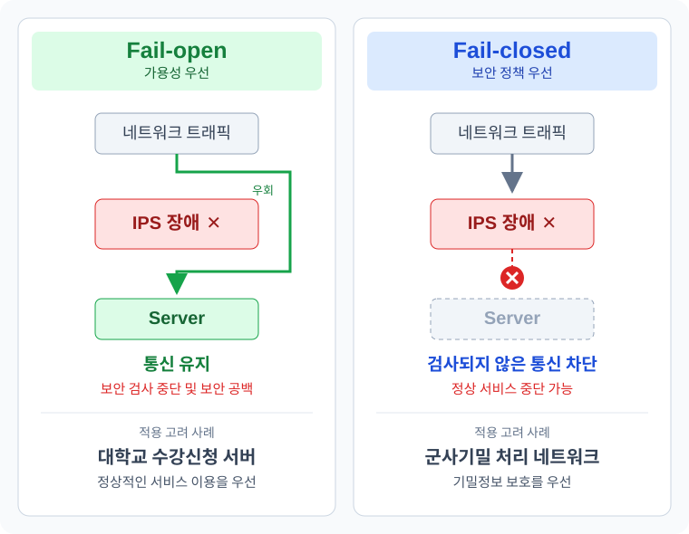
_IPS 장애 대응 방식과 보안성 및 가용성의 관계_

| 구분 | Fail-open | Fail-closed |
|---|---|---|
| 장애 발생 시 | 트래픽 통과 | 트래픽 차단 |
| 서비스 가용성 | 유지 가능 | 중단 가능 |
| 보안 검사 | 일시적으로 중단 | 검사되지 않은 통신 차단 |
| 주요 위험 | 공격 트래픽 통과 | 정상 서비스 중단 |

**대학교 수강신청 서버라면?**

개인적으로 수강신청 서버에서는 Fail-open을 우선 고려할 것 같다.

정해진 시간 동안 학생들이 서비스를 이용해야 하기 때문에 IPS 장애로 모든 요청을 차단하는 것보다 통신을 유지하는 것이 중요하다고 생각했기 때문이다.

다만 검사 기능이 중단되는 동안 발생할 수 있는 위협에 대비하여 다른 보안 수단과 장애 알림 체계도 필요하다.

**군사기밀을 처리하는 네트워크라면?**

반대로 군사기밀을 처리하는 환경에서는 Fail-closed를 우선 고려할 것 같다.

검사되지 않은 외부 트래픽을 내부 네트워크에 허용할 경우 기밀정보가 노출될 위험이 있기 때문이다.

처음에는 군사기밀을 처리하는 환경이라면 무조건 Fail-closed를 적용해야 한다고 생각했다.

하지만 군사 환경에서도 지휘통제나 작전 수행에 필요한 통신의 가용성이 중요할 수 있다. 따라서 해당 시스템의 목적과 위험도를 고려해야 하며, 장비 이중화 등의 방안도 함께 검토할 필요가 있다.

두 사례를 비교하면서 보안성과 가용성 사이의 트레이드오프(Trade-off)를 이해할 수 있었다.

---

### 5.4 네트워크 성능

IPS는 실제 트래픽의 전달 과정에서 검사를 수행하기 때문에 장비의 처리 성능이 부족하면 통신 지연이나 병목 현상이 발생할 수 있다.

| 용어 | 설명 |
|---|---|
| Latency | 트래픽 검사 과정 등에서 발생하는 통신 지연 |
| Bottleneck | 장비의 처리 성능 부족으로 발생하는 병목 |
| Packet Loss | 처리 가능한 범위를 초과했을 때 발생할 수 있는 패킷 손실 |

IDS 역시 무한한 트래픽을 분석할 수 있는 것은 아니다.

처리량을 초과하면 복제된 패킷 중 일부를 수집하거나 분석하지 못하여 탐지 정확도가 떨어질 수 있다.

따라서 IDS와 IPS를 운영할 때는 보안 기능뿐만 아니라 장비가 처리할 수 있는 트래픽의 양도 고려해야 한다.

---

## 6. 방화벽과 IDS/IPS의 차이

기존에 방화벽을 공부했을 때는 네트워크의 경계에서 접근을 제어하는 보안 시스템으로 이해했다.

그런데 IPS도 위협을 탐지하여 트래픽을 차단할 수 있다는 점에서 방화벽과 어떤 차이가 있는지 궁금했다.

전통적인 방화벽은 IP 주소, 포트 번호, 프로토콜, 연결 상태 등을 기반으로 접근 제어 정책을 적용한다.

반면 IDS와 IPS는 허용된 통신에 공격 패턴이나 비정상적인 행위가 포함되어 있는지 분석한다.

### 6.1 SQL Injection 공격 사례

웹 서버에서 HTTP 통신을 제공하기 위해 방화벽에서 TCP 80번 포트에 대한 접근을 허용했다고 가정해 보자.

공격자가 허용된 HTTP 통신을 통해 SQL Injection 공격을 시도한다면 전통적인 방화벽의 접근 제어 정책만으로는 해당 공격을 차단하지 못할 수 있다.

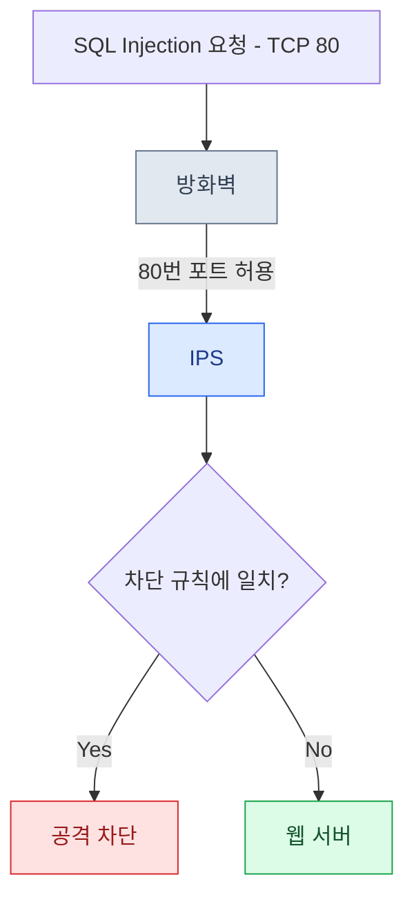

방화벽에서는 허용된 통신이더라도 IPS에서는 해당 요청에 공격이 포함되어 있는지 분석하고 차단할 수 있다.

방화벽을 통과했다는 사실이 해당 트래픽의 안전성을 보장하는 것은 아니다.

---

### 6.2 주요 역할 비교

| 구분 | 방화벽 | IDS | IPS |
|---|---|---|---|
| 주요 목적 | 접근 제어 | 침입 탐지 | 침입 탐지 및 방지 |
| 주요 판단 기준 | 접근 제어 정책 | 공격 패턴, 이상행위, 프로토콜 분석 등 | 공격 패턴, 이상행위, 프로토콜 분석 등 |
| 핵심 역할 | 통신 허용 여부 판단 | 위협 발견 및 알림 | 위협 발견 및 차단 |

세 시스템의 역할을 다음과 같은 질문으로 구분할 수 있다.

- **Firewall:** 이 통신을 허용해도 되는가?
- **IDS:** 이 통신이나 활동에 의심스러운 부분이 있는가?
- **IPS:** 탐지된 위협을 차단해야 하는가?

물론 차세대 방화벽(NGFW)은 애플리케이션 분석과 IPS 기능 등을 함께 제공하기도 하므로 실제 제품에서는 이러한 역할의 경계가 명확하게 나뉘지 않을 수 있다.

---

## 7. 암호화된 트래픽의 탐지 한계

### 7.1 HTTP와 HTTPS

HTTP는 자체적으로 통신 내용을 암호화하지 않지만, HTTPS는 TLS를 이용하여 통신 내용을 보호한다.

따라서 별도의 복호화를 수행하지 않는 네트워크 기반 IDS/IPS는 HTTPS 요청 내부의 공격 문자열을 직접 확인할 수 없다.

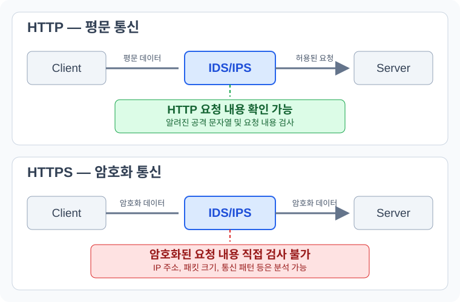
_HTTP와 HTTPS에서 네트워크 기반 IDS/IPS가 분석할 수 있는 정보의 차이_

그렇다고 암호화된 트래픽에서 모든 정보를 확인할 수 없는 것은 아니다.

| 분석 대상 | 복호화 없이 확인 |
|---|---|
| 출발지 및 목적지 IP | 가능 |
| 전송 계층 포트 번호 | 가능 |
| 패킷 크기 | 가능 |
| 트래픽 양 | 가능 |
| 접속 빈도 | 가능 |
| HTTP 요청 본문 | 불가능 |
| 암호화된 공격 문자열 | 불가능 |

통신량이나 연결 패턴을 이용한 이상행위 탐지는 암호화된 환경에서도 활용할 수 있다.

통신 내용을 보호하기 위한 암호화 기술이 보안 시스템의 분석 범위를 제한할 수도 있다는 점이 흥미로웠다.

---

### 7.2 HIDS를 활용한 보완

공격자가 HTTPS를 이용하여 웹 서버에 침입한 뒤 악성 파일을 생성하고 악성 프로세스를 실행했다고 가정해 보자.

NIDS는 암호화된 요청 내용을 직접 확인하지 못하더라도 HIDS는 웹 서버 내부에서 발생하는 파일 변경이나 프로세스 실행을 감시할 수 있다.

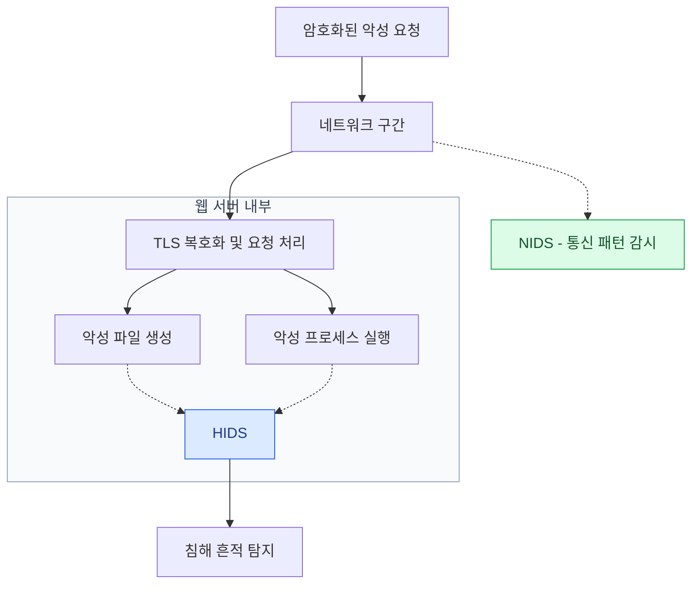

이후 공격자가 외부 서버로 대량의 데이터를 전송한다면, 해당 데이터가 암호화되어 있더라도 NIDS가 비정상적인 전송량을 발견할 수 있다.

처음에는 NIDS가 외부에서 내부로 접근하는 공격을 탐지하는 시스템이라고 생각했다.

하지만 센서의 감시 범위에 따라 내부에서 외부로 나가는 트래픽이나 내부 시스템끼리의 통신도 분석할 수 있다.

| 트래픽 방향 | 의미 |
|---|---|
| Inbound | 외부에서 내부로 들어오는 통신 |
| Outbound | 내부에서 외부로 나가는 통신 |
| East-West | 내부 시스템 간의 통신 |

이를 통해 HIDS와 NIDS가 서로의 탐지 한계를 어떻게 보완할 수 있는지 다시 확인할 수 있었다.

---

### 7.3 TLS 복호화 검사(TLS Inspection)

암호화된 트래픽의 내용을 확인하기 위한 방법으로 TLS 복호화 검사가 있다.

중간 검사 장비에서 TLS 연결을 종료하고 통신 내용을 검사한 뒤, 목적지 서버와 별도의 TLS 연결을 구성하는 방식이 대표적이다.

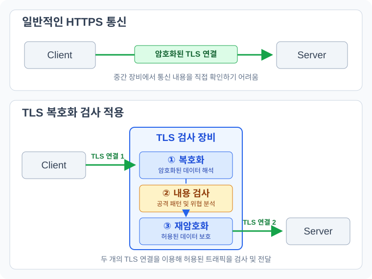
_중간 검사 장비에서 수행하는 복호화, 내용 검사 및 재암호화 과정_

모든 HTTPS 트래픽을 복호화하여 검사한다면 어떤 문제가 발생할지 생각해 보았다.

가장 먼저 떠올랐던 것은 추가적인 처리 시간과 비용이었다.

**성능 및 비용 문제**

복호화, 내용 검사, 재암호화 과정에서 추가적인 연산이 필요하다.

그 결과 통신 지연이나 병목 현상이 발생할 수 있으며, 이를 처리하기 위한 장비 도입 및 운영 비용이 증가할 수 있다.

**개인정보 및 기밀성 문제**

검사 장비가 통신 내용을 복호화하면 비밀번호, 금융정보, 개인 메시지, 기업 기밀정보와 같은 민감한 정보도 확인할 수 있게 된다.

검사 장비 자체가 침해될 경우 새로운 정보 유출 위험이 발생할 수도 있다.

| 구분 | TLS 복호화 미적용 | TLS 복호화 적용 |
|---|---|---|
| 공격 문자열 분석 | 제한적 | 가능 |
| 장비의 연산 부담 | 상대적으로 낮음 | 상대적으로 높음 |
| 통신 지연 | 상대적으로 적음 | 증가 가능 |
| 민감정보 관리 | 기존 암호화 유지 | 추가적인 보호 필요 |
| 운영 복잡성 | 상대적으로 낮음 | 인증서 및 검사 정책 관리 필요 |

위협 탐지 능력을 높이기 위한 기술이 오히려 새로운 보안 위험을 발생시킬 수도 있다는 점에서 검사 대상과 예외 정책을 신중하게 결정해야 한다.

---

## 8. 실제 네트워크에서의 IDS/IPS 배치

### 8.1 방화벽 외부와 내부

NIDS를 한 대만 설치할 수 있다면 어디에 설치하는 것이 좋을지 생각해 보았다.

처음에는 네트워크 기반이라는 용어 때문에 NIDS를 방화벽 외부에 설치해야 한다고 생각했다.

하지만 NIDS의 분류 기준은 네트워크 트래픽을 감시한다는 것이지, 반드시 외부 네트워크에 설치해야 한다는 의미는 아니었다.

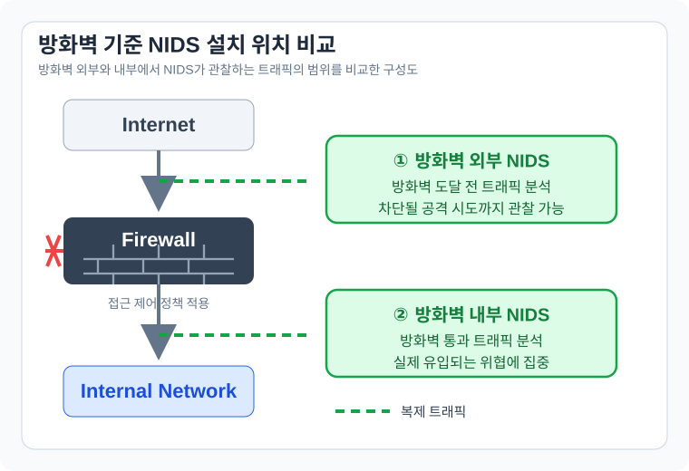
_방화벽을 기준으로 한 NIDS의 설치 위치 및 감시 범위 비교_

| 구분 | 방화벽 외부 | 방화벽 내부 |
|---|---|---|
| 감시 대상 | 방화벽 도달 전 트래픽 | 방화벽 통과 트래픽 |
| 주요 장점 | 차단된 공격 시도까지 관찰 | 내부에 도달하는 위협 집중 감시 |
| 주요 단점 | 경고 및 분석량 증가 가능 | 방화벽에서 차단된 공격 관찰 불가 |
| 활용 목적 | 외부 위협 동향 분석 | 내부 시스템 보호 |

만약 하루 동안 10,000건의 공격 시도가 발생했고 그중 9,900건을 방화벽에서 차단했다고 가정해 보자.


보안 관리자의 분석 인력과 시간이 제한적이라면 이미 차단된 9,900건보다 실제 방화벽을 통과한 100건의 공격 시도에 집중하는 것이 더 효율적일 수 있다.

방화벽에서 차단된 공격 시도는 설정에 따라 방화벽 로그를 통해 일부 확인할 수도 있다.

이러한 점을 고려했을 때, 내부 시스템 보호가 주목적이라면 방화벽 내부에 NIDS를 설치하는 것이 적절하다고 생각한다.

---

### 8.2 DMZ(Demilitarized Zone)

DMZ는 외부에서 접근할 필요가 있는 서버를 내부 업무 네트워크와 분리하기 위한 네트워크 구역이다.

대표적으로 웹 서버, DNS 서버, 메일 서버 등을 배치할 수 있다.

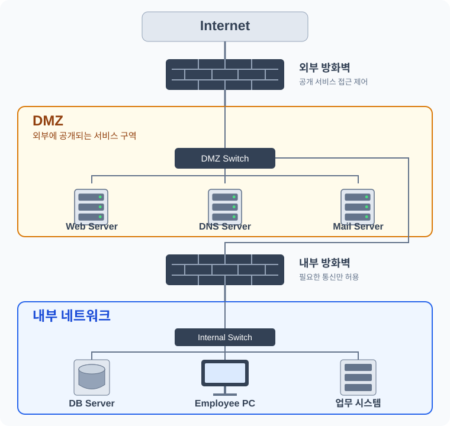
_외부 공개 서비스와 내부 업무 네트워크를 분리하는 DMZ 구조_

외부 사용자에게 웹 서비스를 제공해야 하지만 내부 업무 시스템까지 직접 접근하도록 허용하는 것은 위험하기 때문에 네트워크를 분리하는 것이다.

위 그림은 두 개의 방화벽을 이용한 구성 예시이며, 하나의 방화벽을 이용하여 DMZ와 내부 네트워크를 분리할 수도 있다.

**DMZ의 웹 서버가 침해된다면?**

외부 방화벽이 정상적으로 동작하고 있더라도 DMZ의 웹 서버가 침해될 수 있는지 생각해 보았다.

앞서 공부했던 방화벽과 IPS의 차이를 생각해 보면, 방화벽에서 허용한 HTTP 또는 HTTPS 통신을 통해서도 웹 서버의 취약점이 악용될 수 있다.

웹 서버가 침해되었다고 해서 반드시 방화벽 자체가 침해된 것은 아니라는 것이다.

공격자가 침해한 웹 서버를 거점으로 다른 시스템까지 침입을 확대하는 행위를 측면 이동(Lateral Movement)이라고 한다.

DMZ는 내부 방화벽과 접근 제어 정책을 통해 이러한 피해 확산을 제한하는 역할도 수행한다.

---

### 8.3 직접 구성해 본 IDS/IPS 배치 구조

NIDS, NIPS, HIDS를 각각 하나씩 설치할 수 있다고 가정하고 직접 배치 위치를 생각해 보았다.

내가 선택한 구성은 다음과 같다.

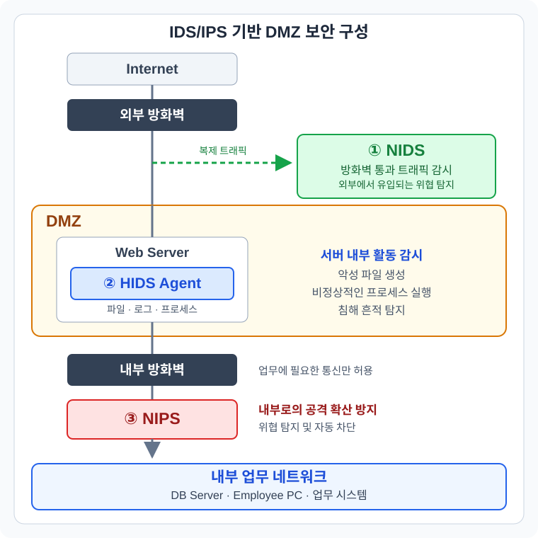
_내부 업무 네트워크 보호를 우선시하여 직접 구성해 본 IDS/IPS 배치 구조_

**① DMZ 앞 — NIDS**

외부 방화벽을 통과한 트래픽을 집중적으로 분석하기 위해 NIDS를 배치하였다.

방화벽에서 이미 차단한 트래픽보다는 실제 웹 서버에 도달할 수 있는 위협을 탐지하는 데 집중하는 것이 효율적이라고 생각했다.

**② 웹 서버 내부 — HIDS**

웹 서버 내부에서 발생하는 파일 변경, 프로세스 실행 등의 활동을 감시하기 위해 HIDS를 배치하였다.

네트워크 트래픽만으로는 확인하기 어려운 서버 내부의 침해 흔적을 발견하는 것이 목적이다.

**③ DMZ와 내부 네트워크 사이 — NIPS**

외부에 공개된 서버가 침해되더라도 내부 업무 네트워크로 피해가 확산되는 것을 방지하기 위해 NIPS를 배치하였다.

외부 공개 서버와 달리 내부 업무 네트워크는 접근이 제한되어야 하므로, 허용된 통신에 포함된 위협을 탐지하는 것뿐만 아니라 차단할 수 있는 기능이 필요하다고 생각했다.

| 배치 위치 | 선택한 시스템 | 목적 |
|---|---|---|
| DMZ 앞 | NIDS | 외부에서 유입되는 위협 탐지 |
| 웹 서버 내부 | HIDS | 서버 내부의 침해 흔적 탐지 |
| 내부 방화벽 뒤 | NIPS | 내부로의 공격 확산 방지 |

---

### 8.4 구성의 한계

위 구성은 내부 업무 네트워크 보호를 우선시하여 설계한 가상의 네트워크 구조이다.

하지만 DMZ 앞에 NIPS가 없기 때문에 NIDS가 웹 서버를 향한 공격을 발견하더라도 직접 차단하지는 못한다.

또한 내부 네트워크라고 해서 DMZ에서 발생하는 모든 통신을 차단할 수 있는 것은 아니다. 웹 서버가 내부 DB 서버에 접근해야 하는 상황도 있기 때문이다.

따라서 업무에 필요한 통신을 최소한으로 허용하면서 보안 시스템을 배치해야 한다.

웹 서버 자체의 보호를 우선시하는 환경이라면 DMZ 앞에 NIPS를 배치하는 방법도 고려할 수 있다.

직접 배치 위치를 생각해 보면서 IDS와 IPS는 정해진 위치에 설치하는 것이 아니라 보호 대상과 보안 목적에 따라 배치해야 한다는 점을 이해하게 되었다.

---

## 9. 실제 IDS/IPS 도구

### 9.1 Snort와 Suricata

대표적인 오픈소스 네트워크 기반 IDS/IPS 도구로는 Snort와 Suricata가 있다.

| 구분 | Snort | Suricata |
|---|---|---|
| 개발 및 관리 | Cisco Talos | OISF |
| IDS 모드 | 지원 | 지원 |
| IPS 모드 | 지원 | 지원 |
| 멀티스레드 | Snort 3에서 지원 | 지원 |
| 주요 특징 | 오랜 운영 역사와 풍부한 탐지 규칙 | 프로토콜 분석 및 구조화된 이벤트 로그 |

두 도구 모두 설정에 따라 IDS 또는 IPS로 활용할 수 있다.

이번에는 Suricata를 기준으로 탐지 규칙이 어떤 구조로 이루어져 있는지 살펴보았다.

---

### 9.2 Suricata 탐지 규칙의 구조

다음은 ICMP Echo Request를 탐지하기 위한 예시 규칙이다.

```text
alert icmp any any -> $HOME_NET any (msg:"Ping Detected"; itype:8; sid:1000001; rev:1;)
```

규칙은 크게 Header와 Options로 구분할 수 있다.

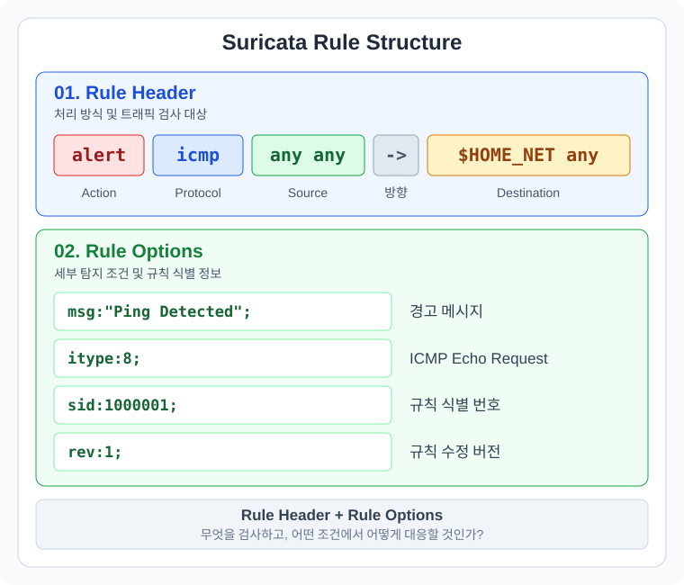
_Suricata 탐지 규칙의 Header 및 Options 구성 요소_

**Rule Header**

| 항목 | 의미 |
|---|---|
| `alert` | 경고 생성 |
| `icmp` | ICMP 프로토콜 검사 |
| `any any` | 출발지 주소 및 포트 자리에 대한 와일드카드 |
| `->` | 검사 방향 |
| `$HOME_NET any` | 보호 대상 네트워크 및 목적지 포트 자리 |

**Rule Options**

| 항목 | 의미 |
|---|---|
| `msg:"Ping Detected"` | 경고 메시지 |
| `itype:8` | IPv4 ICMP Echo Request |
| `sid:1000001` | 규칙 식별 번호 |
| `rev:1` | 규칙 수정 버전 |

ICMP는 TCP나 UDP와 달리 포트 번호를 사용하지 않으므로 위 규칙의 포트 자리에 사용된 `any`는 규칙의 문법적 구조에 따른 것이다.

---

### 9.3 탐지 규칙과 차단 규칙

**IDS 탐지 규칙**

```text
alert icmp any any -> $HOME_NET any (msg:"Ping Detected"; itype:8; sid:1000001; rev:1;)
```

**IPS 차단 규칙**

```text
drop icmp any any -> $HOME_NET any (msg:"Ping Blocked"; itype:8; sid:1000001; rev:2;)
```

규칙의 Action을 `alert`에서 `drop`으로 변경하면 적절하게 구성된 IPS 모드에서 해당 트래픽을 차단할 수 있다.

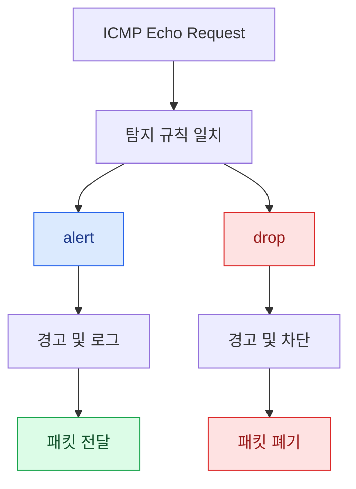

물론 차단 기능이 실제로 동작하기 위해서는 규칙을 변경하는 것뿐만 아니라 인라인 모드와 네트워크 환경도 정상적으로 구성되어 있어야 한다.

위 두 규칙은 서로 비교하기 위한 대안이며, 동일한 SID의 규칙을 동시에 사용하는 예시는 아니다.

---

### 9.4 탐지 규칙의 개선

위 규칙을 그대로 IPS에 적용한다면 어떤 문제가 발생할지 생각해 보았다.

ping은 공격자도 사용할 수 있지만 정상적인 네트워크 관리자도 통신 상태를 확인하기 위해 사용하는 명령어이다.

따라서 모든 ping 요청을 차단하면 정상적인 네트워크 점검까지 방해할 수 있다.

이를 개선하기 위해 다음과 같은 조건을 추가로 고려할 수 있다.

| 추가 조건 | 적용 목적 |
|---|---|
| 출발지 IP 주소 | 관리용 네트워크와 일반 접근 구분 |
| 목적지 IP 주소 | 중요 서버에 대한 집중 감시 |
| 일정 시간 내 요청 횟수 | 과도한 ICMP 요청 탐지 |
| 트래픽 방향 | 외부 접근과 내부 점검 구분 |

```text
alert icmp any any -> $HOME_NET any (msg:"Excessive ICMP Echo Requests"; itype:8; detection_filter:track by_src, count 100, seconds 10; sid:1000002; rev:1;)
```

위 규칙은 동일한 출발지에서 10초 동안 발생하는 ICMP Echo Request 횟수를 추적하여 설정된 임계치를 넘는 요청에 대해 경고를 발생시키기 위한 예시이다.

| 항목 | 의미 |
|---|---|
| `detection_filter` | 규칙 일치 횟수에 따른 경고 제어 |
| `track by_src` | 출발지 IP별 추적 |
| `count 100` | 탐지 임계치 |
| `seconds 10` | 추적 시간 범위 |

위 수치는 동작 원리를 설명하기 위해 임의로 설정하였으며, 실제 환경에서는 정상적인 트래픽 수준을 확인하고 임계치를 조정해야 한다.

또한 이러한 고정 임계치 기반 탐지는 정상행위 기준선을 학습하거나 설정하는 이상행위 기반 탐지와는 구분할 필요가 있다.

**탐지 규칙의 적용 과정**

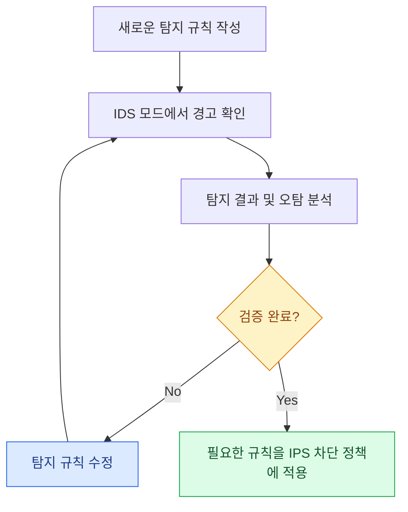

개인적으로 새로운 탐지 규칙을 처음부터 차단 정책으로 적용하기보다는 경고가 발생하는 상황을 먼저 확인하고 정상적인 서비스에 영향을 미치는지 검토하는 과정이 필요하다고 생각한다.

---

### 9.5 탐지 로그

Suricata는 `fast.log`, `eve.json` 등의 로그를 통해 탐지 결과를 확인할 수 있다.

| 로그 | 특징 |
|---|---|
| `fast.log` | 간단한 형태의 경고 로그 |
| `eve.json` | 경고, 메타데이터, 프로토콜 정보 등을 JSON 형식으로 기록 |

다음은 앞서 작성한 ping 탐지 규칙을 바탕으로 구성한 JSON 로그 예시이다.

```json
{
  "event_type": "alert",
  "src_ip": "192.168.1.10",
  "dest_ip": "192.168.1.20",
  "proto": "ICMP",
  "alert": {
    "signature_id": 1000001,
    "signature": "Ping Detected",
    "action": "allowed"
  }
}
```

출발지와 목적지 주소, 탐지 규칙의 식별 번호, 경고 메시지 등의 정보를 확인할 수 있다.

관리자는 이러한 정보를 바탕으로 탐지된 활동이 실제 공격인지 추가로 분석할 수 있다.

이번 학습에서는 Suricata의 탐지 규칙과 로그 구조를 중심으로 살펴보았으며, 위 규칙과 로그는 직접 실행하여 얻은 결과가 아닌 설명용 예시이다.

---

## 10. 학습을 마치며

이번 미션을 통해 IDS와 IPS를 처음 접하게 되었다.

처음에는 침입 탐지와 자동 차단이라는 기능적인 차이부터 공부했지만, 학습을 진행하면서 설치 위치와 탐지 방식, 운영 환경까지 고려해야 한다는 것을 알게 되었다.

특히 NIDS는 방화벽 외부에 설치해야 한다고 생각했고, HIDS는 네트워크를 통한 공격을 탐지할 수 없는 것인지도 궁금했다. 이러한 의문을 하나씩 해결하면서 두 시스템의 감시 대상과 상호보완 관계를 이해할 수 있었다.

가장 인상적이었던 부분은 IPS가 공격을 자동으로 차단할 수 있다고 해서 IDS보다 항상 좋은 선택은 아니라는 점이었다.

수강신청 서버의 사례처럼 오탐이 발생하면 정상적인 서비스 이용이 방해될 수 있으며, 인라인 장비에 장애가 발생하면 네트워크 통신 자체가 중단될 수도 있다.

Fail-open과 Fail-closed의 차이를 공부하면서 기존에 배웠던 정보보안의 3대 요소인 CIA를 실제 보안 시스템의 운영 방식과 연결해 볼 수 있었던 점도 의미 있었다.

또한 DMZ를 포함한 네트워크 구조에 NIDS, HIDS, NIPS를 직접 배치해 보면서 단순히 각 시스템의 기능을 이해하는 것과 실제 보호 대상에 맞게 보안 시스템을 구성하는 것은 다르다는 것을 느꼈다.

결국 IDS와 IPS는 단순히 공격을 탐지하거나 차단하는 시스템이 아니라, 네트워크 구조와 서비스 특성에 맞게 구성하고 관리해야 하는 보안 시스템이라고 생각한다.

이후에는 Suricata를 직접 설치하고 탐지 규칙을 작성하여 실제 트래픽이 어떤 과정으로 분석되고 로그가 생성되는지 확인해 보고 싶다.

---

## 참고 자료

- [NIST SP 800-94 — Guide to Intrusion Detection and Prevention Systems](https://csrc.nist.gov/pubs/sp/800/94/final)
- [NIST — Network-based Intrusion Detection and Prevention System](https://csrc.nist.gov/glossary/term/network_based_intrusion_detection_and_prevention_system)
- [Snort 3 — Reading Traffic and Modes of Operation](https://docs.snort.org/start/inspection)
- [Suricata — IPS Concept](https://docs.suricata.io/en/latest/ips/ips-concept.html)
- [Suricata — Rules Format](https://docs.suricata.io/en/latest/rules/intro.html)
- [Suricata — Thresholding Keywords](https://docs.suricata.io/en/latest/rules/thresholding.html)
- [Suricata — EVE JSON Output](https://docs.suricata.io/en/latest/output/eve/eve-json-output.html)
